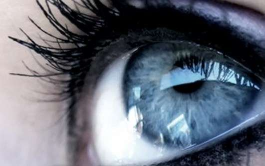
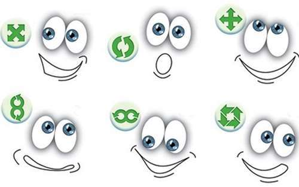

# Хараагаа сайжруулахын тулд 10-хан минутыг өөрөөсөө бүү харамлаарай

Нүдний энэ дасгалыг тогтмол хийснээр, хараа гайхалтай сайжирдаг гэнэ. Мөн, 10 минутын турш хийх ёстойг анхаараарай. Энэ 10 минутын дасгал, эрүүл хараатай хүмүүсийн хараа муудахаас сэргийлж, харааны асуудалтай хүмүүсийн харааг сайжруулдаг тул, залхууралгүй хийж, энэхүү багахан хугацааг өөрөөсөө бүү харамлаарай. Тэр, дундаа харааны шил, нүдний булчингийн ажиллагааг сулруулж улам муутгадаг талаар, мөн шил зүүхийн хор холбогдолын тухай яригдаад эхэлчихсэн энэ үед, хараагаа хамгаалах үүднээс одооноос хийж дадах нь зүйтэй юм.

1. 2 минутын турш нүдээ анивчуул. Нүдний дотоод цусан хангамжийг сайжруулна\
2. Нүдээ хоёр булан руу нь, хялайх маягаар, харааны нэг түвшинд хөдөлгөh\
3. Нүдээ аниад харанхуйг мэдрэхийг хичээ. Хурц хараатай байхад нөлөөлдөг родопсин, гэрэл мэдрэгч эд эсэд эрчимтэй ялгарч эхэлдэг\
4. Толгойгоо зүүн баруун тийш, дээш доош нь хөдөлгө. Цусны эргэлт сайжирна\
5. Дугуйтай хүн харааны сэрэмжтэй явдаг байдалд ор, хоёр тийш, урдах өмнөхөө харах үйлдэл хий\
6. 3-5 секундын турш, нүдээ сулхан аних. 7 удаа давтан хийнэ. Нүдний булчингууд суларч, цусан хангамж сайжирна\
7. Дээд зовхин дээрээ хуруугаараа 2 секунд орчим хөнгөн дарах хөдөлгөөнийг 4-5 удаа гүйцэтгэ. Нүдэн доторхи шингэний урсгалыг сайжруулдаг\
8. Цонхоор харж зогсоод, хамгийн ойр мөн хамгийн хол байгаа зүйл дээр сэлгүүлэн хар\
9. Нүдээ аниад, нүдээ зөөлөн дээш нь доош нь хөдлөгөх. 5-10 удаа давтан хийнэ\
10. Нүдээрээ, агаарт геометрийн дүрсүүд зурах, аажмаар дүрс хэлбэрүүдээ хүндрүүлж өгөх хэрэгтэй
