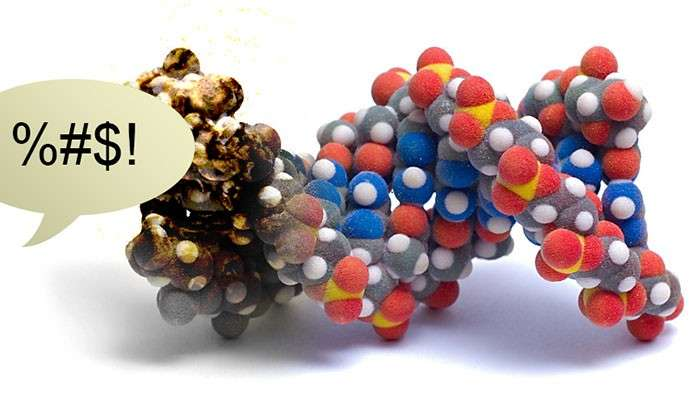

# Хараалын үгс, удамд нөлөөлдөг

Оросын шинжлэх ухааны академийн, квантын генетикийн институт, орчин үеийн хүн төрөлхтөний генийн түвшний өөрчлөлтүүдийн талаар судалгаа явуулжээ. Үүнд олон асуудлуудыг хамруулан явуулсан бөгөөд тусгайлан зохион бүтээсэн багажийн дэлгэц дээр, цахилгаан соронзон үелзэлийн хэлбэлзлийн тусламжтай, хүний хэлж ярьж буй үгс хүний молекулын бүтэц шинж чанарт нөлөөлдөг болохыг тогтоожээ.

Эдгээр молекулууд хүний генд, удамшдаг бөгөөд хүний хэлдэг үгс, хүний организмын генийн бүх мэдээлэлд шууд нөлөөлдөг гэж үзжээ. Хүний байнга хэлдэг таагүй, муу, бүдүүлэг үгс, хүний хромосомын бүтцийг эрчимтэй өөрчилж эхэлдэг болох нь харагдсан бөгөөд сөрөг программуудыг, генийн мэдээлэлд суулгадаг байна. Энэ программууд нь явцын дунд, “өөрийгөө устгах” программ болдог бөгөөд өвчин, гуниг, азгүйтэлд хүргэн, мянган рентгений хүчин чадалтай радио цацрагтай дүйцэх, мутацлагдах процесс явагддаг гэж үзжээ. Энэхүү, үгс, удмын програмд үйлчилдэг талаар эрт дээр үеэс мэддэг байсан ба үг тарнийн хүч, ерөөл адислал маягаар хэрэгжиж ирсэн билээ. Үгийг хоёр иртэй илд гэж эртнээс үзэж ирснийг шинжлэх ухаан, хүний ДНК-нь, үг яриа, бодол санааг хүлээн авах чадвартай, авианы хэлбэлзлээр өөрчлөгддөг, тиймээс, хүн өөрөө генийн аппаратаа бүтээдэг гэсэн дүгнэлтэд хүрсэн гайхалтай нээлтээрээ баталгаажууллаа гэж үзжээ. Тиймээс, хүмүүсийн генийн мэдээлэлд суугдсан сөрөг үгс, удмаас удамд нэмэгдэн хураагдсаар, “өөрийгөө устгах” буюу зовлон зүдгүүртэй, азгүй амьдарлд хүргэдэг аж. Мөн, хамгийн гайхалтай нь, уг үг яриаг хүн өөрөө хэлэхээс гадна сонсох нь ч муу үр дагавартай гээд, нэрт сэтгэл зүйч С.Горин, “өдөр тутмын хэлдэг, сонсдог сөрөг муу үгс, хүмүүсийн сэтгэл санаанд, хүчтэй мэргэжлийн гипнозоос ч илүү хөнөөлтэй” гэж дүгнэжээ. Тиймээс, өөрсдийн генээ хайрлах, үр удмаа хамгаалах үүднээс, хараал, муу үгс хэлэхгүй байхыг зөвлөжээ.

Өнөөдөр, манай нийгэмд, хараал хэрүүлээс их юм алга боллоо. Хачин хараалын үгнүүд, энд тэндгүй сонсогддог. Хамгийн их дэлгэрсэн “П...а!” гэдэг үгийг үр удамдаа дамжуулж, “п...а!” шиг амьдралыг уламжлуулна гэж үү? Энэ үгийн утгыг мэдмээрсэн дээ! Хэрэв мэддэггүй бол асууж мэдвэл, эрх биш ийм үг хэлэх ээ болих биз ээ. Урдны хүмүүсийн, “амны билгээс ашдын билэг” гэдэг сайхан үгийг уриагаа болгон, уулга алдсан ч сайн үг хэлдэг заншилд суралцахыг хичээцгээе! Хараал муу үг хэлэх ээ больж, удмын сангаа хамгаалахыг sugar.mn уриалж байна.
