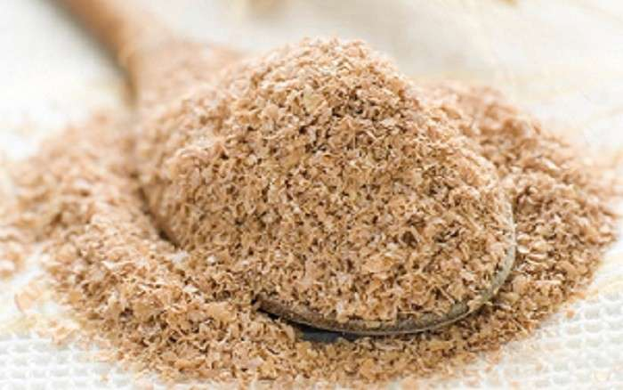

# Харшилаас салах ардын эмчилгээний аргууд:

-Хамгийн үр дүнтэй арга бол хивэг тогтмол хэрэглэх гэнэ. 1 халбага хивгэн дээр буцламгай ус хийж хэдэн минут дэвтээгээд өлөн дээрээ идэх. Өмнө нь нэг аяга ус уусан байх ёстой. 15 минутын дараа харшлын зовиурууд арилна. Хивэг биеэс хор гадагшлуулж, бактери устгадаг. Энэ аргыг улирал харгалзахгүй, хичнээн хугацаагаар ч хэрэглэж болно.\
-Өглөө бүр, цайлахаас 30 минутын өмнө хагас аяга бүлээн сүүнд хусны давирхай нэмж уух. Эхний өдөр 1 дусал давирхайнаас эхэлж, өдөр бүр 1 дуслаар нэмж 12 дусал болгоод, буцаж бууруулан 1 дусал болтол ууж, нэг курс хэрэглээд, 1 долоо хоног завсарладаг. Амьсгал чөлөөтэй болж, зовиурууд арилахаас гадна цус цэвэрлэгддэг.\
-Астма. Энэ арга удаан хэрэглэх хэрэгтэй нь түвэгтэй ч, астмаас нэг мөсөн салгах үр дүнтэй. 3 литрийн шилэнд 1 кг сармис жижиглэж хийгээд 1 литр хэсэг тавьж байлгасан усыг ёроолд нь багахан ус үлдэхээр болгоомжтой хийгээд, нэг сар харанхуй газар тавьсны дараа хэргэлдэг. 1 цайны халбагыг 1 аяга халуун сүүнд найруулан өглөө бүр, өлөн дээрээ цайлахаас 30 минутын өмнө тасралтгүй уух хэрэгтэй. \
-Харшилын тууралттай үед. Хусны навчийг хандлан цайны оронд уух. Долоо хоногийн дараа үр дүн нь гардаг.
