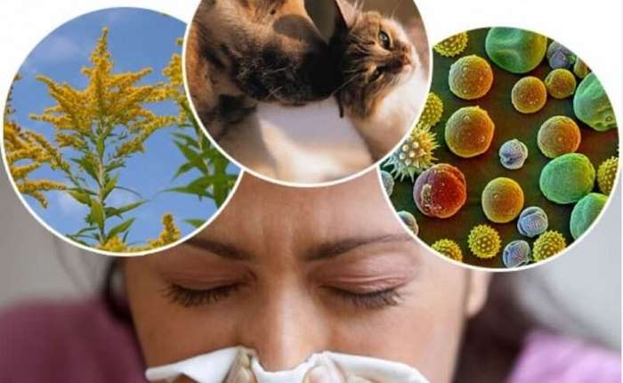
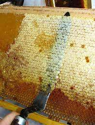

# Харшилтай тэмцэх ардын эмчилгээний аргууд

Орчин үед, харшил нь, хамгийн их дэлгэрсэн, бүх насныхан өртөж байдаг аутоиммуны өвчилөл болоод байгаа билээ. Тоосны, хүнсний, эпидерм буюу үс ноос, амьтны гаралтай зүйлсийн, ахуйн тоос, тоосны хачигийн, химийн буюу ахуйн хэрэглээний химийн бодисын, эмийн, нян мөөгөнцрийн гэсэн үндсэн хэлбэрүүдтэй байна. Харшилыг ардын эмчилгээний аргаар эмчилэхэд, байгаль ургамал дээр суурилсан зүйлсийг хэргэлдгээс бөөр, элэг зэрэг эрхтэнүүдэд ачаалал өгдөггүй, бие организмд хоргүйгээс гадна өндөр үр дүнтэй байдаг байна.

-Витамин С- ийн үрэвслийн эсрэг үйлчилэл нь өндөр байдаг тул, түүнийг хэрэглэх нь ихээхэн тустай байдаг. Өдөрт 1000мг –г 4-5 удаа уух маягаар 7 хоногийн турш хэрэглэнэ. Болвол, биед хялбар шингэдэг учираас эрдэсжүүлсэн аскорбины хүчил хэрэглэх нь ердийн аскорбины хүчилээс дээр гэж үздэг байна.\
-100гр хатаасан халгайг 300 гр буцламгай усаар хандалж 3 цаг орчим тавьна. Өдөрт 3 удаа тал аягаар ууж, нэг сарын турш хэрэглэнэ. Жилд, 3-4 удаа давтан хэрэглэх.\
-Цагаан өндөгний хальс. Сайн угааж, доторхыг нь суллаад хатааж, кофе бутлагчид нунтаглана. Шингэцийг сайжруулахын тулд 4-6 дусал лимоны шүүс нэмж, том хүн өдөрт 1 цайны халбагаар хэрэглэнэ. Дооз хэмжээг хэтрүүлж болохгүй.\
-Харшилын тос: цагаан цуу 50мл. Өндөг 1 ширхэг. Цөцгийн тос 100гр. Өндөг цууг хольж хутгаад нэг хоног сэрүүн газар тавиад, дараа өдөр нь хайлуулсан цөцгийн тосоо нэмж хутгаад дахин нэг хоног хөргөгчид байлгаад бэлэн болно.\
-Харшилын эмчилгээний ванн. Хатаасан ганга 50гр. Ус 800гр. Усандаа гангаа хийж зөөлөн гал дээр 5 минут орчим буцалгаад шүүж ваннтай усандаа хийнэ. Унтахын өмнө орох тохиромжтой. Нэг курс 10 удаа.\
-Забрус буюу зөгийн сархинагны дээд хэсэгт тогтсон байдаг хальс. Цайндаа нэмж хутгаж уух, бохь шиг зажилж хэргэлдэг. 6 сарын турш, 2 кг орчимыг хэрэглэхэд бүрэн эмчилэгднэ.
