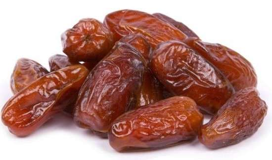
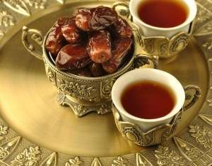

# Хасарваань жимс нь, ”байгалийн” хоол орлуулагч

Бид, аль болох, чихэрлэг жимс жимсгэнээс, жин нэмнэ, илчлэг ихтэй гэх зэрэг шалтгаануудаар татагалзахыг хичээдэг. Гэтэл хамгийн их чихэрлэг, хасарваань жимс, биед, ашигтай элементүүдийг өгөхөөс гадна, илүүдэл жинг хасах үйлчилгээтэй болохыг нотложээ.

Энэ жимсийг 5 ширхэгийг идэхэд л бялуурдаг. Учир нь, энэ жимсэнд глюкоз, фруктоз, рифофлавин, ниацин, В6,В1, В12, А, С амин дэмүүд, бүх төрлийн давс, цинк, магний, фосфор, зэс, төмөр, натри, бор, кобальт, селен, хүхэр, кадмий, хөнгөн цагаан агуулагддаг байна. Хасарвааньд агуулагддаг селен нь үсийг бэхжүүлэхээс гадна торгомсог зөөлөн болгох үйлчилгээтэй.\
Энэхүү, биед ашигтай бодисуудын цуглуулга болсон, хасарваань жимс нь өдрийн болон оройн хоолыг бүрэн орлуулах чадвартай. Мусульман шашинтнууд, хасарваань жимсийг эмчилгээнд өргөн хэрэглэдэг байна.

Зөвхөн хасарваань жимсийг хэрэглэн, ус ууж, бүтэн сар амьдарч болох бөгөөд бие организм сайжирахаас өөр, сөрөг өөрчлөлт гардаггүй аж. Өдөрт 10-с дээш ширхэг хасарваань идэж, махыг орлуулан амьдарч болохоос гадна, жин хасагдаж эхэлдэг.
