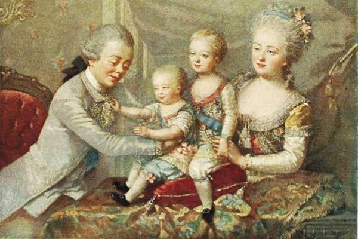

# Хатан хаан Екатерина II-н, ач нараа хүмүүжүүлэхэд зориулан өгсөн зааварчилга

Оросын хатан хаан Екатерина II, өөрийн хүү Павел I –г, өөрийнхөөрөө хүмүүжүүлж чадаагүй бөгөөд хүүг нь, хадам эх, ээж нарынх заавраар ордны асрагчид, хуучны орос заншлаар өсгөхдөө Екатеринаг оролцуулдаггүй, өөрсдийнхөөрөө үнэт арьсан эдлэлд ороож, хэт хооллолтод нь анхаарч, хоол чихэхээс өөр гавьтай зүйл хийдэггүйг залуу бүсгүй, харавч, тэвчихээс өөр арга байгаагүй гэдэг. 1862 онд, ордонд эргэлт хийж хатан хаан болмогцоо, -“Миний хүү бие муутай, ухаан шалихгүй, энэ нь хүмүүжлийн үр дагавар учраас, би, ач нараа ийм болгохгүй” гэж андгайлсан аж. Түүний, сурган хүмүүжүүлэх арга барилыг авъяаслагаар гаргаж тавьсан “Хүмүүжлийн тухай зааварчилга”-нь, хатуу чанд байдал, тэвчээр, төрлөх чанар ба эрх чөлөөг хослуулан ухаалгаар хязгаарласан эрүүл зөв хувь хүнийг хүмүүжүүлэх гайхалтай сургаалын хэмжээнд баримт болон үлдсэн байдаг байна. Энэхүү хүмүүжлийн зааварчилгад, 126 орос ардын зүйр цэцэн үгс, 2 сургаалт үлгэр орсон байдаг гэнэ. Эдгээр зааварчилгуудын зарим нэгтэй орчин үеийн сэтгэл зүйчид зөрөлдөх нь маргаангүй ч, ихэнхи нь одоо үед ч хэрэглэж болох ухаалаг арга боломж гэдгийг үгүйсгэхгүй биз ээ.

-Тоглохыг нь хорьж болохгүй, хүссэнээр нь тоглуул\
-Тоглох эрх чөлөөг өгснөөр, тэдний зан чанар, дуртай зүйлсийнх нь талаар мэдэх боломжтой болно\
-Хүүхдийн тоглох наадах хүслийг дарах, хаах, үүнтэй холбоотой сануулга өгөх ёсгүй. Жижиг алдаанууд дээр ч мөн адил, засах асуудлыг цаг хугацаа болон оюун ухаанд нь даатга.\
-Тоглох нь үнэндээ тоглоом биш, харин хамгийн хэрэгтэй дасгал сургуулилалт юм.\
-Хүмүүжүүлэгч нь, хүүхдүүдийн харилцан яриаг сонсох, тэр дундаа өөрт хандсан яриаг анхаарал тэвчээртэйгээр сонсон, ярилцаж, хүүхдүүдийг учир шалтгааныг олох хүсэлрүү хөтлөх хэрэгтэй.\
-Худал хуурмагийг тэвчишгүй зүйл гэдгийг ойлгуулж, орчин тойрныхон нь ийм байдал гаргахыг хориглоно.\
-Буруу муу зуршилуудыг хүүхдийн нүд чихнээс хол байлгах. Дэргэд нь, хараалын үгс, бүдүүлэг үг хэрэглэхгүй байх, мөн уурлаж уцаарлахыг хориглоно.\
-Сануулга өгөхдөө ганцааранд нь биечилж өгөх, харин магтаалыг бусдын дэргэд өгөх хэрэгтэй\
-Аливаад татгалзах үед уйлж хашгирч нэхэж авах байдал гаргавал хүслийг нь биелүүлэхгүй байх ёстой\
-Сургахдаа хүчээр сургах, мөн загинаж болохгүй харин, сурах дур хүслийг нь төрүүлэхэд илүү анхаарах ёстой\
-Сониуч занг хөхиүлэн дэмжих, мөн тэдний асуултуудыг анхааралтай сонсож, үнэн зөв хариулт өгдөг байх, түүнчлэн, өөрөө мэдлэг олж авах хүсэлтэй болгоход илүү анхаарах ёстой \
-Гадаад хэлийг, өөрсдөө, зөвхөн тэр хэлээр ярьж харьцсанаар сургах ёстой\
-Оюун ухаан нь бэхжээгүй байдаг тул, их зүйлийг цээжлүүлэхийг хориглоно\
-Сургалтын үед айлгахыг хориглоно. Сэтгэл нь айдаст автсанаар, салгалсан гараар бичихээс цаашгүй муу үр дүн гарна.\
-Хүүхдийг дурласан тоглоомоос нь салгахын тулд, тэр тоглоомоор нь залхтал нь, нэг дор хэдэн цаг тоглуулах хэрэгтэй\
“Агуу их тайжтан Александр, Константин нарыг хүмүүжүүлэх зааварчилга” 1784 оны 3 сарын 18. Екатерина II.” /Оросын эзэн хаадын түүхийн 10-р боть, 310-330-р хуудас/
