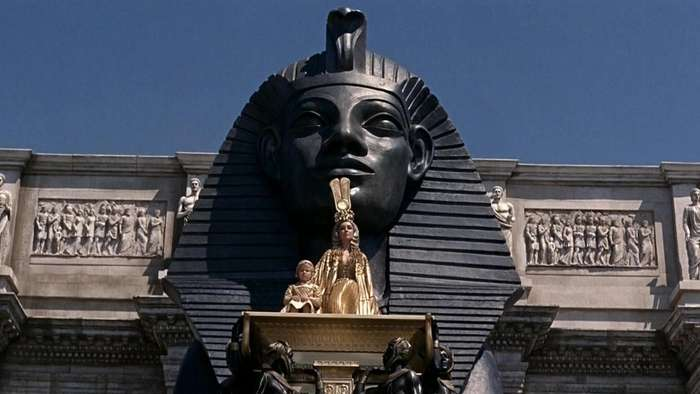

# Хатан хаан Клеопатрагийн масканы эртний жор

Хатан хаан Клеопатрагийн гоо үзэсгэлэн, сүр жавхлангийн тухай сонсоогүй хүн үгүй биз ээ. Түүний гоо үзэсгэлэнгийн өмнө олон хаад унаж байсан гэх, Клеопатра ч, гоо үзэсгэлэнгээ гундаахгүйн тулд гоо сайхандаа ихэд анхаардаг байсан гэдэг.

Энэхүү залуужуулах эртний маскыг хийхийн тулд дараах зүйлс хэрэг болно. Маш хялбар, гарын дорх зүйлс ашиглагдагаараа онцгой бөгөөд элдэв химийн нэмэлтгүй нь мөн давуу тал юм.\
-1 хоолны халбага зөгийн бал\
-1 хоолны халбага лимоны шүүс\
-1 ширхэг өндөг\
-1 хоолны халбага сүү\
-1 хоолны халбага ургамлын тос\
-Геркулес өтгөртөл нэмэх хэмжээ

Геркулесийг буталсан байвал сайн. Цэвэрлэсэн нүүрэндээ 20 минут тавиад, бүлээн усаар угаана. Долоо хоногт, 1-2 удаа тавиад үр дүнд нь та, сэтгэл хангалуун байх болно.
