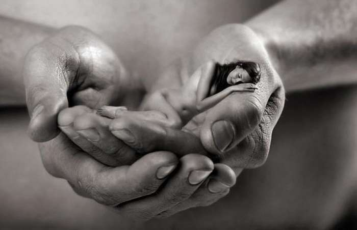

# Хатуу боловч үнэн! Эмэгтэйчүүдэд тавигддаг орчин үеийн шаардлага

Орчин үеийн нийгэм, эмэгтэйчүүдэд ахадмаар олон дүрэм нөхцөлийг тэднээс шаарддаг болсон нь харамсалтай.

Эмэгтэй хүн, үргэлж залуу сайхан харагдах ёстой, амжилттай, аж ахуйч, ухаантай байх, хүмүүжилтэй хүүхэд өсгөдөг байх, гэр орноо арчилж цэвэр цэмцгэр байлгадаг байх, өөрийгөө хөгжүүлдэг байх, ажиллаж мөнгө олдог байх, ажил дээрээ амжилтад хүрдэг байх гээд дуусашгүй олон “байх ёстой”-д дарагддаг. Хөөрхий эмэгтэйчүүд, заримдаа бүр эмэгтэй болж төрсөндөө харамсах үе таардаг нь ч нууц биш. Төрөхөөсөө эхлээд л, биеэ даасан байх ёстой, хөл дээрээ бат зогсож чаддаг байх ёстой, хүнээс хамаарахгүй байх ёстой, нөхрөөсөө мөнгө аль болох хүсэхгүй байх гэх мэт “ёстой”-ууд хөвөрнө. Мөн тэд, бас хүүхэд байхдаа ч хөвгүүдтэй адил хэмжээнд бүхнийг хийх, суралцах “ёстой байдаг. Эмэгтэйчүүд, “ганцхан өндөр өсгийт” өмсдөгөөрөө л эрэгтэйчүүдээс ялгаатай атлаа яагаад энэ олон “ёстой”-д дарагдна вэ? Тэд хүүхэд төрүүлж, эх болж удам залгуулах, ариун сайхан бурханаас заяасан үүргээ биелүүлсээр ирсэн. Болж бүтэхгүй амьдрал дээр эмэгтэйг л буруутгадаг. Хэрэв амжилттай явбал, эмэгтэй биеэ ашигласан болж буруутна. Үнэхээр амжаагүйгээс хааш яайш хувцаслачихвал, эрэгтэйчүүд өөрсдийн дутагдлаа мэдэхгүй, тонн гэдсээ унжуулчихаад өөрсдийгөө мэдэхгүй дооглон гутаана. Тэдний нүд эмэгтэйчүүдийг сонжин харах эрхтэй гэсэн шиг гүйлгэнэнэ. Эрт дээр үеэс биднийг хамгаалах үүрэгтэй эрэгтэйчүүдэд “ёстой”-гоосоо хуваалцмаар байна.\
–“Би сайхан харагдах ёстой учраас, өглөө ажилруугаа, сиймгэр торон платье, торгон оймс, хадаасан өсгийттэйгээ гүйж явна. Хажууд минь эрэгтэй хүн хөлд эвтэй гутал, биед чөлөөтэй хувцастай мөн гүйж байна. Өндөр өсгийт минь хөл өвтгөж, сайхан торгон оймс минь намайг дулаацуулахгүй байна. Гэхдээ би дотроо уйлан байж, би нээрээ тэгш эрхтэй цаг үед төрсөн шүү гэсэн бодлоор голоо зогоон инээмсэглэв” -“Тиймээ! Би эмэгтэй хүн, дэлхий дээрх хамгийн хүчтэй хүн! Бурхан минь! Би уйлмаар байна.”
