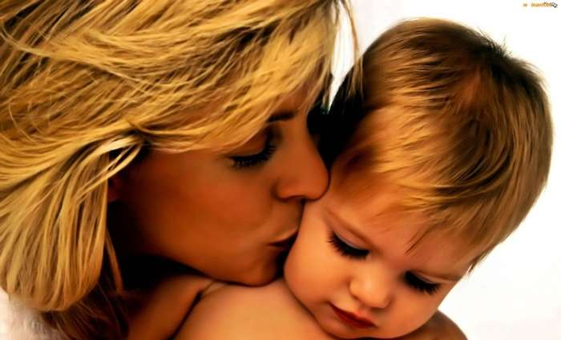
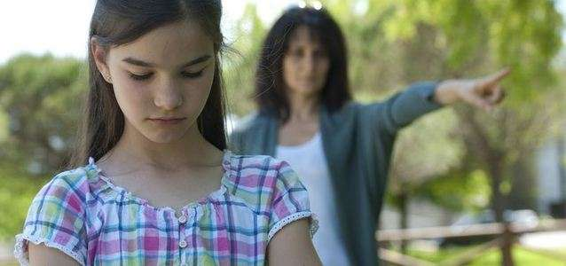

# Хатуу ширүүн, шаардлагатай ээжүүдийн хүүхдүүд, амжилттай хүмүүс болж өсцгөөдөг

Hangover Cure-н мэдээлснээр яг ийм зантай ээжүүдийн хүүхдүүд илүү их амжилтай, хариуцлагата зорилготой хүмүүс болж өсдөг гэжээ. Эх хүний зүгээс үр хүүхэддээ байнгын сэтгэл хангалуун бус байж, байнгын шаардлага тавих, хүүхдийнхээ таагүй хүлээн авалтыг харах, хайр энхрийллээ дарах, хүүхдээ төгс хүн болгож өсгөх оролдлогууд тийм ч амар зүйл биш юм. Хүүхдэд, хэдийгээр тэр үедээ хүнд хэцүү байсан санагддаг ч, өсч том болоод талархаж явдаг гэнэ. Эссексийн их сургуулийн профессор Эрика Рассон, амжилтад хүрсэн хүмүүсийн ээжүүд хатуу ширүүн шаардлагатай хүмүүс байсныг, мөн 2004-2010 оны хооронд, 13-14 насны 15 000 хүүхдийг хамруулсан ажиглалт судалгааны явцад, хатуу шаардлага тавьдаг ээжүүдийн хүүхдүүд илүү амжилтад хүрдэг болохыг тогтоожээ. Хүүхдээ өндөр боловсролтой болгохыг бүх эцэг эхийн аль аль нь хүсдэг болов ч, энэ нь ээжийн шаардлагаас илүүтэй хамаардаг болох нь ажиглагджээ. Өндөр шаардлага тавьж, итгэл үзүүлдэг ээжүүдийн хүүхдүүд өөртөө итгэлтэй, тууштай зорилготой болж өсдөг гэсэн судалгааны үр дүн гарсан бөгөөд шаардлагатай хатуу ээжүүдийн охидын дунд эрт жирэмслэлт бүртгэгдээгүй, мөн охид хөвгүүдгүй сургуулиа төгсдөг, сайн боловсрол эзэмшдэг болох нь ажиглагдав. Бид, өөрсдийн дуртай зүйлийг хийцгээж, эцэг эхийн хүслийг сөрөн байж амжилтад хүрч буй гэж боддог болов ч, мөн эцэг эхийн шийдвэрээс аль болох зайлсхийхийг хичээх хэдий ч, бага насанд суурилуулсан хариуцлага, тэдний ямар ч зөвлөгөө, хүсэл ил далдаар бидний сонголт шийдвэр, эрмэлзэлд нөлөөлсөөр байдаг, гэхдээ бид үүнийгээ өөрсдөө шийдвэрлэж байна гэж боддог гэж Рассон доктор тайлбарлажээ. Хатуу ширүүн зантай ээжтэй ихэнхи хүүхдүүд, тэр үедээ, ээжийгээ дайсан шиг үзэж, амьдралыг нь там болгон хувиргаж байна гэж боддог ч, өсч том болоод үүнийх нь төлөө талархаж явдаг, мөн түүнийг хүчирхэг болгохын тулд хийж байсан хичээл зүтгэлийг ойлгодог, үнэлдэг болдог, түүнчилэн залгамж үед нь ч, энэ нь дамжидаг гэсэн дүгнэлтэд хүрчээ.

