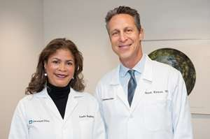

# Хавдар судлалын эмч, өөрөө өвдвөл яах байсан тухайгаа нийтлүүлжээ

Америкийн нэрт хавдар судлалын эмч, эрдэмтэн Марк Хайман, найз нь санамсаргүй түүнд тавьсан -”хэрэв чамд, өөрт чинь хавдар гэсэн онош тавигдвал, чи яах байсан бэ?” гэсэн асуултад, юу гэж, хариулснаа олон нийтэд хүргэхээр нийтэлснийг хүргэж байна.

Тэрээр, хавдар буюу рак эмчлэх эмчилгээ нь, хавдарыг тайрах, түлэх, химийн аргаар хордуулах, туяагаар шарах зэргээр л хязгаарлагдаж байгаа бөгөөд эдгээр нь хавдрыг уг үндсээр нь устгаж чадахгүй байгаа юм гээд, рак өвчний онош хэрэв надад тавигдвал, би сандарч цөхрөхгүйгээр дараах арга хэмжээ авах байсан гэжээ.

---

1. Сахар, сахарын орцтой бүтээгдэхүүн хэрэглэхээ шууд болино. Сахар нь хавдарын эд эсийг гол тэтгэгч. Мөн цусандах инсулиныг хэмжээнд нь барих хоол хүнс: шинэ, эслэг ихтэй, ширхэглэг байгалийн хүнс сонгон хэрэглэнэ. \
2. Өөртөө таарахгүй байгаа хүнсүүдийг хэрэглээнээсээ хасна. Энэ нь хүн бүрт янз янз байдаг. Глютений агууламжтай бүтээгдэхүүнийг мөн хасна. Нарийн бүдүүн гэдсэнд үрэвсэл үүсгэх магадлалтай байдаг сүүнээс татгалзахыг хичээнэ. Сүүнээс болж гэдсэнд ямар нэг өөрчлөлт анзаарагддаг бол шууд зогсоох хэрэгтэй. Ямар нэг зүйлийг идсэний дараа бие эвгүйцдэг бол тэр зүйлээ болих. Өөрийгөө сонсох буюу биедээ маш анхааралтай хандна.\
3. Бие организмдаа үрэвсэл явагдахаас болгоомжилно. Үрэвсэл үүсэхийг дардаг Омега-3 -р баялаг улаан загас, маалинганы үр хүнсэндээ түлхүү хэрэглэнэ.\
4. Ямар ч эрхтэний хавдарыг бүдүүн гэдсэнд байдаг микробиом гэдэг бактераас үүсдэг гэж үздэг тул гэдэсний эрүүл байдлаа хадгалах үүднээс, пробиотик, пребиотикийн орцтой тараг, йогурт, фитонутриент /ойн жимснүүд/, куркумин /куркума/, ресвератрол /усан үзэм, дарс/ хэрэглэнэ. Эдгээр нь гэдэсний бичил орчинд сайн нөлөөтэй.\
5. Аливаа, хорын агууламжтай байж болох зүйлсээс татгалзна. Ингэснээр бие дэх хорыг бүрэн гаргах боломжгүй ч гэлээ багасгаж болох юм. Юуны түрүүнд пестицид, фталат, бисфенол А, антипирен, хүнд металууд /мөнгөн ус, хар тугалга,/агуулдаг зүйлсийг хэрэглээнээс бүрэн хасна. Эдгээр нь, дараах зүйлст агуулагддаг: хуванцар савтай ундаа, олон зүйлсийг нийлүүлсэн хагас боловсруулсан бүтээгдэхүүнүүд мөн том хот суурингийн авто машины хөдөлгөөн ихтэй газрын агаарт агуулагддаг хар тугалга онцгой аюултай учраас тийм газраар явах салхилахаас бүрэн зайлсхийнэ гэсэн ажээ.

Мөн, хорт хавдар бол цаазын ял биш, тиймээс өөрөө хичээсэн цагт энэхүү өвчнийг ялж болохыг сануулаад, зөвхөн эмч нарт найдах биш өөрийнхөө төлөө зүтгэж, өөртөө итгэхийг чухалчлан зөвлөсөн байна.
