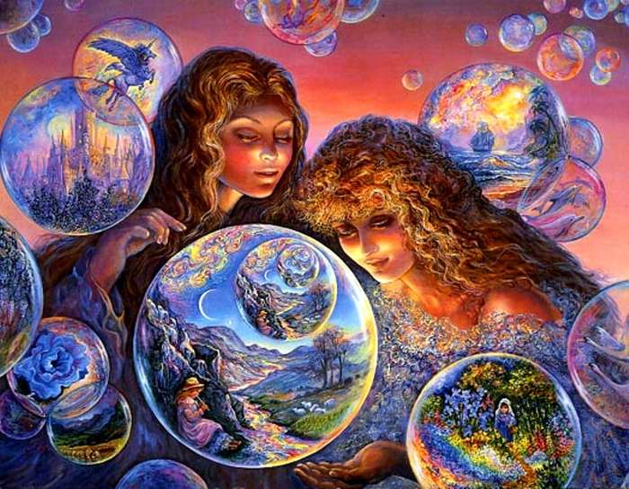

# Хайр ба дурлал

ХАЙР минь! Би чам шиг байхыг мөрөөдөх юм даа. Чи надаас асар их хүчтэй гэж Дурлал, атаархангуйгаар Хайр-д давтан үглэх аж.

-Харин чи намайг яагаад ийм хүчтэй гэдгийг мэдэх үү? гэж Хайр бодлогошронгуй тайвнаар асуухад,\
-Яагаад гэвэл чи, надаас илүү хүмүүст чухал, хэрэгтэй\
-Үгүй ээ, найз минь, гээд Хайр, Дурлалыг илбэснээ,\
-**Би өршөөж, уучилж чаддаг болохоор, хүчтэй байдаг,** гэлээ.\
-Чи бүр урвалтыг ч өршөөх үү?\
-Тиймээ, урвалт ихэвчлэн санаатай байдаггүй юм. Энэ талын мэдлэггүйгээс л болдог\
-Чи мөн хуурахыг ч өршөөх үү?\
-Тийм ээ, хууралт, хүнд харьцуулах, сонгох боломж олгодог\
-Чи бас, худлаа ярихыг ч өршөөх үү?\
-Тийм ээ, хүн, гарцгүй байдлаас гарах эсвэл буруугаа ухамсарласнаа нуух, аливааг мэдэгдэж зовоохгүйн үүднээс худал хэлдэг юм.\
-Үргэлж худал ярьдаг хүмүүсийг яахав?\
-Тэд, хайр буюу миний тухай ойлголтгүй байдаг. Тэд хайрлаж чаддаггүй учраас надтай холбоогүй байдаг.\
-Өөр бас юуг, өршөөж чаддаг вэ?\
-Би, уур хилэнг, маш богино үргэлжилдэг учраас өршөөдөг. Бас, сэтгэл дундуур гонсойхоос үүддэг ширүүн занг ч өршөөнө. Голж, гонсойх сэтгэлийг тааварлашгүй юм. Чухам юу, сэтгэлд нь таалагдахыг мэдэхэд цаг хугацаа шаардагддаг.\
-Өөр бас юуг өршөөдөг вэ?\
-Гомдолыг өршөөнө. Гонсойх, гомдол хоёр эгч дүү хоёр. Бас, урам хугарахыг ч өршөөдөг. Урам хугарсаны дараа шаналал ирдэг. Харин шаналал эдгээрийг цэвэрлэдэг юм.\
-Хайр минь, чи гайхалтай юм. Чи бүхнийг, бүгдийг өршөөх чадвартай юм. Харин би, эхний багахан зөрөлдөөнүүд дээр л, ассан чүдэнзний мод шиг унтарчихдаг. Би чамд үнэхээр атаархаж байна.\
-Дурлал минь, чи, буруу ярьж байна. Бүхнийг уучилж чаддаг хэн ч байхгүй. Хайр ч уучлахгүй зүйлс байдаг юм\
-Чи, дөнгөж сая өөрөөр ярьсан биш үү?\
-Үгүй ээ, би саяын ярьсан зүйлүүд ээ үнэхээр өршөөж чадна. Харин, энэ хорвоо дээр, Хайр ч өршөөж чадахгүй, сэтгэлийг мөхөөж, мэдрэмжийг устгадаг, уй гашууд хүргэж, үгүйсгэлд хүргэдэг, зүйрлэшгүй өвдөлттэй, эргэн тойрноо хордуулж, хүний сэтгэлийг дотогш хумьдаг, урвалт, хууралт, худал хуурмаг, гомдолоос хүчтэй хүнийг шархлуулдаг нэг зүйл байдаг. Тэр нь, Хайрын аймшигт дайсан болох хүний Хайхрамжгүй зан юм. Дурлал минь, чи тааралдахаараа ойлгоно гэлээ.
