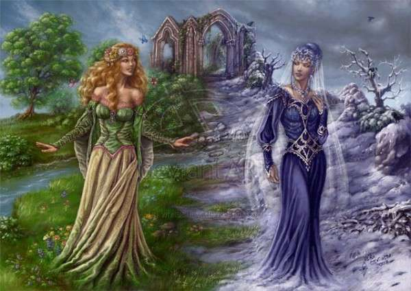

# Хайр ба Салалт

Ойгоор зугаалан, хөгжилтэй алхах бүсгүй залуу хоёрыг, Хайр, Салалт хоёр ажиглан зогсох зуураа, Салалт, -“би, энэ хоёрыг салгачих уу? Мөрийцье!” хэмээн алгаа үрчив, харин Хайр, -“чи, жоохон хүлээ, надад тэр хоёрт ганцхан удаа дөхөх боломж өгөөдөх, тэгээд дараа нь чи, хүссэнээрээ бол! Тэгээд чи тэднийг салгаж чадах эсэхийг чинь харъя” гэж гуйв. Хайр тэдэнд дөхөж очоод хүрч, нүд рүү нь харахад, тэдний нүдэнд хайрын оч гэрэлтэн асчээ. Хайр, Салалт дээр хүрч ирээд, - “одоо чиний ээлж” гэхэд, Салалт,-“одоо хайраар дүүрчихсэн байгаа, би дараа уулзана аа” гэж хариулав. Хэсэг хугацаа өнгөрч, Салалт нөгөө хосыг хайсаар очиж, нярай хүүхэдтэй эцэг, эх болсныг харж, -“хайр нь, одоо өнгөрөө байлгүй дээ”, гээд тэдний нүд рүү хартал, тэдний нүд Талархлаар дүүрэн байсан тул яаж ч чадсангүй, за, дараа л болохоос гээд явжээ. Хэдэн жил өнгөрч Салалт, нөгөө гэр бүл дээр дахин очив, гэрт нь хүүхдүүд шуугилдаж, нөхөр нь ажлаасаа ядарчихсан орж ирж байхтай таарч, -“за, одоо л салгая, хайр, талархал хоёр нь дуусаа биз” гээд тэдний нүд рүү хартал, тэдний харцанд Ойлголт, Хүндлэл хоёр гэрэлтэж байх нь тэр. Олон жил өнгөрч, Салалт дахин тэднийд ирэв. Хүүхдүүд нь өсч том болчихсон, хүүхдүүддээ зөвлөгөө өгч суух үед нь таарч, тэдний харцан дах Итгэлцэлийг олж харсан Салалт, харамсалтайгаар санаа алдаад, -“за, дараа ирнэ ээ” гэж бодоод явжээ. Цаг хугацаа өнгөрсөөр, нэг удаа Салалт өнөөх гэр бүл дээр дахин ирэв. Ач нар нь гүйлдэж тоглон, ширээний дэргэд гунигтай суух эмгэнийг хараад, Салалт –“за, одоо миний ээлж ирлээ” гэж баярлав. Энэ үед эмгэн босч гарч явахад нь дагасаар оршуулгын газар ирсэн бөгөөд өвгөнийхөө хөшөөний өмнө бохирон суусан эмгэнийг хараад, Салалт –“би, хоцорчихлоо, надаас өрсөөд цаг хугацаа салгачихаж” гээд, эмгэний нүд рүү хартал, эмгэний харц, Хайр, Талархал, Хүндлэл, Ойлголт, Итгэлцэлээр дүүрэн Дурсамжаар бялхаж байлаа.
