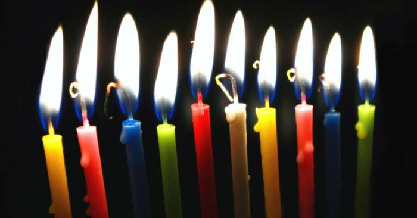
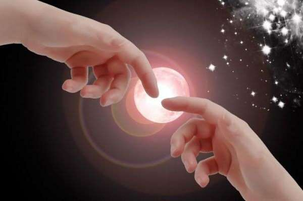

# Хайр дурлал, аз жаргалыг дуудах чадвартай лааны увидас

Лааг, бараг бүх улс үндэстнүүд, эрт дээр үеэс увидаст чанарыг нь ашиглан олон төрлийн зан үйлд хэргэлсээр ирсэн бөгөөд галыг билэгдэх чанар, хаана ч хэргэлэх боломжтой, галын хүчний хүчит, увидаст шинж чанарыг агуулдаг, мөн гэрэлтүүлэх хэрэгслийн хэмжээнд гэх мэтчилэн өргөнөөр ашиглагдсаар иржээ.

Лааны энергийг зөв ашиглахын тулд дараах зүйлийг мэдэж байх хэрэгтэй байдаг гэнэ. Гэрт, лааны суурин дээр удаан зоолттой байсан лааг дахин асааж ашиглах таагүй. Лаа, орчины энергийг шингээн авах, өөрийн ой санамжтай байдаг байна. Өнгөн хэсгийг нь будаж өнгө гаргасан өнгөт лааг, зан үйлийн зориулалтаар ашиглах үр дүнгүй гэдэг бөгөөд зөгийн лаваар хийсэн лааг хамгийн увидастай, олон эмчилгээний чанаруудтай байдаг гэж үздэг аж. Хүслээ биелүүлэх, лаа асааж дөлийг нь харж суунгаа тухайн зүйлсээ шивнэх, бодох үр дүнтэй арга байдаг. Мөн тухайн хүслийг биелүүлэхэд тустай увидаст шинж чанар бүхий эфирийн тосыг гаднаас нь түрхэн асаахад увидас нь нэмэгдэхээс гадна сайхан үнэр гарган асдаг. Асч буй лааг аль болох үлээж унтраахгүй, голыг нь чимхэж унтраах заншил уламжлагдан ирсэн байдаг. Тухайн зорилго, хүслээс шалтгаалан, өнгийн лаануудыг зан үйлийн хэмжээнд, гэр орондоо асааж ашиглах нь, аз, амжилт, эд баялгийг дуудах үр дүнтэй гэж үзэн нийтлэг ашиглаж иржээ. Лааны өнгө бүр нь тус тусын зориулалттай байдаг бөгөөд цагаан лаа, цэвэрлэгээ, үнэн мөнийг тогтооход тустай. Улаан лаа, эрүүл, эрч хүчтэй байж, өөрийгөө хамгаалах, гоё сайхан байх, ялангуяа, хайр дурлал, дур хүсэл, хосын амьдралыг татах увидастай байдаг. Мөн эд баялгийг дууддаг гэж эртнээс хэргэлж иржээ. Тиймээс, аливаа шийдвэр гаргахын өмнө улаан лаа асааж байхыг зөвлөдөг. Шаргал лаа, эрч хүч, аз завшааныг дуудна. Шар лаа, саад бэрхшээлийг дарж замыг чөлөөлнө гэж үздэг. Ногоон лаа, албан тушаалын өгсөлт, санхүүгийн өсөлтөд тустай. Цэнхэр лаа, эв эе, зохилдлогоо, гэгээрэл, зөн совинг тэтгэдэг. Хар лааг, хар муу зүйлсийг зайлуулах, саад бэрхшээлийг дарах, хүчтэй хэрэгсэл гэж үздэг. Хар домын зан үйлд ихээхэн хэргэлдэг. Болгоомжтой хэргэлэх ёстой бөгөөд гэр орны сөрөг энергийг зайлуулах, хүнийг муу зуршлаас хамааралтай байдлаас нь салгах, хар, цагаан хэл амнаас хамгаална гэж үздэг. Лаа нь, галын, үгийн, төсөөллийн ид шидтэй нэгдэн, хүчтэй үйлчилэл үзүүлэх увидастай гэх бөгөөд түүний тусламжтай хайр дурлал, эмчилгээ, эрх мэдэл, эд баялаг, гэгээрэл, ариусал гэх мэт олон зүйлд хүрч болно гэж үздэг. Хамгийн гол нь, тухайн хүсэлдээ зориулан лааг асааж байгаа үйлдэлдээ итгэлтэй байж, наад захын дээрхи дүрмүүдийг мөрдөх хэрэгтэй бөгөөд үлдсэнийг нь лаа тань, өөрийн увидаст чанар, галын хүчээр туслах чадвартай гэж үздэгийг, галын ариусгах чанар, оюун сэтгэхүйд галын нөлөөлөх нөлөөлөлтэй холбон үздэг аж
