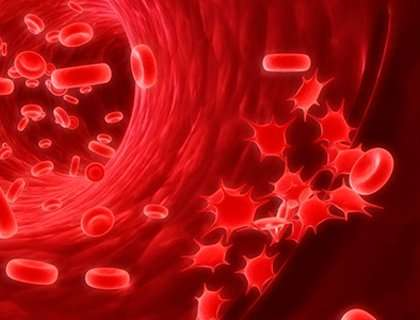

# Хайр эмчилэх увидастай

Огайогийн Их сургуулийн эрдэмтэн судлаачид, зүрхний өвчилөл үүсдэг шалтгааныг илрүүлэх зорилгоор, хүний артерын судасны бөглөрлийг үүсгэдэг гэж үздэг, өндөр холестерин, биед ашиггүй, хортой хүнсүүдээр туршилтын туулайнуудыг тэжээх туршилт явуулжээ.

Судалгаа шинжилгээний үр дүн нь, туулайнуудад, хүний адил, зүрх судасны өвчлөлийн шинж тэмдэгүүд илэрч байгааг харуулсан бөгөөд харин ганцхан туулай, бусадтай нь харьцуулахад, өвчний илрэх шинж тэмдэг нь 60% бага, хортой хүнсэнд организм нь бараг өртөөгүй, тэсвэртэй байсан нь гайхашралд хүргэн, элдэв таамаглалд төөрөлдсөний эцэст, туулайг хариуцан хооллодог байсан оюутан, уг туулайг тэврэн илж, ярилцан өхөөрдөн хайрладаг байсныг олж тогтоон, гайхсандаа, энэхүү харьцаа нөлөөлж буй эсэхийг шалгахаар давтан туршилт явуулахад эхний туршилтын үр дүн нотлогдсон байна. Иймэрхүү, бие организмын дархлааны механизмыг, одоо ч, орчин үеийн шинжлэх ухаан тайлбарлаж чадахгүй байгаа бөгөөд хайр энхрийлэл бие организмд хүчтэй нөлөөлдөг болохыг хүлээн зөвшөөрөхөөс цаашгүй байгаа аж.
