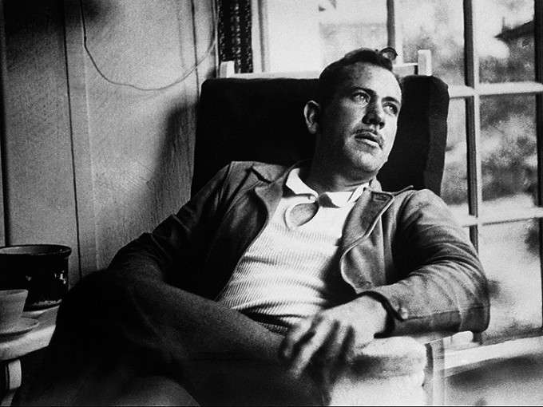

# Хүүдээ бичсэн захидал

Алдарт сурган хүмүүжүүлэгч Макаренко: -“Бага насных ч бай, өсч том болсон ч бай, хүүхдүүдтэйгээ сайн найзтайгаа харьцдаг шигээ ярилцах хэрэгтэй байдаг” гэж эх эцгүүдэд зөвлөснийг, нэр алдартай түүхэн хүмүүс амжилттай, чандлан мөрдөж ирсэнийг, тэдний үр хүүхэддээ бичсэн захидлууд харуулж байдаг. Тэдний захидлуудыг уншихад, мэргэн ухаан, амьдралын хэв маяг, хорвоог авч үзэх үзэлд нь атаархмаар. Америкийн Нобелийн шагналт нэрт зохиолч, цэргийн сэтгүүлч Джон Стейнбекийн хүүдээ бичсэн захидлыг толилуулъя.

1958-11-10\
Хайрт Том минь, чиний захидлыг аваад, хариуг нь ээжтэй чинь хамт бичиж сууна. Дурласан тухайгаа чи бичжээ. Энэ бол, хүн бүрт таардаг хамгийн сайхан мэдрэмж гэдгийг хэлэх нь зүйтэй. Гэхдээ дурлал янз бүр байдгийг бичмээр санагдлаа. Өөрийнхөө чухлыг гайхуулсан, аминч, хатуу, солиотой, дорой дурлал байдаг. Энэ дурлал хүнийг өвчтэй, сул дорой хүн болгодог. Харин, хүн, өөрийнхөө хамгийн сайхан чанарууд болох сайхан сэтгэл, анхаарал халамжаа нээдэг, хайртай хүнээ үнэлж, хүндэлдэг дурлал нь, хүний зүрх сэтгэлийг чөлөөлж, хүчирхэг, эрэлхэг, сайхан сэтгэлтэй, бүр ухаантай болгох нь ч бий. Чи надад үүнийг бичихдээ, магадгүй надаас зөвлөгөө хүсээ биз ээ. Би юу хэлэх вэ? Дурлал бол хязгааргүй, зүйрлэшгүй сэтгэлийн таашаал, амьсгаа боогдом сэтгэл догдлол, баяр зөвхөн баяр баясгалангийн мэдрэмж, бүх зүйл сайхан харагддаг талархлын мэдрэмжээр дүүрэн байдаг. Хайртай бүсгүй чинь, хамгийн сайхан, юутай ч зүйрлэшгүй. Энэ мэдрэмждээ тохирохоор биеэ авч явах, өөрийгөө өөрчилөх чинь зайлшгүй. Хайрлаж дурласан хүн энэ мэдрэмжээ илэрхийлэхэд хамгийн хэцүү байдаг. Бүсгүйчүүд, тэдэнд хаягласан жижигхэн мэдрэмжийг чинь ч, мэдрэх төрлөхийн авъяастай улс. Тиймээс дурлаж хайрласан бүсгүй чинь бүхий л мэдрэмжүүдийг чинь сонсох дуртай байдаг. Чиний зарим догдлол, мэдрэмж зарим нэг шалтгаанаар хариу авахгүй байх нь бий шүү. Гэхдээ үүнээс болж дурлал хайрын үнэ цэнэ, утга учир алдагдах ёсгүй. Би чиний бүх мэдрэмжүүдийг өөр дээрээ ойлгож байна. Учир нь, ээжид чинь би ухаангүй хайртай. Би чамайг дурлал хэмээх сайхан зүйлтэй учирсанд баяртай байна. Бид Сьюзенг баяртайгаар хүлээн авах болно. Энэ үед, ээжийн чинь үүрэг илүүтэй байх биз ээ. Ээж чинь дурлалын талаар бас зөндөө зүйл мэднэ, надаас ч илүү туслана гэж бодож байна. Алдахаас бүү айгаарай. Болох юм болдогоороо болдог. Хамгийн гол нь бүү яар. Сайн юм хэзээ ч үгүй болдоггүй юм.\
Хайртай шүү. Аав нь.
