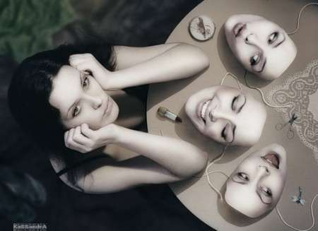

# Хэдхэн минутад хэрхэн дур булаам болох вэ?

Бусдад таалагдахыг хэт хичээсэн, хиймэл байдал хэзээ ч сайхан харагдахгүй гэдгийг ойлгох хэрэгтэй. Хүний гадаад гоо үзэмжээс илүү дотоод зан чанар хэзээд үнэтэй байдаг. Тиймээс царай зүс, бие хаанаас илүү гэгээ татуулсан инээмсэглэл, өөдрөг зан, сайхан харилцаа хүнийг дур булаам сэтгэл татам болгож байдаг.

-Хүнтэй харилцахдаа, нүд рүү нь харж ярилцах нь, өөртөө итгэлтэй байдлыг тань харуулж, харцаараа харилцах боломж олгодог\
-Инээмсэглэх нь хамгийн аятайхан харагдах арга. Хүмүүс аз жаргалтай, өөдрөг хүмүүст дуртай байдаг\
-Бүх хүмүүстэй харилцаж хоёр гурван үг ч атугай солиход, эргэн тойрон дох хүмүүсийн сэтгэл санаа хангалуун болох процесс явагдаж та, аятайхан харагддаг гэнэ. Та хэн нэгнийг анхаарч анзааран харилцахад, түүнд аятайхан харагдаж эхэлдэг\
-Ярилцах үедээ, цэх зөв зогсох нь таныг өөртөө итгэлтэй сайхан харагдуулна\
-Бүх хүн магтаалд дуртай байдаг. Тиймээс, бусдад магтаалын үг хэлж байх, мөн тухайн хүнийг их чухал хүн маягаар хүлээж авахад, та, шууд л таалагдаж эхэлнэ\
-Өөртөө хамгийн эвтэйхэн, таатай байхаар биеэ авч явах нь, таныг бусдад таалагдуулна. Бусдад таалагдахын тулд хэн нэгнийг дуурайж жүжиглэх хэрэгггүй\
-Ямар нэг зүйл хийхдээ, бусад юу гэж бодох бол гэж бүү шанал\
-Өөрийн стиль хувцаслалтыг, өөртөө таалагдахаар тохируул. Чөлөөтэй, итгэлтэй биеэ авч явж байгаа байдал тань бүгдэд таалагдна. Улаан өнгийн хувцас эрчүүдэд таалагддаг гэнэ\
-Эрэгтэйчүүдийн хамгийн түрүүнд хардаг зүйл эмэгтэй хүний уруул байдаг гэнэ. Тиймээс, уруулаа хэт бараан биш өнгөөр, зохимжтой бол улаанаар будах нь сайхан харагдуулж дур булаадаг байх нь
