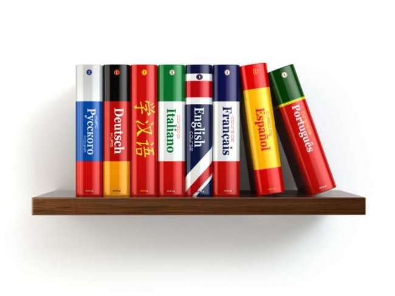

# Хэлний тухай сонирхолтой баримтууд

Дэлхий дээр 6000 гаруй хэлээр ярьдаг. Эдгээр хэлнүүдийн, зарим хамгийн сонирхолтой зүйлсээс толилуулъя.

-НҮБ-ын хэмжээнд, зөвхөн 6 хэлийг, албан ёсны хэл гэж үздэг: англи, франц, араб, хятад, орос, испани\
-Шинэ Гвинейн Папуа-н оршин суугчид бараг 700-д төрлийн хэлээр ярьдаг. /Дэлхийн бүх хэлний 15%/\
-“О” үсгийг хамгийн эртний үсэг гэж үздэг\
-Хятадын дүрс бичигт, “хэцүү бэрх, тааламжгүй” гэхийг, нэг дээвэр дор хоёр эмэгтэйг зурсан дүрсээр илэрхийлдэг\
-Кхмерүүдийн цагаан толгой 72 үсэгтэй, харин Бугенвиль арлынх ердөө л 11 үсэгтэй\
-Хятад хэлэнд, “цай” “эрч хүч” гэдэг хоёр үг, адил бичигддэг\
-Англи хэлний эгшиг ороогүй хамгийн урт үг-“rhythms ”\
-Эскимосчууд “цас” гэхийг, 20 янзаар дууддаг\
-Англи хэлний хамгийн эртний үг-“town”\
-Англи хэлэнд, 600 000 гаруй үг байдаг\
-Америкийн ерөнхийлөгч Б.Франклин “согтуу” гэдэг үгэнд, 200-д ижил утгатай үг олж бичсэн байдаг гэнэ\
-Эртний Египетэд, абрикосыг “нарны өндөг ” гэдэг байжээ
