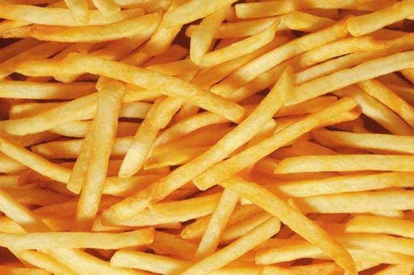
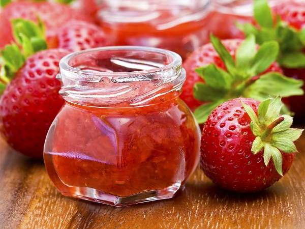
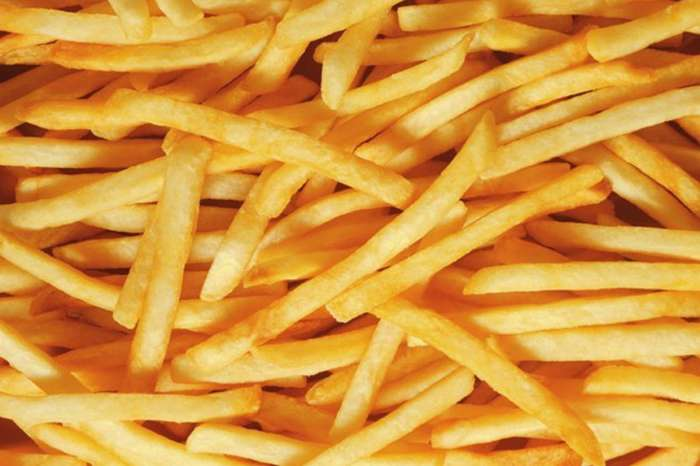
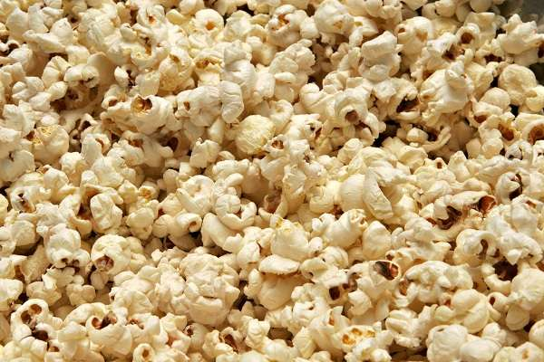
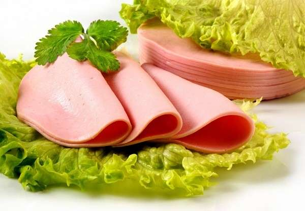
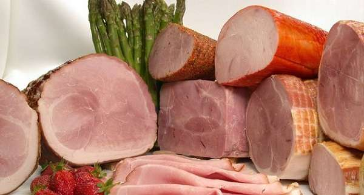
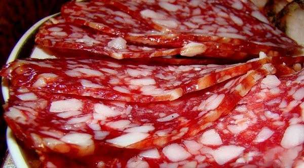
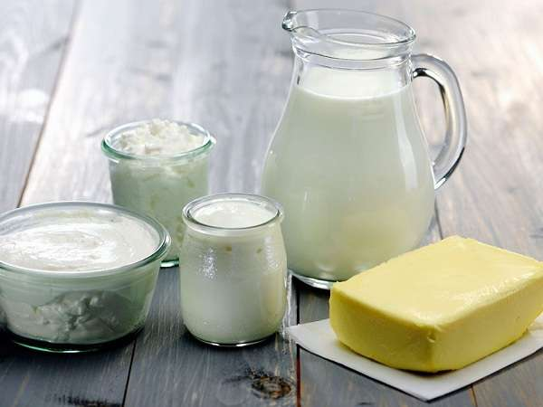

# Хэрэглээгээ хязгаарлах хэрэгтэй 7 хүнс

Хэрэглэж буй хүнсээ анзаарч хянаж ,идэж хэрэглэхгүй бол болохгүй цаг үед бид амьдарч байгаа бөгөөд өдрөөс өдөрт хүнсний бүтээгдэхүүний чанар алдагдсаар байгаа нь нууцгүй билээ. Тиймээс дараах 7 хүнсний хэрэглээгээ, хязгаарлахыг зөвлөж байгаа юм.

#### Дэлгүүрт худалдаалагддаг жимс, жимсгэний чанамалууд

Чанамал доторх жимсийг муутгахгүйн тулд, хүчтэй исэлдэлтийн эсрэг бодис нэмсэн байдаг бөгөөд, мөн нэмэлт хүнсний будагуудыг хортой гэж үздэг.

---

#### Хоолны газруудын шарсан төмс “фри”

Маш их крахмал, тосны агууламжтай учраас таргалуулдаг. Таргалуулдаг чанар нь бусад муу үр дагавруудын хажууд юу ч биш гэнэ. Транс тосны агууламж нь маш өндөр байдаг тул, атесклероз, чихрийн шижин, хорт хавдар өвчнүүдийн шалтгаан болдог, мөн генд өөрчлөлт оруулах муу үр дагавартай байдаг байна.

---

#### Попкорн

Эрдэнэ шиш, өөрөө ямар нэг муу үр дагавар дагуулдаггүй. Харин попкорныг хийхэд, тос, давс, сахар, өтгөрүүлэгч, будаг, амт оруулагч үнэр оруулагч зэргийг нэмж хольж хийдэг. Ердийн попкорны давсны орц чипснийхээс хэд дахин их байдаг.

---

#### Чанамал хиам

Чанамал хиамыг генийн өөрчлөлттэй буурцаг ашиглан хийдэг. Хиам, зайдас, нухаш зэрэгийн амтыг амт оруулагч ашиглаж гаргадаг.

---

#### Утсан гахайн мах

Махны орц бага, ихэвчлэн гель /амт оруулагч, өнгө оруулагч/ нэмэлтүүд байдаг.

---

#### Утсан хиам

Урдных шиг утахаа больж, формальдегид хэмээх бодисын агууламжтай шингэн утааг ашигладаг болсон. Энэ бодис хорт хавдар үүсгэх боломжтой.

---

#### Удаан хадгалж болдог сүү, сүүн бүтээгдэхүүн

2 долоо хоногоос илүү хадгалж болдог сүү, сүүн бүтээгдэхүүнийг хэрэглэж болохгүй. Эдгээр бүтээгдэхүүний савлагаа антибиотиктай байдгаас мууддаггүй. Мөн өтгөрүүлэгч, тогтворжуулагч, исэлдэлтийн эсрэг бодис, амт оруулагчийн агууламж өндөртэй байдаг.
