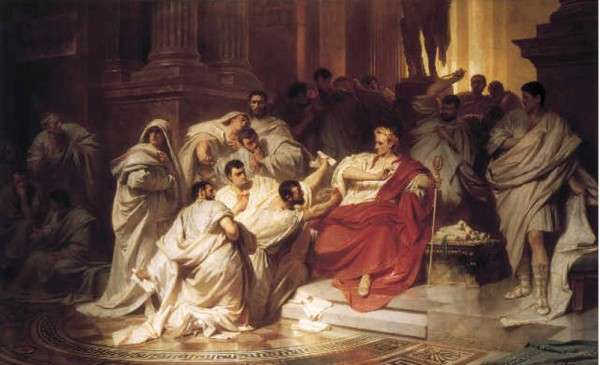

# Хэрэлдэхээс өөр аргагүй болсон үед...

Хүн хичнээн, тайван хүлээцтэй байсан, яалт ч үгүй, хэрүүл маргаанд орох үе гардаг нь нууцгүй. Маргалдаж буй хоёр тал, өөрийн зөвийг батлах гэж, маргалдаад, бүр даамжирч муу, сайнаа дуудсан хамгийн таагүй байдал өрнөж байдаг нь, бидний хувьд хэзээний танил асуудал юм.

Хэрүүл маргааанаас зайлсхийхийн тулд яах вэ? Эртний Римийн үед, түшмэд, хоорондоо маргалдмагц, шууд гаргаж, газар дээр нь тэр дороо шүүх хуралдаж, буруу зөвийг нь тогтоон арга хэмжээ авдаг байж. Одоо цагт, Английн хатан хаан Елизавета II –н ордонд, хэзээ ч хатан хааны дэргэд маргаан гардаггүй. Тэд, хатан хаанаа хүндэлж хайрладгаас ийм байдал гаргадаггүй гэнэ. Ер нь хүн, хэзээч хайрлаж хүндэлдэг хүнийхээ дэргэд, хэрэлдэж харагдахыг хүсэхгүй. Тиймээс, хэрүүл, маргаанд оролцохоос өөр аргагүй байдалд орвол, хажууд чинь, хамгаас их хайрлаж хүндэлдэг хэн нэгэн, хайртай бүсгүй, залуу чинь, эсвэл, хайрлаж хүндэлдэг хань, төрөл төрөгсөд чинь, нэг бол хамгаас хайртай үр хүүхдээ байж байна гээд БОД! ТӨСӨӨЛ! ИТГЭ! Хэрэв, Бурханд итгэдэг бол, хажууд чинь Бурхан сууж байна гээд боддоо, бид, хамаагүй хэрэлдэж чадах уу? Үгүй, гэдэг нь ойлгомжтой. Энэ аргыг, бид, бүгдээрээ хэрэгжүүлчихвэл, хэрүүл маргаангүй, эв эетэй амьдрал бий болох нь гарцаагүй.

Танд, бас бүгдэд, эвтэй найртай, тайван ажил, жаргалтай амьдралыг хүсье.
