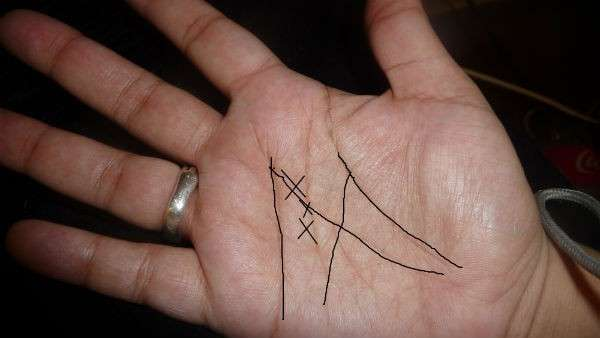

# Хэрэв алганд тань “М” үсэг шиг зураас байвал та, онцгой хүн.

Дэлхийн сая сая хүн алганы мэргэнд итгэж, хувь тавилан зан араншинг хэлж чаддаг гэж үздэг. Мөн алган дээрээ М үсэг шиг зураастай хүн онцгой, өвөрмөц байдаг гэж үздэг байгааг дуулгахад таатай байна. Та өөрийнхөө алгыг шалгаарай.

Ийм хүн авъяаслаг, зөн совин нь сайн хөгжсөн, төрөлхийн ажил хэрэгч байдаг. Мөн үнэн үгтэй, ил тод ярьдаг, бусдын хууралтыг зөнгөөрөө мэдэрдэг. Зөн совин нь тэднийг хэзээ ч хуурдаггүй. Ялангуяа ийм алгатай эмэгтэйчүүдийн 6 дахь мэдрэхүй илүү хөгжсөн байдаг байна. Энэ хүмүүс эрх мэдэлтэй зантай, ямар ч эргэлзээгүйгээр чухал шийдвэр гаргаж чаддаг, амьдралд гардаг боломжуудыг ашигладаг. Өнгөрсөн үеийнхний агуу лидерүүд, зөнчид ийм алгатай байсан байна. Магад таны алган дээр М зураас байх юм бол үүнийгээ байн байн харж, өөрийгөө онцгой, амьдралд хүссэн зүйлдээ хүрч чаддаг хүн гэдгээ өөртөө сануулж байх хэрэгтэй юм байна.
