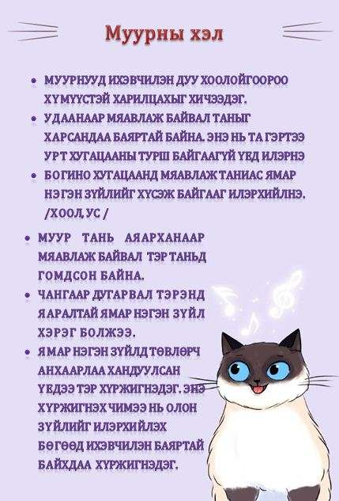

# Хэрхэн мууртайгаа ойлголцох вэ?

Муур бол урьдчилан таамаглах боломжгүй, нууцлагдмал гэрийн тэжээвэр амьтан юм. Муурыг дотоод бодолдоо юу бодож байдгийг нь алхам тутамд нь ажиглах хэрэгтэй. Хэрэв та муураа ажиглаж чадвал тэдэнтэй илүү сайн ойлголцох болно.

---

---

---

---

---

---

---

---

---

