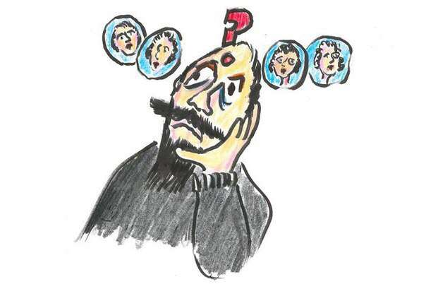

# Хэрхэн сайн эхнэр сонгох вэ: математикийн бодлого

1611 онд, агуу одон оронч, од эрхсийн хөдөлгөөний хуулийг нээгч, математикч, суут ухаантан эрдэмтэн Иоганн Кеплер, авааль эхнэр Барбарагаа өөд болсоны дараа, хоёр хүүхэд,орон гэрээ авч явахын тулд эхнэртэй болохоор шийдэн, түүнд тохирно гэж тухайн үеийн хүрээллийнхэн нь үзэцгээсэн, 11 эмэгтэйчүүд дундаас нэгийг нь сонгон гэрлэх болжээ.

Тэрээр угийн аливааг цэгнэх зантай тул, хүн тус бүртэй уулзаж ярилцсан бөгөөд үүнийгээ өдрийн тэмдэглэлдээ бичиж үлдээснийг, Алекс Беллос өөрийн “Виноградины математики” номондоо хэвлүүлэн олон түмэнтэй хуваалцсан байдаг. Иоганн Кеплер, түүний зүрх сэтгэлийг татах хүсэлтэй энэхүү эмэгтэйчүүдийг: “”эхний эмэгтэй, амнаас нь муухай үнэр ханхалж байсан”, “хоёрдох эмэгтэй, хэт үнэт эдлэл, тансаглалд дуртай юм, сайн зүйл болохгүй”, “гуравдах эмэгтэй, урдах нөхөр нь амар заяа үзүүлэхгүй төлөвтэй”, “дөрөвдөх эмэгтэй хараад ханашгүй сайхан эмэгтэй, гэхдээ тавдахтай уулзаж үзмээр байна”. Энэ үед, түүний хүрээллийнхэн, түүнд, “тавдах эмэгтэйг, даруу төлөв, ажилсаг хичээнгүй, сайн хойд эх болно” гэх мэт магтацгааж байсанд үл итгэн, эргэлзсээр хэсэг хугацаа өнгөрөх хооронд, №4, №5 эмэгтэйчүүд тэвчилгүй энэ агуу одон орончийн зүрх сэтгэлийг татах шалгаруулалтаас гарцгаасан аж. Хөөрхий Иоганн, дараагийн эмэгтэйчүүдтэй уулзаж эхлэв. Зургаадах эмэгтэйгээс тэр бүр айчихсан бөгөөд тэр, “хэт өндөр гаралтай, язгууртан учраас би, түүний зарлагыг дийлэхгүй биз”, “долоодох эмэгтэй, аятайхан л юм, гэхдээ дараагийн эмэгтэйчүүдтэй уулзаж үзмээр байна”, “наймдах, ёстой таалагдаагүй”, “есдөх, бие муутай”, “аравдах, хэнд ч тохирохгүй”, “арван нэгдэх, хэт залуу юм” гэж бичиж үлдээсэн бөгөөд хий дэмий цагаа үрсэн дэмий зүйл боллоо гэж үзэн хэнийг нь ч сонгоогүй гэдэг. Энэ үйл явдлыг, Алекс Беллос өөрийн номондоо, тэр үед Иоганн Кеплерт, амжилтад хүрэх магадлал биш харин сэтгэл ханамжийн магадлалын өсөлтөд чиглэх өөдрөг стратеги хэрэгтэй байсан юм гэж жишээ болгон авсан ажээ. Энэ стратеги, ямар ч зүйлийг сонгоход тусалдаг бөгөөд маш хялбар, сонгох зүйлээ сайтар тунгаан бодож, жагсаалт болгон гаргаж, математикчидын хувьд хангалттай үр дүн болох, байнгын сайн үр дүнд биш ч, муу төгсгөлд ховор хүргэх хувилбар буюу дараах аргыг харуулдаг. Энэ аргыг 1960-д онд “а-ля Кеплер” гэж нэрлэсэн бөгөөд хожим нь “ Нарийн бичиг сонгох асуудал” гэж нэрлэсэн аж. Уг арга нь: хүмүүсийг ажилд шалгаруулах үеийн жагсаалт дахь 20 хүнтэй бүгдтэй нь уулзаж ярилцаж сонгох нь, эхний үед хэн нэгнийг нь сонговол, цаашид шалгаруулалт үргэлжлэхгүй төгснө. Хэрэв бүгдтэй нь уулзвал бусдыг нь сонгоогүй учраас хамгийн сүүлийнхийг сонгохоос өөр аргагүй тул тухайн ажлыг, тэр хүнд олгоно. Эсвэл, буцаад, эхний хүмүүсээс сонгох гэтэл тэд өөр ажилтай болчихсон байх магадлалтай зэрэг эргэж буцсан эргэлзээнд орох асуудлуудыг шийддэг ажээ. 1960 онд, Мартин Гарднер энэ аргыг, /урд нь, өөр мөтематикчид хэсэгчлэн судалж байсан/ томъёолсон бөгөөд тухайн жагсаалт дах бүх хүмүүс, эсвэл ажил, ер юу ч бай, нийт жагсаалтын эхний 36.8%-с сонголтоо хийх нь зөв гэж дүгнэсэн байна. Яагаад 36.8%? гэж асуух тань лавтай. Энэ нь, математикчидын *e* тоо хэмээн нэрлэдэг (=2,718 281 828 459 045 235 360 287 471 352 662 50):томъёогоор гарах 1/е –нь, 0.368 буюу 36.8 хувь болдогтой холбоотой аж. Энэ томъёо, хяналт шалгаруулалтын бүх төрлүүдэд хэрэглэж болох нь нотлогдсон бөгөөд хэдийгээр үнэмлэхүй үр дүнг амлахгүй ч, 36.8% -н амжилтыг баталгаатай авчирдаг гэнэ. Энэ бол муугүй үзүүлэлт гэж тооцогддог байна.

Алекс Беллос, хөөрхий Иоганн, энэ томъёог ашигласан бол, нийт 11 оролцогчийн 36.8%-д багтах эмэгтэйчүүдээс №4-г сонгон эргэлзээ болгоомжлолгүй, эвтэй найртай амьдрах байсан биз, мөн сэтгэлд таагүй дараагийн уулзалтуудаас зайлсхийх байсан юм гэж уг сэдвийнхээ төгсгөлд бичжээ.
