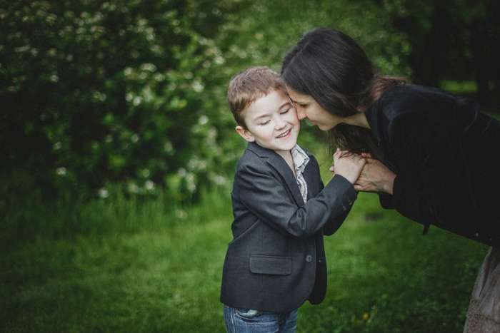
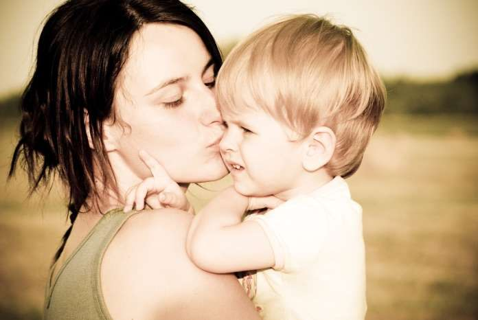

# Хүүгээ хэрхэн “эр хүн” болгон өсгөх вэ?

Хүүхдүүдтэйгээ хамгийн ойр байж, цагаа хамгийн их хамт өнгөрүүлдэг ээж нарын өмнө, хүү нараа жинхэнэ “эр хүн” болгон өсгөх асуудал яалт ч үгүй тулгарч байдаг бөгөөд ирээдүйд хүү тань, мөрөөдлийн “залуу”, сайхан “эр хүн” болон өсч, бахархал тань болж явах сайхан боломжийг олгохх нэгэн зөвлөгөөг толилуулъя.

**Хэзээ ч хүүгээ шоолж инээж болохгүй**\
Эмэгтэй хүний жуумалзсан инээмсэглэл, инээд, шоо, доог тохуу, эрэгтэй хүний хувьд хүнд тусдаг. Үүний адил, ээжийнх нь шоолсон инээд, бүр хичнээн өхөөрдсөн аястай ч байсан, эрэгтэй хүүхдийн хувьд, сэтгэхүйд нь үлдэх, өөртөө итгэх итгэлд нь нөлөөлөх, хаагдмал болох, өөрөөрөө байж чадахаа болих зэрэгт хүргэх уршигтай. Хувцасаа буруу харуулж өмсөх, буруу зөрүү зурсан зураг, цэцэрлэгийнхээ ангийн охиныг онцолж ярих зэрэг бидний хувьд өхөөр татам зүйлс дээр ч инээж хөхрөхдөө болгоомжтой байх хэрэгтэй гэнэ. Ялангуяа, дэргэд нь, бусад хүмүүст, инээж өхөөрдөн ярих бүр хэрэггүй. Ичих зовох мэдрэхүй нь дөнгөж хөгжиж буй үедээ, бяцхан зүрх нь шархлах, насан туршдаа мартахгүй байдалд орох, илэн далангүй гэнэн, хүүхэд занд нь нөлөөлөх аюултай.\
**Асуусан бүгдэд нь хариулж байх хэрэгтэй**\
Нас харгалзахгүйгээр, асуусан бүгдэд нь хариулахыг туйлаас хичээж байгаарай. “Том болоод мэдээрэй”, “том хүний юм бүү асуу” гэх мэтийн хамгийн бүдүүлэг хариултаар, хүүхдийн сониуч сэтгэхүйг эвдэж болохгүй. Үнэхээр мэдэхгүй зүйл асуувал мэдэхгүйгээ үнэнээр нь хэлсэн нь дээр. Харин дараа нь мэдэж авч, мартахгүйгээр хариулвал хүүхэд ихэд баярладаг. Заримдаа, хүүхдүүд, “нүүр улайм” асуулт тавих нь олонтаа байдаг. Энэ үед, бодох хэрэгтэй асуулт байна, хариулах хугацаа өг гэх мэтээр зайлсхийж болох юм. Хүүхэд иймэрхүү хандлагад дуртай байдаг.\
**Хүүхдээсээ зөвлөгөө хүсч, ярилцаж байх**\
Ямар нэг шийдвэр гаргах үедээ, бага гэж гололгүй, хүүгийнхээ сэтгэлийг нь сонсч, зөвлөлдөх нь, түүнийг ирээдүйн амьдралд нь бэлдэх сайхан арга юм. Зарим нэг толгой гашилгасан асуудлыг хүүгээсээ асуугаад үзээрэй. Хар сэргүй, эргэлзээ тээнэгэлзэлгүй, айдас болгоомжлолгүй бяцхан оюун ухаан нь, тухайн асуудлыг тань гайхалтай хялбар, хөөрхөнөөр шийдчих өндөр магадлалтай шүү... “Чи энэ тохиолдолд яах байсан бэ?” гээд асуучих, хамгийн хөөрхөн шийдлүүдийг тэд л гаргана.\
**“Би чамд хэлсэн биз дээ” гэдэг үгийг март**\
Та, урд нь хэлсэн үгийг чинь сонсохгүй, дуулгаваргүй байсан ч, энэ үгийг бүрмөсөн мартах хэрэгтэй. Та, бол хүүхэдтэйгээ буруу зөвийн төлөө уралдан тэмцэлдэгч байх ёсгүй. Таны зөв байх нь гарцаагүй. Гэсэн ч та, үүнийг ялалтад үл тооцон чимээгүй баярлаж сурах хэрэгтэй. Түүнд ойлгох хугацаа л өг.\
**Мөрөөдөл бүрийг нь дэмжиж байх хэрэгтэй**\
“Усны ёроолын ургамал судлаач болъё”, - догь байгаа биз дээ? Хүүгийнхээ энэхүү мөрөөдлийг дэмжин, холбогдох ном, сэтгүүлийг нь аваад өг. “Зураач болно”, “инженер болно”, “цагдаа болъё” гэх мэтээр мөрөөдөл нь үргэлжилнэ. Ямар ч мөрөөдлийг нь бүү үгүйсгээрэй. 20 нас дөхөх үедээ л, хүү нар тогтворжиж, хэн болохоо тодорхойлох эхлэл нь тавигдаж эхэлдэг гэнэ.\
**Хүү чинь уйлвал...**\
Хүүхэд зовсондоо л уйлдаг. Тэдний хувьд, шалихгүй зүйл ч зовлон мэт санагддаг бөгөөд учир нь, тэдний ертөнц жижигхэн, тэрхүү жижигхэн ертөнцөд нь, тэрхүү таагүй зүйл нь асар том мэт санагдан уйлдаг гэсэн үг... Хүүгээ уйлвал, хүү тань хэдэн ч настай байсан ээж та, тайтгаруулж байх ёстой. Энэ бол, та хоёрын ирээдүйн харилцан ойлголцлын үндэс суурь, зөрчишгүй хууль юм. \
**Хэзээ ч, аливааг нотолж мөрдүүлэхийг шаардах, хүчлэх үйлдэл бүү хийж бай**\
**Үргэлж хүүгийнхээ талд орж бай**\
Үгээр ч тэр, үйлдлээрээ ч тэр хүүгийнхээ талд байхыг хичээ. Гомдол мэдүүлж байгаа багшийн хэлсэн болгоныг зөвшөөрөх нь, та, өөрөө хэн бэ гэдгээ л мэдэж авч байна гэсэн үг, түүнчилэн, хэн нэгэн гэр бүлийн гишүүн тань, хүүг тань загинах үед нийлж загиналцаж хэрэггүй. Дараа нь хүүтэйгээ ярилцаж, сонсч бай. Ялангуяа, хүмүүсийн дунд, үргэлж, таны хүүгийн зөв гэдгийг нотлон дэмжигч нь Та л байх ёстой. Түүний итгэж болох цөөн хүний нэг нь Та л байх ёстой. Хүүгийнхээ итгэлийг авах нь, ээж бүрийн нандин хүсэл бөгөөд хүү тань таныг өөрийгөө ойлгоно гэдэгт итгэл дүүрэн байх нь, мөн та хоёрын халуун дулаан харилцан ойлголцол нь Таныг, хүүгээрээ бахархан амьдрах аз жаргалтай ирээдүй рүү хөтөлнө.
