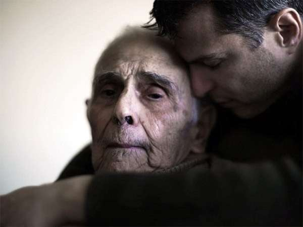

# Хүүгийн хайр

Хүү нь, хөгшин настай аавыгаа ресторанд оруулан хамт хооллож сууна. Аав нь, эв дүйгүйхэн халбагадаж сэрээдэн хоолоо ширээ, хувцсан дээрээ унаган идэх бөгөөд үүнийг харсан ойр ширээний хүмүүс, сэжиглэнгүй харцгаан ярвайж, үүнийг нь огт тоохгүй тайван хооллох хүүг нь гайхсан маягтай харцгаах аж. Хооллож дуусаад, хүү нь босч, асгасан цутгасныг нь цэвэрлээд, аавыгаа угаалгын өрөөнд оруулж хувцсанд нь тогтсон толбыг нь мөн цэвэрлэж, үсийг нь самнаад гарч ирэхэд, өнөөх хүмүүс мөн л сониучирхан харцгаана. Үүнийг харсан аав нь, -“Миний хүү, бид энд нэг юм үлдээж байгаа юм шиг санагдахгүй байна уу?” гэхэд, -“Үгүй ээ, аав аа, юу ч үлдээгээгүй”. Аав нь тэгтэл чангаар, -“Үгүй, миний хүү, бид энд, хүү нарт зориулсан сургамж, харин аав нарт зориулсан ирээдүйдээ итгэх итгэл үлдээлээ” гэхэд, бүх хүмүүс ичсэндээ доош харцгаажээ. Тиймээ, бид, өөрсдийгөө халамжлан өсгөсөн хүмүүс ээ, өтөл насанд нь халамжлахаас ичих ёстой гэж үү?, нас дээр гарсан хайртай эмээ, өвөө, аав, ээжийгээ хайрлаж халамжлах нь бидний үүрэг бөгөөд залуу өсвөр үеийнхэн маань иймэрхүү алдаа гаргах нь анзаарагддаг тул, үүнийг онцлон хүргэмээр санагдлаа.
