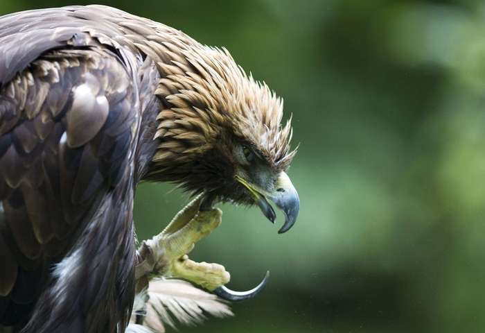

# Хөгшин бүргэдийн хийдэг зүйлээс бид суралцмаар...

Хөгшин бүргэдийн хийдэг зүйлээс бид суралцмаар... энэхүү хийморьлог шувууд, биднээс илүү ирээдүйдээ бэлтгэж, өөрийгөө өөрчилөх чадвартай байдаг гэнэ. Бүргэд 40 хүрэх үед, хумс нь урт ургаж махийн олзоо шүүрэхэд хэцүү, мөн хошуу нь махийж олзоо идэх аргагүй, цээж, далавчных нь өд өтгөрч хүндрэн нисэхэд нь мөн хүнд болдог гэнэ. Түүний өмнө үхэх эсвэл, хүнд хэцүү өвдөлтийг тэсвэрлэн өөрчлөгдөх гэсэн хоёр сонголт үлддэг. Бүргэд энэ үедээ, өөрийн өндөр оргилд байх үүрэндээ суун, хошуугаараа хад чулуу нүдсээр хошуунаасаа салж, дахин ургахыг хүлээдэг бөгөөд ургасан хошуугаараа хумсаа ховхолон мөн ургахыг нь хүлээж ургасан хумсаараа өд сөдөө зулгааж, 5 сарын дараа шинэ хошуу, хумстай болж дахин 30 жил амьдрах амьдралыг олж авдаг гэнэ.\
Хүн амьдралынхаа турш өөрчилөгдөх, өнгөрсөн амьдралын ачаа мэт, таагүй дурсамжаасаа салах, тааламжит нөхцөлөөс хамаарсан амьдралыг эрмэлзэх зовлонгоос салах, өөрчилөлтийн тулд, бие мах бодын өвдөлт мэт хэцүү таагүй зүйлээс халшрахгүй зүрх зоригтой байх, нас нэмэхийн хирээр биеэ хаяхгүй байх, ирээдүйдээ бэлтгэх, аливааг даван гарах сэтгэлийн тэнхээтэй байхад дээрхи сургамж нөлөөтэй бус уу...
