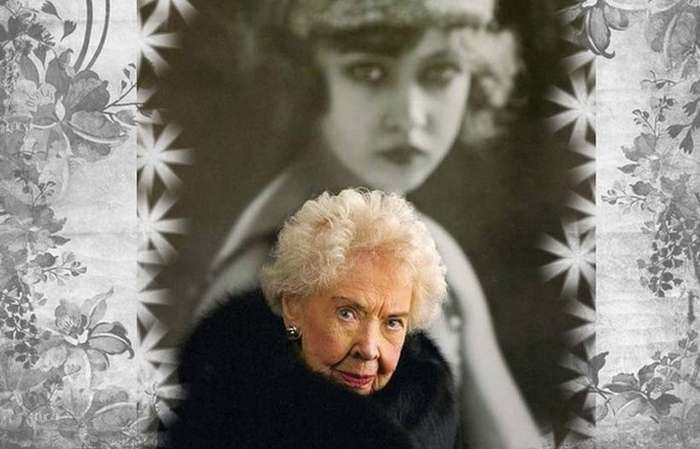
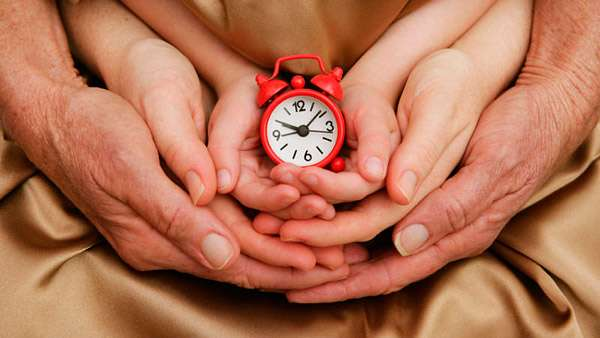

# Хөгширөхөөс айдаг бүх хүмүүст зориулсан ухаантай эмэгтэйн захидал

Олонхи хүмүүс, эрэгтэй эмэгтэйгүй л хөгширөхөөс айцгааж байдаг. Өнөөдөр залуу насыг загвар болгон сурталчилсаар, түүний үр дүнд, тэрхүү залуу нас хэмээх хорвоогийн жамаар өнгөрөн одох гадаад үзэмжээ гээхгүйн тулд хожим зайлшгүй ирэх ухаарал дүүрэн өтөл насны алтан үеэ гэмтээх чинээний төрөл бүрийн хуурмаг санал, бизнесийн мэхлэлтэд өртсөөр явах юм. Зар сурталчилгаагаар тархиа угаалгасан өрөөсгөл бодолтой бидний дунд, хөгшрөлт, өтөл насыг өөрөөр хардаг, түүнийг жаргалтайгаар эдэлж яваа нэгэн эмэгтэй ховор ч атугай байгаа нь сайн хэрэг юм. Түүнийг Филлис Шлосберг гэдэг. Тэрээр өтөл насны тухай хөгшрөлт, насжилт бол нэг төрлийн гайхамшигт бэлэг гээд дараах захидлыг бичжээ.

Саяхны нэг өдөр, нэгэн өсвөр насны охин над руу дөхөж ирсэнээ, -“Хөгшин байх ямар вэ?” гэж асуусан юм. Би урд нь огт бодож байгаагүй асуултад балмагдаад хариу хэлж чадаагүй, учир нь, өөрийгөө хөгшин гэж боддоггүй ч байсан юм уу. Өнөөх охин, миний балмагдсаныг хараад өөрөө ч эвгүйцлээ. Харин би, түүнд сонирхолтой асуулт байна, хариултыг нь олмогцоо мэдэгднэ гэчихээд талархаж билээ. Миний толгойд гэнэт өтөл нас бол бэлэг юм гэсэн нэгэн гайхалтай бодол орж ирээд салахаа больлоо. Эхлээд эргэлзэж байснаа нуух юун. Ингээд энэ насандаа мэдэрч буй зүйлсээ үнэнээр нь бичье. Өнөөдрийн байдлаар, би үргэлж ийм байхыг эрмэлзэж хүсдэг байсан тэр хүнийхээ дайтай болж чаджээ. Гэхдээ, унжсан арьс, үрчлээс, хөгшрөлтийн толботой арьсыг хүсч эрмэлзсэн гэж бүү бодоорой. Толинд дүр төрхөө хараад багахан гутардаг ч тэр байдал минь дорхноо арилчихдаг. Яагаад гэвэл, би ямар ч нэр алдар, улаан хивс, нарийн бэлхүүс, толигор арьс, бууралтаагүй үсээр сольшгүй эрдэнэ мэт гэр бүл, үр хүүхэд, найз нөхдүүдээр хүрээлүүлсэн байгаа. Би нас минь явахын хирээр сайхан сэтгэлтэй, өрөвч зөөлөн болж буйгаа ажигласан. Гайхалтай нь, мөн өөрөө өөрийнхөө найз болсон. Илүү хэтрүүлэн идсэн жигнэмэг, хэрэг болохгүйг нь мэдсээр байж авчихаад дараа нь өөрийгөө буруутгасан эд зүйлс зэргийн төлөө өөрийгөө мэрж зовоохоо больсон байна билээ. Би энэ насандаа, олон найз нөхөд, танилууд минь өтлөх хэмээх энэхүү бэлгийг авч чадалгүй энэ хорвоогоос явахыг нь харж байсаан. Би өнөөдөр үүрийн 4 цаг хүртэл ном уншаад, үд дунд болтол унтаж байсан ч хэнд ч хамаагүй сайхан байдаг шүү. Өтлөлт бол эрх чөлөө. Залуу цагийнхаа дуртай аяа сонсоод уярч уйлж суухаасаа ичихээ больж, наранд шарлагын газар, цаг нь ирэхэд мөн л ийм болохоо мэдэхгүй өрөвдөнгүй харцаар биеийг минь сонжин харах охид залуусыг үл тоомсорлон усны хувцастайгаа тэнгисийн усанд булхах зэргээр өөртөө таашаал авахаасаа айхаа больсон. Урд нь, заавал бусдад таатай сайхан харагдах гэж яагаад зовдог байсан юм бол оо? Заримдаа олон дурсамжид ээрүүлэх нь бий. Энэ насандаа нэг бус удаа зүрх сэтгэл минь урагдан зовж байсан. Хайртай хүнээ алдах, хүүхдийнхээ төлөө зовинох, зорилго нурах зэрэгт зовохгүй гээд яах билээ. Гэхдээ эдгээр гуниг зовлонд л бидний хүч оршдог юм. Нэг ч удаа уйлж үзээгүй нүд яаж сайхан байх билээ, гуниг зовлонд өртөөгүй, цэвэрхэн зүрх яаж амьд, аливааг хайрлах чадвартай байх билээ. Хувь тавилан надад, залуу цагийн минь инээд нүүрэн дээр минь гүн үрчлээс болон тогтсон буурал толгойтой болтлоо амьдрах насыг бэлэглэсэн. Олон хүмүүс эрт, өтөл насыг үзэхгүй өнгөрцгөөдөг нь гунигтай. Би одоо, чин үнэнээр “Тийм” эсвэл “Үгүй” гэж хэлж чаддаг. Өтлөх тусам бусдын сэтгэгдэлд ач холбогдол өгөхөө больдог нь өөрөөрөө амьдарч сурч байгаатай минь холбоотой болов уу. Мөн эргэлзээ тээнэгэлзээ багасч /өчнөөн удаа тохиолдож байсан уналт, цохилтын дараа шүү дээ/, үүнтэй зэрэгцэн алдаа ч багасах юм. За, залуухан бүсгүй минь, би чамд л гэж хэлэхэд миний өтөл нас, хөгшрөлт минь таалагдаж байна. Асуултын чинь хариултыг эрэлхийлэн явах зуураа өтөл насныхаа өчнөөн сайхан зүйлсийг олж харж чадлаа. Өтөл нас намайг чөлөөлжээ. Өнөөдөр би хэн болсон байна, тэр хүн надад таалагдаж байна. Би мөнх амьдрахгүй, гэхдээ энд байгаа дээрээ болох, болзошгүй зүйлийн төлөө санаа зовоход цагаа үрэхгүй ухаалаг болсон. Амттанаас айхгүй, хүссэн цагтаа идэж, Бурханы өгсөн өдөр бүрийг чимж байгаа.
