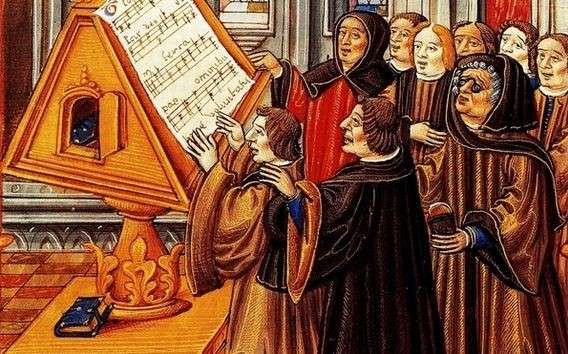
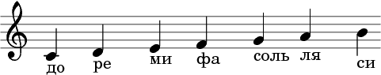

# Хөгжмийн 7 нотны тухай

Энэ зүйл ялангуяа хөгжимчидийн сонирхлыг их татдаг гэнэ.

Нотыг Гвидо д’ Ареццо гэх итали лам, 1026 оны орчим зохиосон гэх бөгөөд нотнуудын бүтэн нэршил нь сонирхол татдаг.\
**Do** – Dominus – Бурхан\
**Re** – rerum – матер\
**Mi** – miraculum – гайхамшиг\
**Fa** – familias planetarium – нарны аймаг\
**Sol** – solis – нар\
**La**– lacteal via – сүүн зам\
**Si**– siderae – тэнгэр\
Тэрээр нотны нэршилийг, гэгээн Иоанд зориулсан залбирлын мөрийн эхний үсгүүдээр дараалуулан зохиосон ажээ. \
Мөн тэр үеийн сүмийн хорын дуулаачид гар гараасаа атгалцан удирдаачгүй, гараараа мэдрэлцэн дуулдаг байж ээ.
