# “Хиджаб”өмсгөлтэй, гоо үзэсгэлэнт, мусульман сүйт бүсгүйчүүд

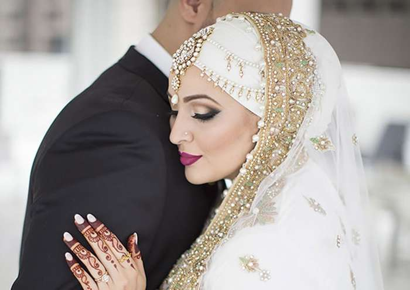

Хуримын ёслол нь, улс орон бүр, өөр өөрийн ёс жаягийн дагуу хийдэг, сүйт бүсгүйчүүлийн үзэсгэлэн гоог уралдуулсан, хүндтэй сайхан баяр ёслолуудын нэг билээ. Европ сүйт бүсгүйчүүд, цагаан өмсгөлөөр гоёдог бол, мусульман бүсгүйчүүд, үндэснийхээ ёс заншлаас шалтгаалан янз бүрийн өнгөтэй, “хиджаб”хэмээх өмсгөлөөр гоёж, хуримын ёслолоо чимдэг.

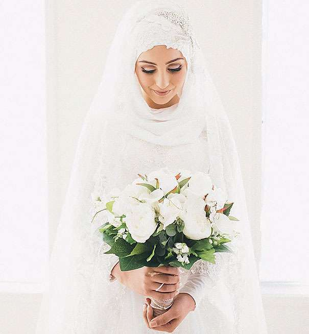

---

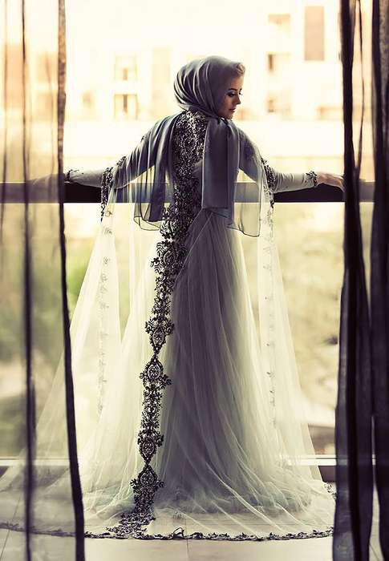

---

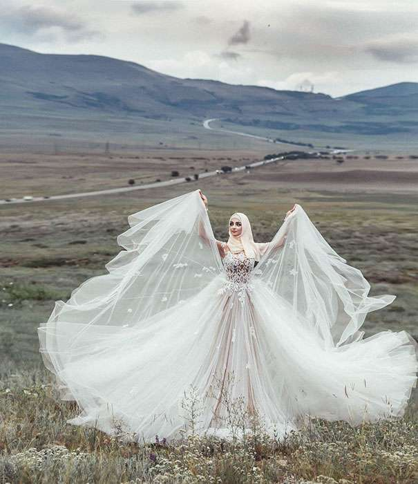

---

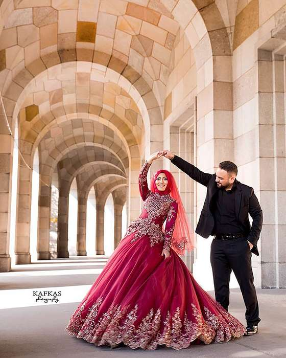

---

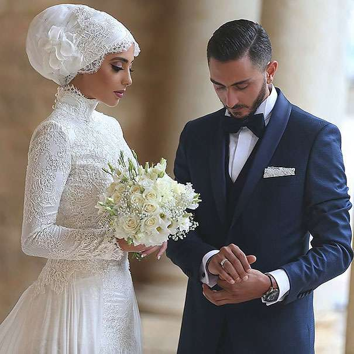

---

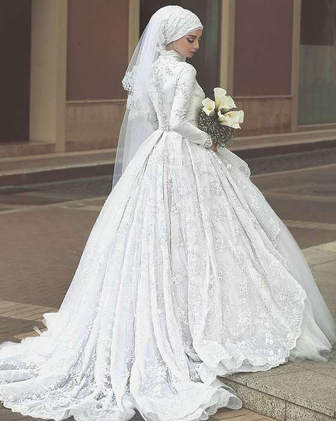

---

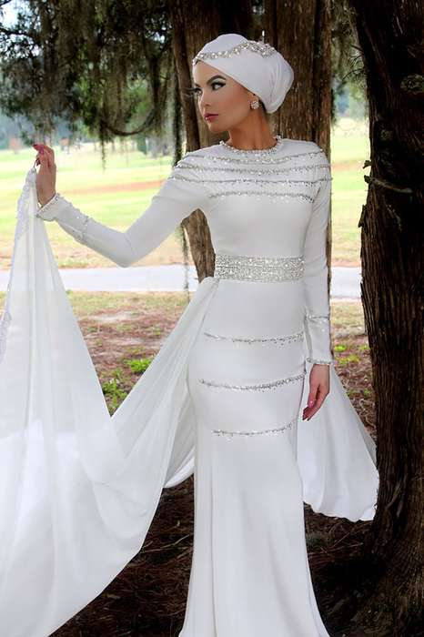

---

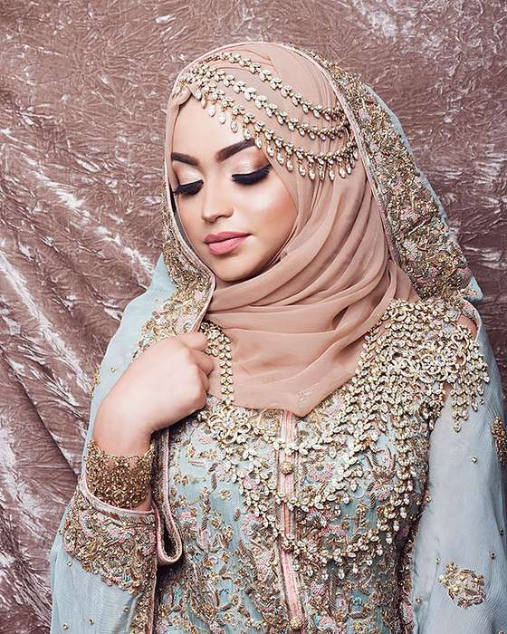

---

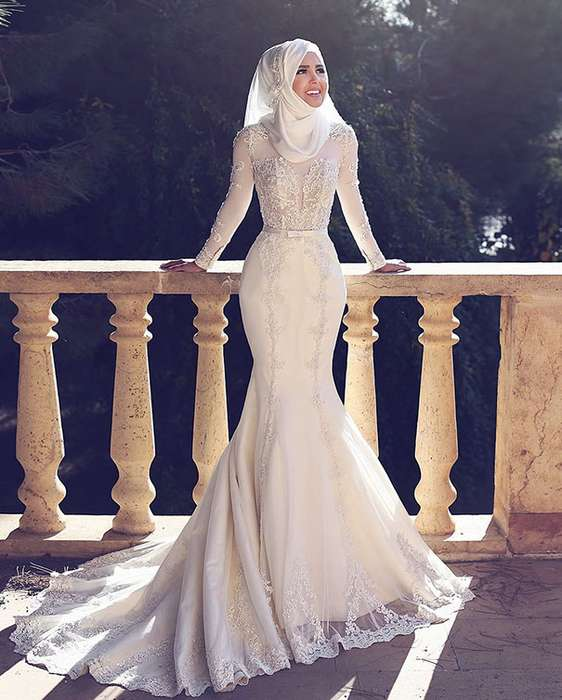

---

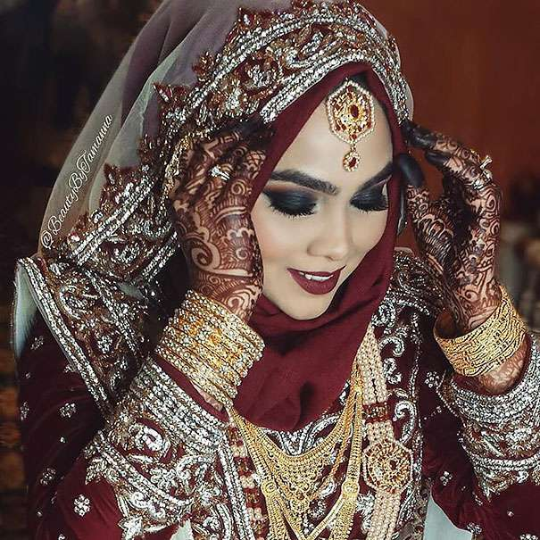

---

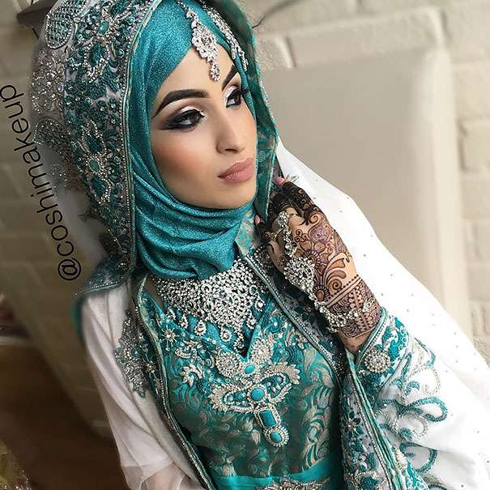

---

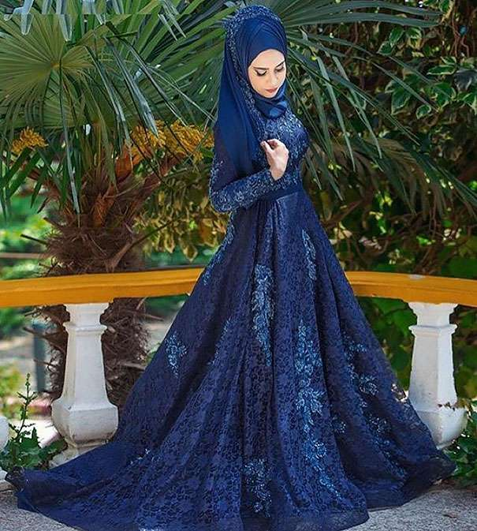

---

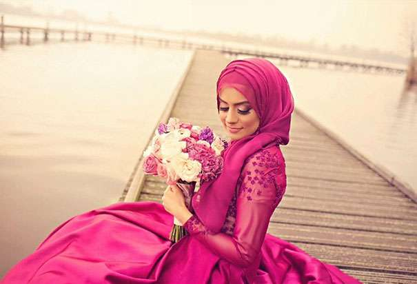

---

