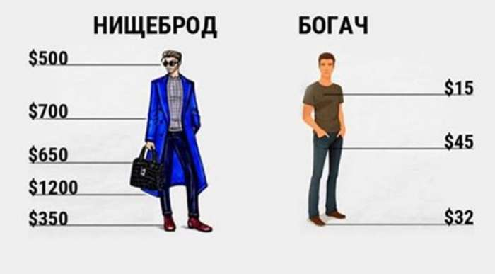

# Хиймэл аз жаргал ба 21-р зууны сэтгэлгээ

Хүн үнэтэй машин, сайхан эд зүйлс, тансаг зэрэглэлийн орон сууц болон бусад, бусдын хэрэглээний эд зүйлсээс дээр зүйлс хэрэглэснээр, өөрийгөө бусдаас илүү гэсэн бодолтой болж, өөрийгөө эдгээр зүйлс байхгүй хүмүүсээс дээш, дээд түвшинд байна гэсэн мэдрэмж авч эхэлдэг байна. Хямд машинтай хөршөө харахдаа, “би” мундаг, тиймээс их мөнгө олж байна. Хөрш маань ядуу, харин би баян. Хөрш маань намайг, ийм тансаг машинтай учираас баян, том хүн гэж бодож байгаа гэх мэтийн бодол тээж явдаг бөгөөд чухам энэхүү бодлууд нь зүрх сэтгэлийг нь дулаацуулж, хүн өөрөө өөрийнхөө өмнө өөрийгөө өргөж, өөрийн үнэлэмж нь өсч, өөрийгөө чухал, хэрэгтэй гэдгээ мэдэрч, эргэн тойрныхон доторхи өөрөөсөө дор амьдарч буй хүмүүсийг харах бүртээ өөрийгөө үнэлж байдаг гэнэ. Харин, хөршийнх нь машин өөрийнхөөс нь үнэтэй, мөн тэр түүнээс илүү амжилттай баян харагдаж байвал, хүний өөрийгөө үнэлэх үнэлэмж буурч, эдгээр давуу талуудыг яаж ийгээд олж авах хүсэлтэй амьдарч эхэлдэг аж. Яг ийм байдлаар цаг үргэлж, өөрийгөө үнэлэх үнэлэмж нь нэг буурч, нэг өгссөөр байдаг байна. Мөн нэг эвгүй зүйл байдаг нь, эргэн тойрныхны нь хэн нэгэн, өөрөөс нь дор амьдарч байвал, түүний дэргэд өөрийгөө дээр гэдгээ мэдэрч, зиндаархах мэдрэмж нь сэргэж байдаг аж. Яг үүнээс бидний аз жаргалын мэдрэмж хамаардаг гэнэ. Зохиолч, гүн ухаантан Шарль де Монтескье хэлэхдээ: “Хэрэв бид зүгээр л аз жаргалтай байхыг хүсэх юм бол, амархан аз жаргалтай болж чадна. Харин бид, бусад хүмүүсээс илүү аз жаргалтай байхыг хүсдэг бөгөөд энэ нь бүтэшгүй юм. Учир нь, хэзээд бусад хүмүүс илүү аз жаргалтай санагддагтай холбоотой” гэжээ. Ийнхүү, огтоос байдаггүй нэгэн тодорхой бус статус бүхий зиндааг барих, баталгаажуулахын тулд хүмүүс асар их мөнгө зарцуулж өөрсдийгөө зовоодог байна. Хэрэв тухайн зиндаанд тохирохгүй эд зүйлс хэрэглэж байгаа бол түүнийгээ нууж, харин тухайн зиндааг харуулах, нотлох зүйлийг бол төрөл бүрээр харуулахыг оролдож сайрхаж байдаг аж. 5 одтой буудалд буучихсан бол, олон нийтийн сүлжээгээр цацаж сайрхан, ердийн буудалд байгаа бол хэзээ ч түүнийгээ мэдэгдэхгүй. Хүн ер нь, нэг тийш яваад зочид буудлынхаа талаар дурсахгүй байгаа бол, иймэрхүү хандлагаас болж хаана байгаа нь ойлгомжтой гэдгийг бүгд тааварлаж буй гэдгийг ч бодох сөгөө байхгүй. Хямд байранд амьдардаг бол түүнийгээ нууна. Ийм маягаар, хүмүүсийн амьдрал худал хуурмагт баригдаж эхэлдэг. Бусдыг хуурахаас илүүтэй өөрийгөө хуурч байгаагаа мэдэхгүй. Ийм хүмүүс, өөрсдийгөө чинээлэг гэх зиндаанд хамаардаг гээд итгэчихсэн байдаг бөгөөд амьдралд таардаг хэсэг үе, банкны зээл бүтэхээ болих, мөнгөний эх үүсвэргүй болох, цалин буурах зэрэгт гүн сэтгэл гутралд орж, өөрөөсөө бусад бүхнийг буруутгаж, зиндаархлын төлөө тэмцэлдсээр насаа бардаг. Тэдний ганц хүсэл нь, бусдаас дээр байх, дээдэст тооцогдох. Үүний тулд, амьдралынхаа хамгаас чухал он жилүүдийг хиймэл, хуурмаг аз жаргалаар амьдарч бардаг нь харамсалтай. Энэхүү сэтгэлгээний тухай гунигт нийтлэлээ, Генри Фордын “Би хаана ч, ямар ч зочид буудалд буусан, Генри Форд, би зочид буудлын хэрэгт хэрэггүй тансаглалын төлөө мөнгө төлөхийг утгагүй гэж боддог. Энэ хүрэм минь аавын минь өмсөж байсан хүрэм. Тэгээд юу гэж? Юу ч өмссөн би Генри Форд. Миний хүү залуу, тиймээс хямд төсөр буудалд буувал хүмүүс юу гэж бодох бол гэж айдаг байх. Удахгүй үнэн мөнийг ялгана. Харин би, миний талаарх бусдын сэтгэгдэлд ач холбогдол өгдөггүй, учир нь би өөрийнхөө үнэ цэнийг мэддэг. Би мөнгийг тооцож чаддаг, мөн жинхэнэ үнэт зүйлсийг хуурамчаас ялгаж чаддагтаа тэрбумтан болж чадсан юм” гэсэн гайхалтай ухаалаг, үнэн үгээр төгсгөе.

