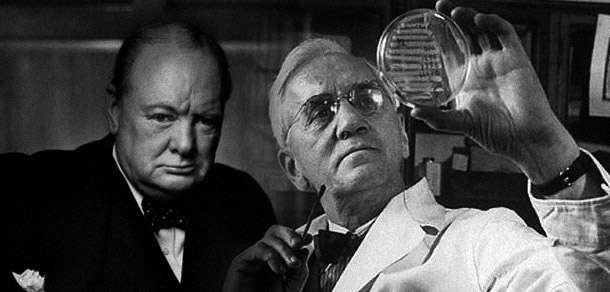

# Хийсэн зүйл хэзээд эргэж ирдэг

Бид хийж буй үйлдэлээ болоод өнгөрч буй зүйл гэж бодоод, ямар нэг зүйлд хүргэдэг гэж төсөөлдөггүй. Гэтэл, хийсэн сайн, муу үйл эрт орой хэзээ ч юм, заавал эргэж ирдэг ертөнцийн нэгэн нууц хууль үйлчилж байдаг ажээ. Дараах сургамж хайрлах түүх нь, бидний сайн танил эрхмүүдэд тохиолдсон явдлын талаар өгүүлэх тул, илүү сэтгэлд ойр тусах буйз аа.

20-р зууны эхэн үе. Шотландын нэгэн фермер, намгийн дэргэдүүр өнгөрч яваад, хөлгүй намагт шигдсэн байсан, нэг жаал хүүг аварчээ. Маргааш нь, фермерийн гэрт, баян тансаг тоноглолтой сүйх тэргээр, нэгэн баян эрхэм ирж хүүгээ аварсанд талархаж, хөлс шан өгөхөд нь, фермер, ”хүн бүрийн хийх ёстой зүйлийг л би хийсэн” гээд, шан авахаас татгалзсан байна. Энэ үед, гэрээсээ гарч ирсэн фермерийн хүүг, өнөөх эрхэм хараад, фермерт, -“танд би нэг санал тавья, татгалзахгүй байхыг л гуйя, би хүүг тань Лондон авч яваад, боловсролтой хүн болгоё, та сайн хүн тул, хүү тань, таныг ч, мөн намайг ч харамсуулахгүй хүн болно гэдэгт итгэлтэй байна” гээд хүүг авч явжээ.\
Олон жил өнгөрч, фермерийн хүү сургуулиа дүүргэж, дараа нь Анагаахын их сургууль төгсч удаа ч үгүй “пенициллин” тариаг нээж, дэлхий даяар алдаршив. Түүнийг Александр Флемминг гэдэг. Мөн энэ үед, Лондонгийн эмнэлэгт, уушигны хурц хэлбэрийн үрэвсэлтэй, нэгэн хүнд өвчтөн Флеммингийн “пенициллин”-ний хүчээр аврагдсан бөгөөд тэр хүн нь, Флеммингд боловсрол олгосон Рандольф Черчиллийн хүү, хожим нь Английн ерөнхий сайд болсон Уинстон Черчилль байжээ. Уинстон Черчилль, “хийсэн бүгд эргэж ирдэг” гэж хэлэх дуртай байсан гэдэг.
