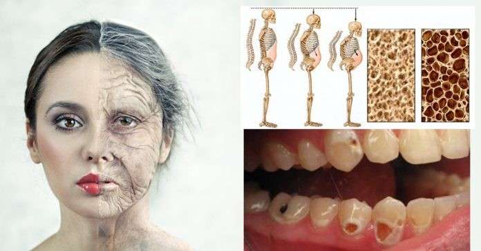
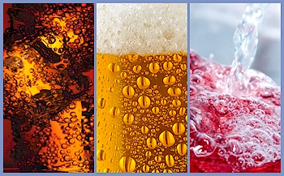

# Хийжүүлсэн ундаа дотор эрхтэнүүдэд хэрхэн нөлөөлдөг вэ

Дэлхийн хэмжээний тоон статистик, жил ирэх тусам хийжүүлсэн ундааны хэрэглээ, хэвлэл мэдээллийн хэрэгслээр хор холбогдолыг нь таниулсаар буй ч, зогсолтгүй өсч байгааг харуулсаар байна. Эдгээр ундаа нь, хүний бие организмд хэрхэн нөлөөлдөг талаар танилцуулъя. Үүнийг уншаад, хийжүүлсэн ундаанд дурлах хүсэл тань өөрчилөгднө гэдэгт найдъя.

-Чихэрлэг, хийжүүлсэн ундааны найрлагад кофеин, фосфорын хүчил агуулагддаг. Энэ нь, ясны эд эсийн эрдэст, хатуулаг чанарыг бууруулж ясны сийрэгжилтийг үүсгэдэг бөгөөд фосфор нь кальцийн шимэгдэлтийг бууруулах, кальцийг устгах үйлчилэл үзүүлдэгтэй нь холбоотой байдаг аж. 2006 оны, 1413 эрэгтэй, 1125 эмэгтэйчүүдийг хамруулсан судалгаагаар, эмэгтэй хүний ясны бүтцэд илүү нөлөөлж ясны сийрэгжилттэй болгодог болохыг нотолжээ. Ясны сийрэгжилттэй, ер нь 50-с дээш насныхныг хэрэглэхийг хориглосон байна.\
-Өдөр бүр, 250-300 мл хийжүүлсэн ундаа уухад, сар бүр 2.5 кг жин нэмэх хандлагатай болох нь ажиглагджээ. Учир нь, хийжүүлсэн ундааны хиймэл амтлагчууд, даавар, бие организмын ноцтой өөрчилөлтүүдэд хүргэдгээс таргалуулдаг аж. \
-Элгэнд маш муу нөлөөлдөг бөгөөд энэхүү ундааны өдөр тутмын хэрэглээ, архаг архидалтын элгэнд нөлөөлөх нөлөөлөлтэй тэнцдэг. Элэгний хатууралд хүргэх өндөр эрстэлтэй болохыг зарласаар байгаа юм. \
-Шүдний пааланг гэмтээж, шүдний бүтцэд, чихэр, чихэрлэг зүйлсээс илүү муу нөлөөлдөг. \
-Бөөрний чулуу, бөөрний өвчилөлд хүргэх эрсдэл дагуулдаг. Фосфорын хүчилийн нөлөөгөөр чулуу үүсдэг бөгөөд өдөр бүр уух 350мл хийжүүлсэн ундаа бөөрний чулуу үүсэх эрсдэлийг 15% өсгөдөг болох нь нотлогджээ.
