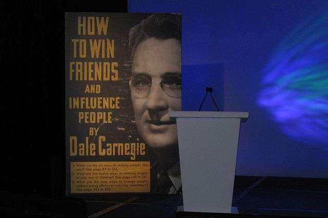

# ХХ зууны сэтгэл судлаачдын гол төлөөлөгч Дейл Карнегийн зөвлөгөө

-Завгүй бай. Энэ бол дэлхий дээрх хамгийн үр дүнтэй, хямд эмчилгээ.\
-Хань ижилд тань, мэдээж дутагдалтай талууд байгаа. Гэхдээ тэр, хэрэв Сахиусан тэнгэр байсан бол тантай гэрлэхгүй байсан биз дээ?\
-Хэрэв хүн өөрийгөө ялахыг хүсээд эхэлчихсэн бол, үнэлгээ тавиулах нөхцөл рүү дөхөж эхэллээ гэсэн үг\
-Хүнийг өөрчлөх бодолтой байгаа бол, өөрөөсөө эхэлсэн нь дээр. Илүү өөрт чинь ашигтай, аюулгүй\
-Инээмсэглэл үнэгүй ч, хамгийн өндөр үнэлэгддэг зүйл юм\
-Өнгөрсөн үеийн ачаан дээр, ирээдүйн ачаа нэмэгдвэл, одоо цагт, хүчирхэг хүнийг ч бүдрүүлнэ\
-Нүүр царайны тань төрх, өмссөн хувцаснаас тань ч илүү чухал\
-Бидний, азгүйтлүүдийн гол нууц нь, бид өөрсдийгөө аз жаргалтай байна уу, үгүй юу гэж шинжихэд ихээхэн хугацаа зарцуулдагт оршино\
-Цэцэн хүний хувьд, өдөр бүр шинэ амьдралыг эхлүүлж байдаг\
-Үргэлж сана. Хүүхдүүд томчуудын яриаг сонсох дуртай байдаг. Тиймээс, болгоомжтой бай.\
-Айдас, таны оюун ухаанаас өөр хаана ч байдаггүй\
-Ямар нэг шинэ зүйлийг үнэхээр сурах чин хүсэл байгаа бол, амжилтын тань 50% байж байна гэсэн үг \
-Өөрийгөө, өөр хэн нэгний оронд тавьж, түүнд хэрэгцээтэй зүйлсийг мэдэрч ойлгож чадсан цагт, дэлхий тэр чигтээ таных болно\
-Дэлхий дээр хайрыг тогтоох, татах ганцхан арга байдаг. Энэ нь, нэхэж шаардахаа больж, хариу нэхсэн тус, бэлэг сэлт өгөхөө болих
