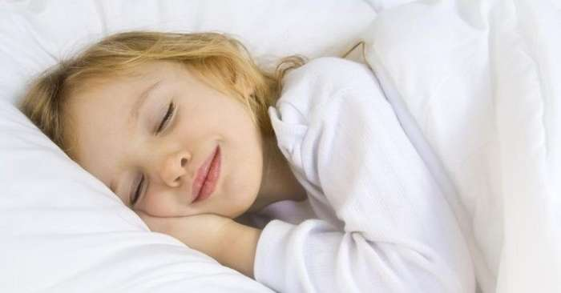
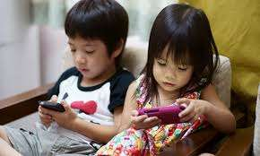

# Хүүхдүүд эрт унтах ёстой

Хүүхдийг эрт унтуулах ёстой гэж үеэс үед үзсээр ирсэн билээ. Үүнийг шинжлэх ухаан хэрхэн тайлбарласныг хүргэе.

Хүүхдийн бие организм, сэтгэхүйг цагаар өсч байдаг гэж үздэг бөгөөд хүүхдийн тархи өдөр тутмын мэдээлэл, туршлагыг томчуудынхтай харьцуулшгүй хурдтай шингээн авч хуримтлуулж байдаг байна. Хүүхдүүд, хорвоо дээрх бүхий л зүйлсийг сонирхон, асууж, хүлээж авч байдаг нь, тухайн насны онцлогтой холбоотой байдаг. Хүүхдийн өсөлтийн даавар, унтсаных нь дараа 2-3 цагийн дараа буюу шөнө дунд идэвхижин өсөлт явагддаг ба 21 цагаас хойш унтах нь, өсөлтийн дааврын ялгаралт алдагдан, үүргээ биелүүлж амжихгүй байдалд хүргэдэг байна. Оройтож унтдаг хүүхдүүд, уцаартай, тайван биш, анхаарлаа төвлөрүүлж чадахгүй, сурах чадвар нь буурдаг гэж судалгаагаар тогтоожээ. Хүүхдийг цагт нь унтуулж сургах нь зөвхөн эцэг эхийн зөв шаардлагаас хамаарах бөгөөд гар утас, планшет, компьютер тоглоомын хэрэгслүүдээс аль болох оройн цагаар хол байлгахыг чухалчлан үзэж, өөрсдөд нь ойлгуулахыг хичээх хэрэгтэй байдаг байна. Эдгээр төхөөрөмжүүд ойр байх нь тархинд дохио өгч тархийг сэргээх үйлчлэл үзүүлдэг гэнэ. Хүүхэд 8-12 цаг унтахыг хэвийн гэж үздэг байна.
