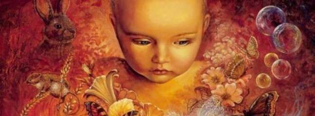
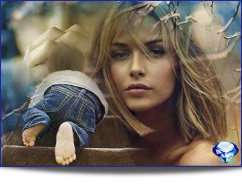

# Хүүхдүүд эцэг эхийнхээ “карма” болж ирдэг үү?

Хүүхдээ төрөхөөс өмнө хийсэн үйл, эсвэл удам дамжсан үйлийн үрийн төлөөс болон, мөн амьдралд сургах, амьдралыг ойлгуулах, хэн болохыг тань ойлгуулах зорилгоор хүүхэд төрдөг гэж үздэг байна. Тиймээс энэ бүгдийг хүндэтгэлтэй хүлээн авч, бодолтой хандсанаар эрүүл зөв үр хүүхэд төрүүлж, өсгөн, ач энэрлийг нь хүртэх боломжтой болдог гэнэ. Үүнээс харахад, хүүхэд төрөх нь тодорхой зорилготой, төрөл төрөгсдөд нь амьдралыг ухааруулах сургалт болдог бөгөөд эцэг эх нь хүүхдээ хүмүүжүүлэхээс илүү хүүхэд нь тэднийг амьдралд сургахаар заяадаг гэж үзэж болно.

Төрөлхийн өвчин эмгэгтэй хүүхэд төрөх нь, эцэг эхийнхээ аль нэгнийг ухааруулах гэж ирдэгээс бус шийтгэл биш байдаг бөгөөд хайртай, үнэлшгүй үнэтэй хүүхдээр нь дамжуулж сургах аргыг амьдрал сонгосон гэж үзэх нь бий. Ялангуяа 16 нас хүртэлх насны хүүхдүүдийн өвчилөл, таагүй хүнд зан авир, давтаж даамжирсан буруу үйлдэл нь, амьдрал тантай ярилцахыг, ухааруулахыг хүсч буйг харуулдаг аж. Хөвгүүд ээжийгээ, охид аавыгаа ухааруулахаар заяагддаг байна. Үүнтэй холбон нэгэн гэр бүлийн түүхийг жишээ болгон авав. Сайхан залуу хос, хүүхэдтэй болтол тэр нь, хараагүй төржээ. Эргэн тойрныхон нь, сүйд болцгоож эрүүл саруул сайхан хос юунаас болов гэцгээн, эмээ өвөө нь “Бурхан шударга биш” юм гэцгээн шаналцгаана. Гэтэл нэгнийх нь ээж хүүхдийг нь харахаар хамт амьдрах болсноор, өнгөн дээрээ эвтэй найртай үлгэр жишээ хос маань ямархуу хүмүүс болохоо харуулсан бөгөөд хөөрхий хараагүй хүүхэд битгий хэл эрүүл эх нь харахаа болимоор хэрүүл уруултай, зөвхөн шөнийн цагаар орондоо эвлэрдэг нөхцөл байдалтай гэр бүл байсан аж. Ийнхүү хүүхэд нь үүнийг харахгүй байхаар, сохор тавиланг сонгон, төрөл төрөгсөд нь учир шалтгааныг нь таамаглаасай гэсэн найдвар тээн төржээ. Гэвч эцэг эх нь үүнийг бодох нь нь бүү хэл таамаглах ч чадваргүй дүлий сэтгэлтэй хүмүүс байжээ. Биднийг аливаа зүйлийн учир шалтгааныг олоход хэн ч сургаж байсангүй. Тиймээс, бодит зүйл ба учир шалтгаан хоёрыг холбон үзэх чадваргүй хэт материалист, үгүйсгэгчид болцгоосон маань нууцгүй юм. Гэхдээ бас “Зөн билгийн тулаан”-ыг сонирхон үзэх дуртай, мартахгүйг нь яана. Бид “ажил-гэр ажил” гэсэн нэгэн хайрцганд баригдан амьдарсаар насыг барна. Хүүхэд төрмөгц, тэдний сайн сайхны тулд хэмээн, юмаар дутаахгүй гэдгээ нэгдүгээрт тавин цаг наргүй ажиллаж, хүүхэдтэйгээ хамт байх хугацаагаа хорооно. Ханиад шуухинаа хүрлээ л бол эмч эмнэлэг гэцгээх. Гэтэл, өвдөхгүй байх шалтгаан нь хамгийн нэгдүгээрт хажууд нь байж, хайрлаж халамжлах гэдгийг, эмч эмнэлгээс илүү эхийн хайр хүчтэй гэдгийг, энэхүү хайр хажууд нь байхад л нөлөөлж үйлчилж байдаг болохыг мэддэггүй. Анагаах ухаан хөгжсөн, техник технологийн XXI зуунд хүүхдийн өвчилөл буурахгүй байгааг яагаад гэдэг талаас хармаар. Энэ бүхнээс харахад, хүүхэд бол эцэг эхийнхээ “Карма” гэж үзэж болох юм.
