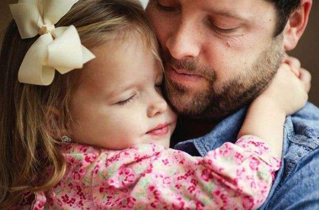

# Хүүхдүүдээ хайрла

Эцэг нь охиноо хайрладаг бол, ирээдүйд охиныг тань хань нөхөр нь хайрлана, ээж нь хүүгээ дээдлэн хайрлавал, хүүг тань мөн гэргий нь хайрлана. Энэ нь, эсрэг хүйсийн хүмүүстэй харьцах хөрсийг бүрэлдүүлж, мөн эх эцгээсээ хүүхэд, өсөж том болтлоо, хайрыг ханатал авсан эсэхийг харуулах үзүүлэлт болдог аж. Аавынхаа нүднээс олж харсан хайр, бахдал дүүрэн харц охидод, өөрийн үнэлэмжийг нь мэдрүүлж, энэ амьдралд гайхамшигт “бэлэг” болон ирсэнийг нь ойлгуулдаг. Харин ээжийн бахархалаар торнисон, эрхэм хүү нар ирээдүйд, хайр энэрэл дүүрэн, амжилттай нэгэн болдог. Хүүхдүүдээ хайрла! Тэднийгээ хүчирхэг, биеэ даасан, өөртөө итгэлтэй болгон өсгөх, хүний ертөнцийн дээд, хайрын бүтээл болгох чадвар эх эцгүүд, бидэнд л бий.
