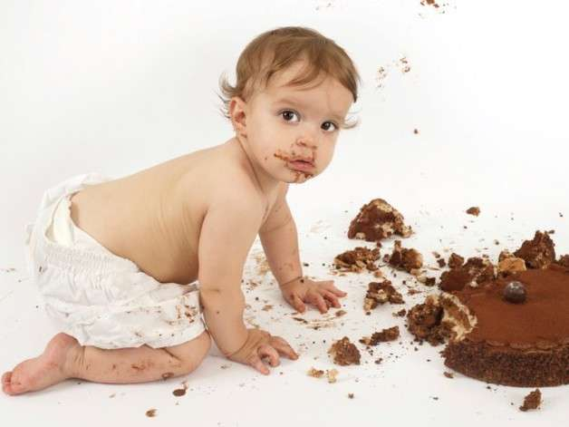

# Хүүхдэд “битгий” “бүү” “болохгүй” гэсэн үгс хэлэх хэрэггүй.

Бид хүүхдүүддээ, ухаан орохоос нь л үргэлж “болохгүй” “битгий” хүр, “бүү” тэг ингэ гэсэн үгийг байнга хэлж, яагаад хүрч болохгүй, яагаад тэгж ингэж болохгүйг тайлбарлахгүйгээр хэлж л байдаг.

Хүүхдүүд ч эдгээр үгсийг зориуд юм шиг зөрчиж, бид ч “түрүүн чамд хэлээ биз дээ” гэх маягийн харьцаа байнга тохиолддог. Хүүхдийн сэтгэхүй, “битгий” хүр, “бүү” авир, ууж “болохгүй” гэж хориглосон үгнүүдээс зөвхөн тэдгээр хориглосон үйлдлүүдийг хүлээж авдаг ба мөн санаа болгон авч байдаг гэнэ. Жишээ нь: тагтны хашлаган завсраар толгойгоо “битгий” хийгээрэй гэж хэлэхэд, толгойгоо тийш нь хийнэ гэж огтхон ч бодоогүй байсан хүүхэд, санаа авч бүхнийг таних, мэдрэх үе дээрээ яваа учраас хийж үзэх хүсэл нь төрж хийж үзэн, хэрэг мандуулдаг байна. Тиймээс, хүүхдийг аливаа зүйлээс болгоомжлуулах, аюул осолтойг мэдрүүлэхийн тулд хориглосон үгс хэлж болохгүй нь. Эдгээр хориглосон үгсийг томчуулд хэлэхэд: шавхай “бүү” туул гэвэл, энэ үгийг “шавхайг тойр” гэсэн үгтэй хамт зэрэг хүлээж авдаг бол хүүхэд цаад үр дагаврыг мэдэхгүй учраас эхлээд шавхайны өмнө зогсно, дараа нь туулж үздэг байна. Аль болох хориглосон үгс хэрэглэхгүйгээр: “шавхайг бүү туул” гэхийн оронд, “шавхайг тойрч гараарай, гутал чинь норно” гэж хэлэх нь шавхайг туулж болохгүйг ойлгуулдаг, мөн аливааг ойлгох, дасан зохицох чадавхийг төлөвшүүлдэг.

Хүүхдүүдийн хувьд энэ ертөнц цоо шинэ, танихгүй зүйл гэдгийг та, “бүү” мартаарай. Мөн өөрөө хүүхэд байснаа мартахгүйгээр, хүүхэдтэйгээ харьцаарай. Танд ч гэсэн хорио зөрчсөн хөгжилтэй тохиолдлууд байгаа даа.
