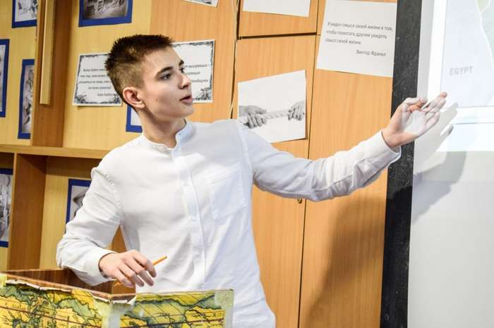
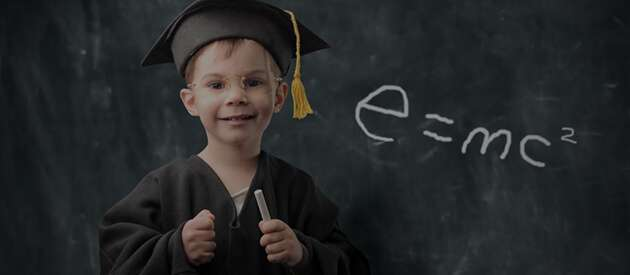

# Хүүхдээ амьдралд сургах 6 зарчим

Өнөөдрийн байдлаар уламжлалт боловсролын системийн сургалт нь, хүүхдүүдийг амьдралд сургах, амжилттай хүн болгон төлөвшүүлэх асуудалд чиглэгддэггүй, харин амьдралд хөлөө олох, амжилтад хүрэх, өөрийгөө ялах, нөхцөл байдлыг даван гарах зэрэг зайлшгүй мэдэж байвал зохих мэдлэг, тодорхойлолтуудыг өгөх нь чухлаас чухал болохыг тоохгүй орхигдуулсаар байгаа юм. Сургалтын гол зорилго бол хүний амьдралын замыг чиглүүлэх асуудал бөгөөд хүүхдүүдийг уг замаа шулуун болгоход сурган, тэр чинээгээр шинэ зүйлсийн гүнд орох боломжийг олгоход оршино. Хүүхдүүддээ туслах үүднээс, аливаа амьдралын үйл ажиллагааны аль ч салбарт өгсөх боломж олгох түлхүүр шинж чанар, тодорхойлолтуудыг уншиж, амьдралдаа хэрэгжүүлэхийг хичээгээрэй. Одоогийн бидний сургалт, хүмүүжлийн арга барил эдгээр чухал шинж чанаруудыг нь нээхээсээ илүүтэй хааж, амжилттай хүн болон өсч хүмүүжих нөхцөлийг нь бүрдүүлж өгдөггүй нь илэрхий болсоор байгаа юм.

Туршлагын үнэ цэнийг мэддэг, үнэлдэг болгох\
Аливаа үйл ажиллагааны ямар ч үр дүн туршлага болдог. Бид зөвхөн ялсан, түрүүлсэн хожсон тохиолдолд магтаж, ялаагүй тохиолдолд алдаа хэмээн шийтгэдэг. Гэтэл, алдаа нь ялалтаас илүү туршлага болдгийг ойлгодоггүй. Тиймээс хүүхдээ алдаанд хандах зөв хандлага, алдаа хийхээс айхгүй байхад сургах хэрэгтэй. Юу ч хийдэггүй хүн л алдаа гаргадаггүй гэдэг. Алдаанаас айдаг хүн шинэ зүйл рүү тэмүүлдэггүй. Түүнчлэн алдаа бүрийг сургамж болгон авдаг болгоход сургах хэрэгтэй. Үүнд, дараах асуултуудыг ашигладаг. “Энэ зүйл, энэ алдаа чамайг, мөн биднийг юунд сургав? “Дараагийн тохиолдолд ийм байдалд яавал дээр байх вэ?” Эдгээр асуултууд дээр хүүхэдтэйгээ хамт ажилласнаар, хүүхдээ бие даан бодох, гарц хайхад сургана. Жолооны багш, сурагчаа машин барихад сургахдаа өөрөө машинаа бариад яваад байвал сурагч нь юу ч сурахгүй. Мөн сурагчаа жолооны ард суулгачихаад хайхрахгүй бол сурагч нь осол гаргана. Яг үүний адил, хүүхдээ жолооны багш мэт аливаад сургах нь зүйтэй юм.\
Чи бол чи, өөр хэн ч биш \
Бид хүссэн хүсээгүй хэн нэгнийг, өөрийнхөөрөө үнэлдэг, хүндэлдэг хүнээ баримжаа болгон дуурайж байдаг гэнэ. Хүүхэд тань мөн таныг хайрладаг, хүндэлдэг учираас дотроо дуурайж байдаг бөгөөд энэ нь ялангуяа шилжилтийн насанд нь илүү илэрч гарах байдал ажиглагддаг байна. Энэхүү даган дуурайх асуудал нь хоёр талтай. Хэн нэгнийг хэт дуурайснаар, хэзээд эх хувиасаа дор хуулбар болно. Хүн хэн нэгнийг дуурайн амьдрах нь өөрт заяагдсан гайхалтай авъяас чадвараа алдахад хүргэнэ. Тиймээс, өөрийн шүтдэг хүндэлдэг хүнээ дуурайх нь гол биш, тэрхүү зүйлд хүрсэн зүтгэл, туйлбартай байдлыг нь дуурайх хэрэгтэйг ойлгуулах хэрэгтэй. \
Дур сонирхолтой, өөрийгөө дуртайяа зориулах зүйлээ олж, түүнийгээ бүрэн эзэмшихэд нь туслах\
Ямар ч зүйл хийсэн тэр нь дур сонирхолыг нь татаж байна уу гэдэгт анхаарах. Огт таалагдаагүй зүйлээ хийж буй хүн, хэзээ ч түүнийг амьдралынхаа утга учир болгож, амжилттай явуулж чадахгүй. Хөндлөнгөөс “Ийм хүн болсон нь дээр”, эсвэл “Эцгийгээ дуурайгаад мэргэжлийг нь өвлөн ав”, “Тийм мэргэжил цалин сайтай” гэх мэтийн зөвлөгөө, ятгалгууд хүүхдийг амьдралдаа байр сууриа олоогүй, өөрийгөө ч олоогүй, үзэл бодолгүй, зорилгогүй, аз жаргалгүй, бүр ажил төрөлгүй нэгэн болоход хүргэх аюултай. Хүүхдээ анхаар, анзаар, хайрла хамгаал, сэтгэлийнх нь мухарт буй бяцхан очийг нь зөөлөн үлээ, тэрхүү оч гал болон бадарч амьдралыг нь дулаацуулан явах юм. Мөн таныхыг ч мөн адил дулаацуулах нь дамжиггүй.\
Туршилт сорилтоос айдаггүй, мөн үзээд алдахаас айхгүй байхад сургах\
Урд нь мэддэг, шалгагдсан арга барилаар хүн бизнесээ явууллаа гэхэд дампуурахгүй нь лавтай. Гэхдээ, өсөлт нь бага. Тэрхүү аргыг туршсан хүн нь үндсэн ашигаа олчихсон, харин бусдад тун бага үлдсэн байдаг. Тиймээс, шинэ мэдлэг, шинэ туршилт, туршлагыг олж авахад хамтдаа тэмүүл. Ингэх нь танд ч ашигтай, хүүхдэд тань бүр илүү чухал юм шүү.\
Саад бэрхшээлээс айхгүй, бэрхшээхгүй байхад сургах\
“Би чамд хэлсэн биз дээ, ингэнэ гэж. Би сануулж байсан даа” гэх мэтийн үгсийг алдах үед нь хэлэх, хэрэглэх нь, хүүхдээ өөртөө итгэлгүй болгох үндэс суурийг та өөрөө тавьж байна гэсэн үг. Өөртөө итгэлгүй хүн, амьдрал дээр аливааг нээх чадваргүй, эсвэл өмнөө буй хаалттай хаалгыг түлхээд онгойлгочих зүрхгүй бэдрэн амьдарч, ихэвчилэн нээлттэй байдаг, ихэнхидээ азгүйчүүд цаана нь амьдардаг хаалгаар орох магадлалтай.\
Хайрцагнаас гарсан сэтгэлгээтэй байхад сургах\
Хүнийг сэтгэлгээний хайрцагнаас гаргах хамгийн хэцүү гэдэг. Хүн өөрөө нийгмийн нэгэн хэсэг учираас, нийгмээс тогтоосон заавар, зөвлөгөө, дүрэм журамд захирагдахад дасчихсан байдаг. Харин хүүхэд насанд нь сэтгэлгээг нь дарахгүй, дэмжихийг мартахгүй байхад л хангалттай.\
Та үүнийг уншиж байхдаа, өөрийнхөө хүүхэд эсвэл ирээдүйд мэндлэх хүүхдээ бодож уншсан байх. Гэхдээ энэ уншсан бүхэн тань, та бидэнд ч мөн хамаатай юм шүү. Хэдэн настай ч байсан өөрийгөө мөн хүмүүжүүлж болно шүү дээ.
