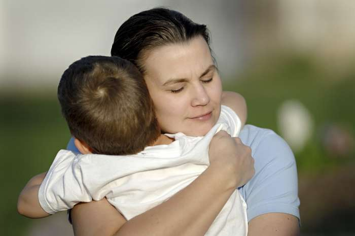
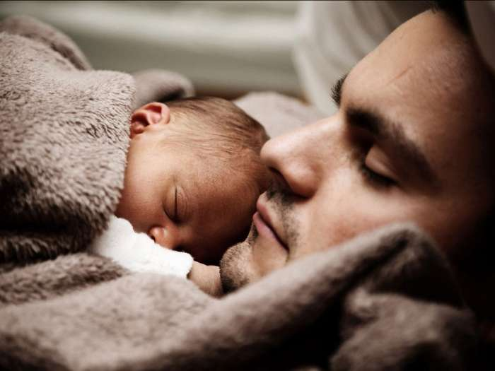

# Хүүхдээ хир их элгэндээ тэвэрнэ төдий чинээ ухаалаг болдог

Хүүхдээ хир их тэвэрнэ төдий чинээ их ухаалаг болох буюу тархи нь хөгждөг гэж Огайогийн Үндэсний шинжилгээ судалгааны игститутутээс мэдээлж байна. Шинэ төрсөн 125 нярай хүүхэд дээр, гадны үйлчлэл нялх хүүхдэд хэрхэн нөлөөлдөг болохыг судлахад, хүүхдүүд, эхийнхээ эсвэл эцгийн тэврэлтийг онцгой мэдрэн хүлээн авдагийг тогтоожээ. Тэд, эх эцэг нь, биед нь хүрэх үед, тархиных нь үйл ажиллагаа нь идэвхижиж, бүүвэйлэх, бүүвэйн дуу аялахад нь тархи нь улам идэвхижиж байгааг тогтоов. Хүүхдүүд, эх эцэг нь тэврэх, бүйвээлэхийг нялх нярай үедээ ч, эцэг эхээ ялган мэдэрдэг, хайр халамжийг нь гайхалтай мэдэрдэг болох нь илэрчээ. Үр хүүхэд маань, бидэнтэй хүйн холбоотой байдаг гэдгийг энэ судалгаа харуулсан бөгөөд өхөөрдөм хөөрхөн үрсээ тэвэрч энхрийлснээр ирээдүйд ухаалаг хүүхдээ бүтээнэ гэж үзсэн байна. Бяцхан хөөрхөн үрс маань, бидний хайр энхрийлэл дунд өсөх нь гарцаагүй. Өсөж том болоход нь ч энхрийлэн тэвэрч байгаарай.
