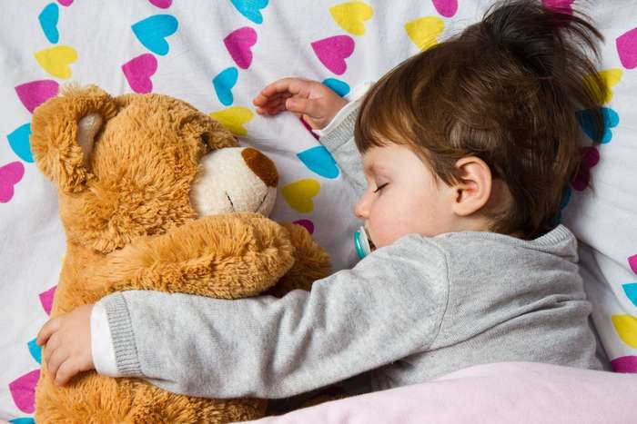
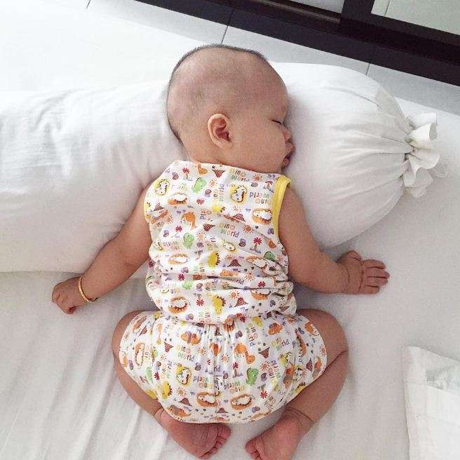
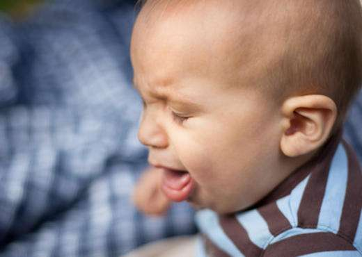
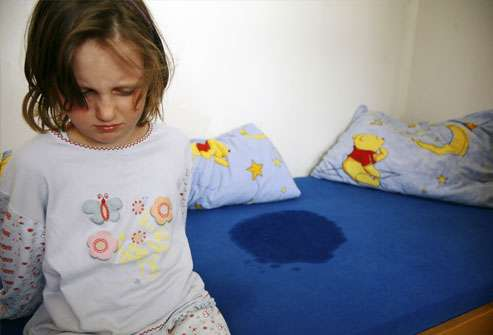
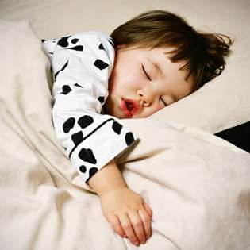
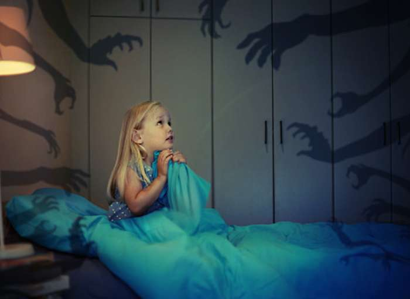
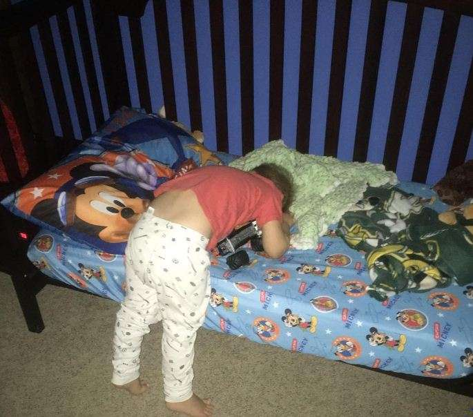
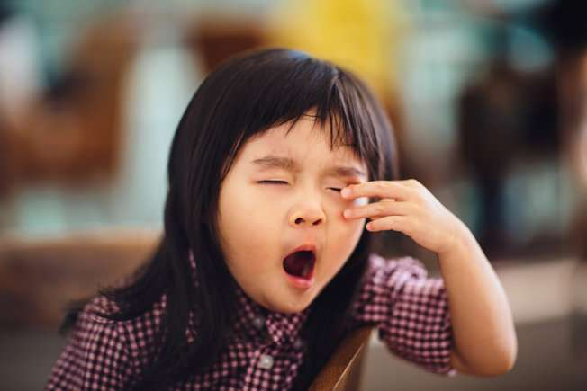

# Хүүхдээ унтаж буй байдлаар нь эрүүл мэндийг нь шинжихүй

Эцэг эхчүүд үргэлж хүүхдийнхээ эрүүл мэнд, сайн сайхан байдалд санаа тавьсаар байдаг. Унтаж байх үед нь ч хүүхдээ анхаарч ямар нэгэн шинж тэмдэг илэрч буйг анзаарах хэрэгтэй. Учир нь өвчин эмгэг эсвэл бусад асуудал тулгарснаар таны хүүхдэд нойрны зарим зуршлууд илэрч эсвэл өөрчлөгдөж болох юм.

#### 1. Хэрвээ таны хүүхэд хэт их унтаад байвал, тэд өвдсөн эсвэл өвдөх магадлалтай.

---

#### 2. Бага насны хүүхэд ялангуяа хөлд орж буй үедээ шөнөөр ханиалгах нь астматай байж болох юм.

---

#### 3. Орондоо байнга шээх нь давсагны асуудал байж болзошгүй. Хэрэв байнга давтагдсаар байвал эмчид үзүүлэх нь зүйтэй.

---

#### 4. Хүчтэй хурхирах нь бүйлсэн болон тунгалгийн булчирхайн үрэвсэл эсвэл харшлын тэмдэг юм.

---

#### 5. Хар дарах нь эрүүл мэндийн хувьд асуудал биш хэдий ч та хүүхэдтэйгээ зүүднийх нь тухай ярилцаж, тайвшруулж айдсыг нь дарах хэрэгтэй.

---

#### 6. Хүүхдийн өсөлт хөгжилд сайн унтаж амрах нь маш чухал ач холбогдолтой учраас бага унтах нь сөргөөр нөлөөлнө.

---

#### 7. Нойрмог эсвэл ядарсан мэт байх нь ихэвчлэн төмрийн дутагдалтай холбоотой. /бусад асуудал байж болно/
