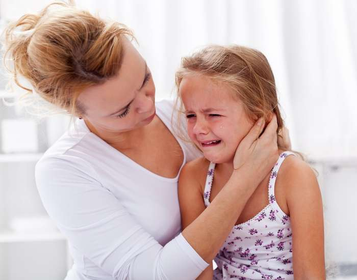

# Хүүхдээ уйлах үед тайтгаруулах зөв арга

Бид, бодлогогүйгээр, хүүхэддээ автоматаар хэлж байдаг нилээд хэдэн үг байдаг бөгөөд, эдгээр нь, хүүхдийн ирээдүйн амьдрал, төлөвшилд нөлөөлдөг талаас ер боддоггүй маань нууцгүй үнэн юм. Бид хичээн хайр, энхрийлэл дунд өсгөж байсан ч, хүүхэд уйлж хүссэнээ нэхэх, таагүй байгаагаа илэрхийлэх байдал үргэлж гаргаж байдаг.

Тэдний хувьд, орчлон ертөнцтэй дөнгөж танилцаж эхлэн, ялангуяа эхний үед, таагүй байгаагаа илэрхийлэх ганц гарц нь уйлах, орилох л байдаг. Энэ үед томчууд бид, “Дуугүй байгаач”, “Битгий уйл” гэхээс өөр юм хэлэх нь ховор бөгөөд үүгээрээ, тусламж хүссэн хүүхдийнхээ нялх оюун ухаан, сэтгэхүйг нь өөрөөсөө түлхэн, улам хэцүү байдалд оруулж байдаг байна. “Орилохоо болиоч. Хүмүүс хараад байна. Ичдэггүй юм уу. Чамаас болоод ядраад байна. Үгэнд орохгүй бол чинь, танихгүй хүнд өгчихнө шүү” гэсэн, сүрдүүлгийн үгс хүүхдийн сэтгэхүйд зөвхөн сөргөөр үйлчилдэг. Томчууд бидэнд, амьдралын таагүй үед маань, хэн нэгэн иймэрхүү сүрдүүлгийн үгс хэлвэл, бид, тайтгарахгүй нь ойлгомжтой. Тиймээс, хүүхдээ уйлах үед, зодож загинах бол, хамгийн бүдүүлэг алдаа бөгөөд хүүхдийнхээ сэтгэл хөдлөлийг дарангуйлсан буруу үйлдэл юм. Мөн, учирыг нь олох гэж олон асуултаар булж хэрэггүй, хүүхэд энэ үедээ, тэртэй тэргүй хариулах чадваргүй байдаг. Энэ үедээ хүүхэд, биднээс зөвхөн тусламж хүсч байдаг. Үүнийг нь ойлгохгүй, сатааруулахын тулд өөр зүйл ярих нь, мөн хүүхдийг, өөрийгөө хэрэггүй гэж бодох, хаагдмал болгох үр дагавартай байдаг. Хүүхэд уйлах нь ичгүүртэй асуудал биш харин өөрсдийгөө ойлгуулах гэсэн оролдлого гэдгийг ойлгон, “Юу болсоныг хэл дээ. Чамд хэцүү байгаа, ойлгож байна. Би чамтай яг адилхан байна, даан ч уйлж болохгүй нь. Чиний уйлах байдаг л зүйл. Би чамайг ойлгож байна. Юм яримааргүй бол ганцаараа сайн бод. Гэхдээ би чамд туслахад үргэлж бэлэн. Уйлмаар бол уйл. Би чамайг сонсоход бэлэн. Тиймээ чамд нэг л онцгүй учираас чи уйлж байгаа” гэсэн ойлгохыг хичээсэн, дэмжсэн үгсийг хэлж байгаарай. Хорьсон, тушаасан үгс, үйлдлүүд, хүүхдийн сэтгэхүйг гэмтээх, мөн ирээдүйн төлөвшилд нь нөлөөлдөг. Хүүхдээ уйлахад нь, үг дуугүйхэн тэвэрч, хамт байгаагаа мэдрүүлэх нь, хүүхдэд, түүний энэхүү сэтгэл хөдлөл таны хувьд чухал юм, дэмжлэг тусламж авч болох юм гэсэн сэтгэл төрүүлдэг, хамгийн хялбар, үр дүнтэй аргад тооцогддог. Томчууд бид ч, мөн ялгаагүй уйлмаар үе гардаг шүү дээ. Тэр үедээ ямар үг, ямар үйлдэл хүлээдэг билээ?
