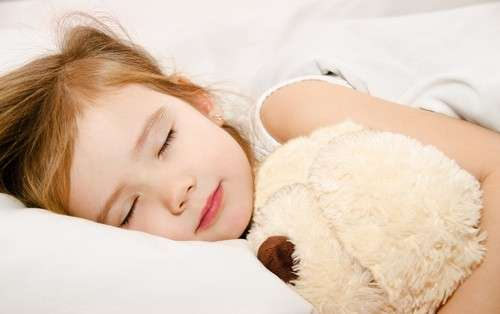

# Хүүхдийг, 21 цагаас өмнө заавал унтуулах шалтгаан

Урд өмнө хэвшил болсон байсан олон зүйл өөрчлөгдөж, оройн 21 цагт, орчин үеийн хүүхдүүд унтсан байх нь ховор үзэгдэл болчихсон цаг үед бид амьдарч байна.

Хүүхэд яагаад эрт унтах ёстой вэ? Хүүхдийг өсгөх үйлчлэлтэй даавар, 21 цагт унтсан тохиолдолд, нойрсолтын 4-р үе буюу 00:30 минутын үед ялгарч эхэлдэг бөгөөд хэрэв орой унтсан тохиолдолд, даавар боловсрох хугацаа багасч, хүүхдийн өсөлтөд нөлөөлдөг байна. Түүнчлэн, эрт унтдаг зөв хэвшилтэй хүүхдүүдийн анхаарлаа төвлөрүүлэх чадвар болон ой тогтоолт илүү сайн байдаг нь судалгаагаар нотлогдсон ажээ. Тиймээс, ямар ч тохиолдолд, хүүхдээ эрт унтуулж хэвшүүлэхийг хичээгээрэй. Хүүхдийнхээ ирээдүйд санаа тавих нь эх, эцэг ойр дотныхны үүрэг гэдгийг бүү мартаарай.

Өөрсдөө ч, мөн, эрт унтахыг хичээвээс, эрүүл мэнддээ, томоохон хувь нэмэр оруулна мөн үр хүүхэддээ ч үлгэр дууриал болно гэдгийг сануулах нь зүйтэй болов уу.
