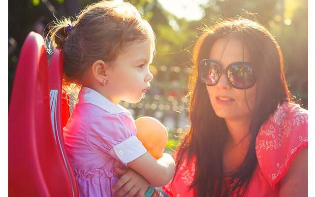

# Хүүхдийг гомдоодог зүйлс

Нэгэн нэрт сэтгэл зүйч, -“Хүүхдийнхээ өөрийг чинь чиглүүлэн сунгах бяцхан гарыг үргэлж илж, гартаа авч, тэрхүү боломжийг ашиглаж бай, хэсэгхэн хугацаа өнгөрөхөд, хөөрхөн гараа өхөөрдөм сунгахаа больчихдог юм” гэж хэлсэн байдаг. Бид хүүхдүүдийнхээ амьдралд юу хийнэ түүнийгээ л буцааж авдаг. Хүүхэд, итгэлцлээр дүүрэн амьдрал дунд өсч байгаа бол, тэр мөн, бусдад итгэж чаддаг хүн болж өснө. Хайр халамжинд өсссөн хүүхэд мөн адил анхаарал халамжтай нэгэн болдог. Гэхдээ бид, уурлаж бухимдах үедээ, эсвэл хүйтэн хөндий харьцаагаараа хүүхдийнхээ бяцхан зүрхийг дараах байдлаар гомдоож байдаг.

-Ойлгохгүй байх. Хүүхдийнхээ бодол, сэтгэгдлийг үл ойшоон, хэлсэн ярьсаныг нь үл тоох нь, хүүхдийг их гомдоодог. Бяцхан оюун нь аливааг таньж эхлэн, таатай таагүйг ялгадаг болж, бүр бяцхан найз нь таалагдан, нууж хаах сэтгэлгүй түүнээ хэлэх нь ч бий. Үүнийг, томчууд бид, инээд, шоо, хөөр болгон хүлээж авч, хөхрөлдөх үед хүүхэд гомддог ч түүнийгээ илэрхийлж чаддаггүй.\
-Дэмжихгүй байх. Нэгэн бяцхан хүү хичээлээсээ тарж ирээд, -“Ээж ээ! Намайг дуулсан чинь багш маань намайг, төмөр хоолойгоор исгэрэх салхи шиг дуугарч байна” гэлээ гээд уйлжээ. Ээж нь хүүдээ, -“Яалаа гэж дээ миний хүү. Миний хүү чинь дэлхийн хамгийн сайхан дуулдаг алтан гургалдай шувуу шиг дуулдаг. Яг үнэн шүү. Хэнийг ч битгий сонс” гэсэн аж. Энэхүү бяцхан түүхийн гол баатар хүү хожим нь алдартай тенор дуучин болсон гэдэг. Ухаалаг ээжийн цагийг нь олж хэлсэн үг ийнхүү нөлөөлжээ. Тиймээс, хүүхдүүддээ, -“Чи чадна. Чи үүнээс илүүг хийж чадна.” Гэж үргэлж хэлж, байнга дэмжиж бай.\
-Бусад хүүдүүдтэй харьцуулах. Тэдний хүүхэд, ёстой нямбай, харин чи өөрийгөө хар даа, халтар ухна. Хамгийн их эцэг эхчүүдийн дунд хэрэглэгддэг танил үг байгаа биз? Энэ үгийг хэлж байгаа ээж, энэ үгсээрээ тэр нямбай гэж нэрлээд байгаа хүүхдийг үзэн ядуулах, дургүй болгох зүйл хийж байгаагаа мэддэггүй нь харамсалтай.\
-Шоолж, тохуурхах. Салхин цэцэгтнээс нүүрээр нь гарсан тууралт дээр нь ногоон түрхлэг түрхсэн бяцхан хүүг, дэлгүүрт орж ирэхэд, хийх юмгүй уйдан зогссон дэлгүүрийн худалдагч нар, -“Энэ хөөрхөн юмыг хараач, хөөе.” гэцгээн инээлдэнэ. Хэдийгээр тэд, хүүхдийг өхөөрдөн инээлдэж буй ч хүүхдүүд үүнийг ойлгодоггүй, тэр өөрсдөө нүүрээ зориуд цоохорлоогүй учираас гомдож дургүйцэн хүлээж авдаг.\
-Чангаар орилж загинах. Хүүхэд, үүнийг огт ойлгохгүй. Тэд уурлаж бачимдахдаа ийм үйлдэл хийдэг гэдгийг мэдээгүй байдаг. Харин энэ үйлдлээрээ бид, өөрсдөө тэднийг ингэж илэрхийлэхэд сургаж өгдөг.\
-Үгүйсгэх. Япон эрдэмтэн, гурван саванд үр суулган, тэдгээрт нөлөөлөх үгийн хүчийг судалжээ. Гуравдах савтай үрийг огт тоохгүй, үгүйсгэсэн хандлага гаргахад, нэг сарын дараа уг үр илжирч, сайн үгс хэлж байсан нь соёолон ургаж, сөрөг үгс хэлдэг байсан үр нь хатчихсан байсан гэдэг. Хүүхдүүд мөн үүний адил гэдгийг хэрхэвч мартаж болохгүй.\
Та үүнийг уншиж байгаа бол, одоо дэлгэцнээсээ харцаа салгаад бяцхан үрийнхээ, булцгар жижигхэн гар, хамраа инээд хүрмээр үрчийлгэн мишээж, шүдгүй амаа ангайн өхөөр хүрэм инээмсэглэж буйг нь төсөөл дөө. Цээжний тань доохон талд, бялуурах шиг болж, нэгэн үл тайлбарлагдах зүйл хөдлөх мэт болдог. Энэхүү, сэтгэл хөдлөлийн биед нөлөөлөх хүчийг хөдөлгөгч бяцхан үр тань, таныг, аав минь, эсвэл ээж минь юм гэсэндээ, хариу нэхээгүй, нөхцөл шаардахгүй хайраар үргэлжид таныг хайрлаж байдаг юм. Энэхүү, хөөрхөн, өхөөрдөм инээмсэглэлийн эздийн төлөө хорвоогийн бүх зүйлийг өгчихмөөр...
