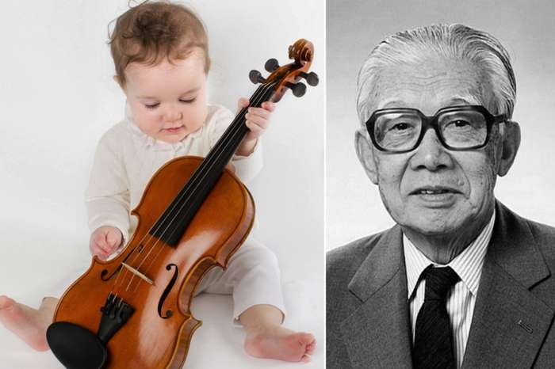
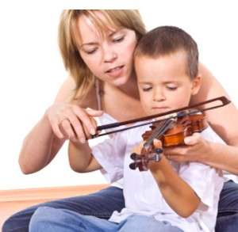

# Хүүхдийг хөгжүүлэх Ибукагийн арга: “Цэцэрлэгийн нас оройтдог”

Японы нэрт бизнесмен, Sony корпорацийн үүсгэн байгуулагч Масару Ибука, хүүхдийг өөртөө итгэлтэй, авъяаслаг, амжилттай, аз жаргалтай хүн болгож өсгөх талаар бичсэн “Гурван наснаас хойш оройтно” гэдэг ном дэлхийн хэмжээнд эрэлттэй, эцэг эхчүүдийн зайлшгүй унших ёстой номны тоонд ороод байгаа аж. Тэрээр 1908 онд инженерийн гэр бүлд төрсөн бөгөөд 1933 онд цахилгааны инженерээр төгсөх үедээ бичсэн дипломын ажил нь сод бүтээл болсноос Парисын нэртэй шагнал хүртэж байжээ. Анх радио засварын газар нээж, 200 доллараар Sony корпорациа эхлүүлж байсан гэдэг. Инженерийн ажлынхаа зэрэгцээ сурган, заах арга, хүний авъяас чадварыг эрт нээх арга, хүүхдийн бүтээлч сэтгэхүйг хөгжүүлэх асуудлуудыг нухацтай судалдаг байв. 1970-д оны сүүлээр, Японы хүүхдийг бага насанд нь хөгжүүлэх Ассоциаци байгуулсан бөгөөд тэр, хүүхдийн танин мэдэхүйн болон хүлээн авах чадвар зөвхөн 3-с өмнө насанд хөгжин төлөвшдөг гэсэн үзлийг баримталдаг байжээ. Тэр, яг энэ үед хүүхдийн тархины хүлээн авах чадвар өндөр байж, мэдээллийг маш сайн тогтоодог, тиймээс олон хэл сургах, сэлж сургах, зурж сургах, хөгжим заах зэрэгт энэ үеийг ашиглах ёстой гэж үздэг байв. Түүний 1971 онд хэвлэгдсэн “Гурван наснаас хойш оройтно” номыг, бага насны хүүхдийг хөгжүүлэх асуудлаар олон бүтээл бичиж олноо танигдсан Гленн Доманн, -“Энэ номыг энэ дэлхий дээр амьдарч буй бүх эцэг эхчүүд унших ёстой” гэж зөвлөсөн байдаг. Ибукагийн арга:

-Хүүхэд хорвоод төрөхдөө аливааг хүлээн авах чадвартай байдаг. Тиймээс, нялх нярай гэлгүй хараанд нь өртөх газар элдэв янзын зүйл өлгөх, байрлуулах хэрэгтэй. Амьдралынхаа эхний өдрөөс эхлэн харсан бүхэн нь, хүүхдийг сониуч, шинэ зүйлийг хүлээн авахад нээлттэй, нийтэч болоход тусалдаг.

-Хүүхдийг бага насанд нь хөгжүүлэх асуудал бол суутан сод хүн болгоход биш, харин аз жаргалтай болгож өсгөхөд чиглэгддэг болохыг эцэг эхчүүд ойлгох хэрэгтэй.

-Хүүхдийн тархины эд эсийн холбоосны 80% энэ үед тогтдог тул, энэ үед аливаад сургах үр дүнтэй. Хөгжмийн сонсгол, хөдөлгөөний зөв баримжаалал, бие мах бодийн чадавхиуд энэ үед тавигдсан байдаг.

-Хүүхдэд нөлөөлөх эцэг эхийн нөлөөлөл, даруулгатай байлгах мөн аливааг болох болохгүйг ойлгуулах асуудал зөвхөн энэ үед тавигдах ёстой. Харин 3-с дээш насандаа хүүхэд эсэргүүцэж чаддаг болдгоос тэр үед нь шаардлага тавих нь, байгаа чадавхи авъяас билэгийг нь дарах өндөр магадлалтай тул, тэдэнд 3-с дээш насанд нь зөвхөн дэмжлэг, харилцан ойлголцол, халамж л хэрэгтэй болдог.

-Гурваас өмнөх насны хүүхдэд “хэцүү”, “хялбар” гэсэн ойлголт байдаггүй. Тиймээс тэднийг энэ үед нь, аливаад сургах эхлэлийг тавих хэрэгтэй. Ямар ч гадаад хэл, сонгодог хөгжим тэдний хувьд хэцүү биш. Ой тогтоолт нь гайхалтай байдаг.

