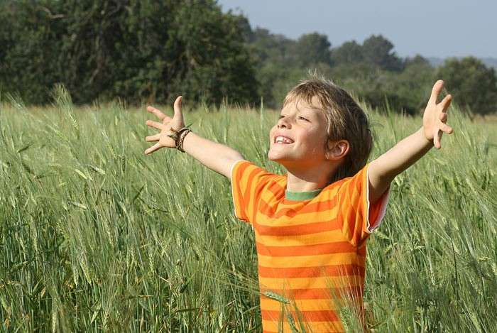
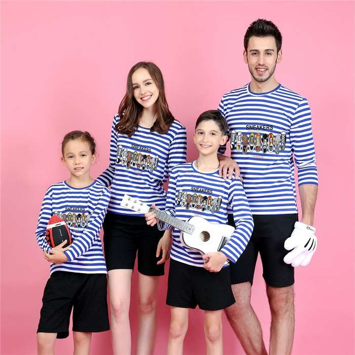

# Хүүхдийг тань хязгааргүй баярлуулах 4 зүйл

Хүүхдүүд бэлгэнд тоглоом, дуртай зүйлсээ авч хөөрөн баярлана, мөн томчуудаас ялгаатай нь энгийн жижигхэн зүйлд ч жинхэнээсээ, хязгааргүй баярлах, аз жаргалаар гийх чадвартай уярмаар хөөрхөн зантай байдаг. Аз жаргалаар гэрэлтсэн хүүхдийн харц, эцэг эхийн хувьд хамгийн жаргалтай үе нь болдог. Хүүхдээ баярлуулахын тулд дэлгүүрээс ямар нэг зүйл худалдаж авч бэлэглэхээс өөрөөр, мөнгөөр худалдагддаггүй үнэлшгүй зүйлээр мөн баярлуулж болно.

**Үлгэрийн орчинг мэдрүүлэх.** Та, үлгэрийн ямар нэг баатар болж, аль болох дуу хоолой, өмссөн зүүснээ төстэй болгож өмнөөс нь ярьж хөөрч, өөрийн зүгээс баяжуулан жүжигчилсэн тоглолт хийгээд үзээрэй. Хүүхэд тань хэдийгээр таныг таньж байгаа ч, түүний хувьд энэ үйлдэл хэзээ ч мартагдашгүй дурсамж болон үлддэг. Түүний хязгааргүй баярласан харц, хамгийн үнэтэй тоглоом бэлгэнд авах үеийнхээс нь ч аз жаргалтай болохыг та, харах болно. Үлгэрийн ертөнцөөр, үргэлж хүүхэдтэйгээ аялаж байгаарай.\
**Гэнэтийн бэлэг.** Өөрт нь зориулан хийсэн, жижигхэн энгийн зүйл ч, ид шидийн хэлтэрхий мэт хүүхдийг баярлуулдаг. Хүүхдүүдийн хувьд төрсөн өдөр хамгийн их хүсэн хүлээдэг баяр нь байдаг ба хамгийн сонирхолтой нь тэд, авах бэлгээ урьдчилаад мэдчихсэн байдаг нь сонин.\
**Аялал, зугаалга.** Хүүхдүүд, аялал зугаалгаар явахыг жинхэнэ шүтдэг. Тэдний хувьд нэг газраас нөгөө газар руу явах нь хамгийн сайхан санагддаг, ямар унаагаар явж буй нь хамаагүй, дэргэдүүр нь өнгөрөн солигдож буй газар орны дүр зураг, очсон газрынх нь байгал, байр байдал нь, аливааг таних, тайлах сониуч занг нь хөдөлгөн, сэтгэл санаа нь аз жаргалаар бялхаж байдаг.\
**Гэрийн тэжээвэр амьтан.** Хүүхэд амьд амьтанд хайртай байдаг. Тиймээс тэдэнд амьд бэлэг өгвөл хязгааргүй баярладаг бөгөөд амьтан арчлах үүргийг өөрт нь оноон сургаснаар бусдыг асран халамжлахад суралцдаг гэж үздэг.\
Хүүхдээ баярлуулах бэлэг нь, тухайн бэлгийг худалдан авсан үнээс хамаардаггүй бөгөөд харин хүүхэдтэйгээ хамтдаа баярлах, халуун дулаан сэтгэлээ шингээсэн дээрхи зүйлс, хоёулангийн тань амьдралын хамгийн гэгээлэг, үнэт дурсамж болон үлдэх юм.
