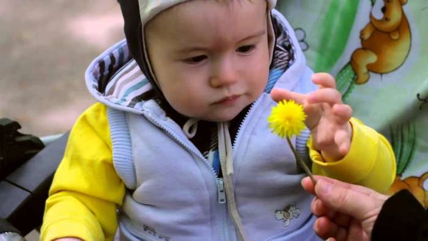
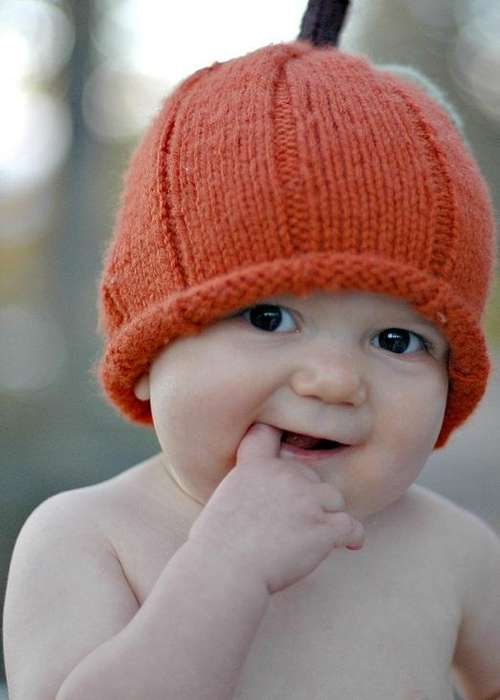

# Хүүхдийн амьдралын код

Хүүхдийнхээ зан чанарыг ойлгох, хүмүүжүүлэх аргаа сонгох, авъяас чадварыг нь хөгжүүлэх баримжаа авах үүднээс, хүүхдийн төрсөн он, сар, өдрийн тоон утгаар, хүүхдийг шинждэг аргатай танилцъя.

Үүний тулд, төрсөн он, сар өдрийн тоон утгуудыг хооронд нь нэмдэг. Гарсан тоо нь, хоёр оронтой болвол, дахин хооронд нь нэмнэ. Жишээ нь, 2002-05-10 –нд төрсөн бол, 2+0+0+2+5+1+0=10 1+0=1 Энэ хүүхдийн код 1-ийн тоо.

#### 1.

Энэ тоонд төрсөн хүүхэд, бараг л төрмөгцөө ааш аягаа илэрхийлж байдаг. Маш идэвхитэй, эрч хүчтэй, сониуч. Бүх зүйлийг сонирхон, судлах, мэдрэх, үзэх амсах, тагнах гэж яаран, эдгээрийг өөрөө бие даан хийх гэж эрмэлзэж байдаг. Эцэг эх нь, хүүхдийнхээ, шүд нь эрт цухуйж, тоглоомоо мэрэх, эрт хэлд орж, хөлд орж, гүйх, тэрхүү хурдан өсөлтийг гайхан хүлээн авч сандран мэгддэг. Ийм хүүхдүүд, юу хүсч буйгаа эртнээс мэддэг, зорилготой байдаг. Эдгээр хүүхдүүдэд, санаснаараа байхад нь чөлөөтэй орон зай хэрэгтэй байдаг. Хэрэв, эцэг эх нь, бүх зүйлд нь оролцон, хатуу хандаж, өөрсдийнхөөрөө байлгах гэж бүхнийг зааж, хязгаарлалт хийгээд байвал, жижигхэн мангас болон өсөх магадлалтай бөгөөд гэр орны ая тухыг эвдлэх чадвартай. Хэдийгээр энэ хүүхдүүд биеэ даасан, идэвхитэй зантай ч, эцэг эхийн хайр, халамжийг нэхэн үгүйлж байдаг. Тэдэнд, байнга, багахан сахилгагүйтдэг байсан ч, арга хэмжээ авахаас илүү хайртай гэдгээ мэдрүүлж хэлж байх нь чухал. Магтаалаар дутагдуулахгүй, хувь хүнийг нь нугалчихгүй өсгөвөл төрөлхийн манлайлагч чанартай, зорилго, үүргээ мэддэг, орчин нөхцөлөө гайхалтай таньж мэдэрсэн хүн болж өсдөг. Гэхдээ, тэр, үргэлж ээж, аавынхаа хайрыг нэхэж байдаг.

#### 2.

Энэ тооны хүүхдүүд, давтагдашгүй, зүйрлэшгүй сэтгэл татсан зан чанартай. Харахад л хайр татмаар, хөгжилтэй, нийтэч, хөдөлгөөнтэй, эвлэгхэн харьцаатай. Энэ хөөрхөн зангийнх нь цаана, өөрийнх нь амьдралд таагүй нөлөөлөх нэгэн зан нуугдаж байдаг нь, тэд, ойр дотныхон, найз нөхдийнхөө төлөө, өөрийнхөө дур сонирхлыг золиослох, өөрийгөө хоёрт тавих, бусдын аясаар байх хандлагатай байдаг. Үүнд онцгойлон анхаарах хэрэгтэй. Хэрэв багаас нь, биеэ даах чадварыг нь хөгжүүлэх, өөрийнх нь бодол санааг хүндлэх, бодолдоо үнэн ч байхад сургахгүй бол, өсч том болохдоо бусдын үгээр амьдардаг, санаачлагагүй нэгэн болж өсөх магадлалтай. Тиймээс, хувийн үзэл бодолтой байх, түүнийгээ илэрхийлэхийг нь хөхиүлэн дэмжиж өгөөрэй. Хүнийг хүнийх нь хувьд хайрлахаас, нэг үзэл бодолтой байсны төлөө хайрладаггүй гэдгийг сайтар ойлгуулж өгөх хэрэгтэй.

#### 3.

Энэ хүүхдүүд төрөлхийн хайр татсан чанартай, ичимхий, даруу зантай ч, найз нөхдөөр дутдаггүй, зохих анхаарлаа авч чаддаг байдаг. Тэд, бусдын дур сонирхолыг, тэр дундаа эсрэг хүйсний хүүхдүүдийн сонирхолыг хуваалцахдаа тааруу. Яриасаг, ямар ч сэдвээр ярилцаж чаддаг. Мөн, өөдрөг, амьдралын баяр баясгалантай, амьдралд хайртай байдаг бөгөөд үргэлж инээмсэглэн, гэрэлтэж явдаг. Тэдэнтэй хамт байхад, таатай, тайван байдаг. Дутагдал нь, аливаад төвлөрөхдөө сул. Сонирхолтой бүх зүйлийг танин мэдэхийг оролддог бөгөөд нэгэн зэрэг хийх гээд байдгаас, хүч нь хүрэхгүй болсноор, аливааг хойш тавих байдал анзаарагддаг. Тиймээс, эцэг эхчүүд, эхэлснийг нь дуусгуулж сургахад анхаарах хэрэгтэй. Үүнийг, хүчээр сургаж болохгүй тоглоом, наадмын аргыг ашиглахыг хичээгээрэй.

#### 4.

Тоон утгаар авч үзэж буй энэхүү хүүхдүүдийн дунд, хамгийн аргачлал төгс гэмээр, буурьтай нь 4-н тооны хүүхдүүд байдаг. Ямар ч асуудлыг нягт нямбай шинжлэн судалж, хүрсэн бодолдоо гуйвшгүй үнэнч, тэрхүү үзэл бодлыг нь өөрчлөхийн аргагүй байдаг бөгөөд өсч том болоод хувийн зохион байгуулалт сайтай, эмх цэгцийг эрхэмлэдэг нэгэн болдог. Өөрийн орон зайд хүн халдаах дургүй, мөн багаасаа өөрийгөө сатааруулах зүйлээ олчихдог болохоор, эцэг эхдээ ямар ч хүндрэлгүй өсдөг. Гэхдээ, хэдийгээр биеэ даасан байдалтай ч, үргэлж хайр, магтаал, дэмжлэг эрж байдгийг нь, эцэг эх нь анхаарах хэрэгтэй. Магадгүй тэр, үүнийгээ харуулахгүй байсан ч та, түрүүлж дөтлөөрэй.

#### 5.

Энэ хүүхдүүдийн ээж, аав бие мах бодын бэлтгэлтэй, тэвчээртэй байх хэрэгтэй байдаг нь, тэдний хэт идэвхитэй, хөдөлгөөнтэй байдагтай холбоотой. Зогсож сурав уу үгүй юу, гүйж, гүйхдээ замдаа байгаа бүхнийг хаман нурааж үзнэ. Харж амжаагүй байхад тань, таныг баярлуулахааргүй юу ч юм сэдсэн байх жишээний. 5 минутаас илүү ганцааранг нь орхиж болохгүй. Тэдэнд, ямар нэг өөрийнх нь таньж мэдэхгүй сонирхолтой зүйлийг нь өгч сатааруулж байх хэрэгтэй. Хэт хөдөлгөөнтэй ч, тэд, үеийнхнээсээ хурдан өсдөг, гайхалтай сониуч, ухаалаг, хорвоо ертөнц, хүний амьдралын шинэ соргог зүйлсийг сэтгэл ханамжтай нээж байдаг. Энэ нь ч түүнд таалагддаг. Өсч том болоод, эдгээр хүмүүс, хувийн өсөлт, хөгжилтөө зогсоодоггүй, үргэлж шинийг таньж мэдэх, ашигтай зүйлсийг олж мэдэхийн төлөө өөртэйгээ ажиллаж байдаг. Энэ хүүхдүүдийг сайн хань, сайхан эцэг, эх болдог гэж үздэг.

#### 6.

Энэ хүүхдүүд, хоёр хүүхэд төрчихсөн юм шиг бужигнуулж өгнө. Тэд ганцаараа байхыг үзэж чаддаггүй. Гэхдээ, ойх дотныхноо бараг шүтэн биширч, тэднийг халамлах ёстой гэсэн мэдрэмж нь илүү хөгжсөн байдаг бөгөөд манлайлах чанараар дутмагдуу, маш мэдрэг, амархан гомдомтгой байдаг. Сэтгэлийн хөдөлгөөнөө барихдаа сул. Тиймээс, эцэг, эхчүүд, тэдний, тэр их дотоод эрч хүчийг зөв зүйлрүү чиглүүлэхэд анхаарах хэрэгтэй. Өсч том болоод, аз жаргалтай, амжилттай амьдардаг.

#### 7.

Маш өвөрмөц, бусад хүүхдүүдээс тэс өөр хүүхэд. Өөртөө итгэлтэй, мөн юу таалагддаг, юу хүсч буйгаа эрт ухаардаг. Түүний хүсээгүй зүйлийг хүчээр хийлгэх оролдлого ямар ч үр дүнд хүргэхгүй. Зөн совин нь илүү хөгжсөн учраас, худал хэлэх, хуурахыг шууд мэддэг. Ямар нэг зүйлийг нууж, хэлэхгүй байсан ч, нууцыг тайлж мэдэх чадвартай. Үүнийхээ шалтгааныг тэр, өөрөө ч ойлгодоггүй. Тайван, аливаад няхуур зантай, их хөдөлгөөнтэй биш, биеийн тамирт дуртай биш. Бүтээлч сэтгэхүйтэй, уран бүтээлийн онгодтой, содон, ховор мэргэжилүүдээр амжилт олдог.

#### 8.

Энэ тоонд төрсөн хүүхдүүд, нилээн гөжүүд, зөрүүд, дураараа зантай байдаг. Чөлөөтэй байх дуртай, өөрийнхөө ертөнцийн захирагч, удирдагч байх эрхийг нь хязгаарлавал, довтлогчийн байр суурь эзлэхээс буцахгүй. Өөрийн эрхийг цөхрөлтгүй хамгаална. Эцэг, эхчүүд, маш ухаалаг хандаж байх ёстой. Гэхдээ, эрхлүүлэхээс болгоомжлох хэрэгтэй. Бүхнийг хүлээн зөвшөөрч болохгүй нь ойлгомжтой юм. 8-н тоонд төрсөн багачуулыг хэт халамжлах нь, хүмүүжлийн сайн хувилбар биш. Хүүхэддээ өөрт нь, аль хувилбарыг сонгохыг нь даатгачих. Өсч том болохдоо эрч хүч, урам зоригоор дүүрэн хүмүүс болцгоодог.

#### 9.

Тал бүрийн авъяастай хүүхдүүд. Бүтээлч хандлага, өвөрмөц сэтгэлгээ нь эрт илэрч байдаг. Хорвоо дэлхий дээрхи бүх зүйлсийг сонирхож, бараг бүх салбарт амжилт гаргах чадвартай байдаг. Найз нөхөд нь, түүний идэвхитэй, амьдралд хайртай, адал явдалд дуртай чанарыг нь үнэлж байдаг. Ийм хүмүүстэй байхад уйдахгүй, тэд ердийн нэг уулзалтыг ч, мартагдашгүй гайхалтай сайхан болгон хувиргах чадвартай. Хүүхэд тань, хэдийгээр амжилтад хүрэхэд хэрэгтэй бүхий л мэдлэг, ухаанаар дүүрэн заяагдсан ч, өөрийн авъяас, эрч хүчээ хааш нь чиглүүлэхээ мэдэхгүй байж болох тул, эцэг, эхчүүд нь, хүүхдийнхээ өөрийгөө таних, өөрийгөө хөгжүүлэх чадварыг дэмжиж тусалж байх хэрэгтэй. Багаас нь, жижиг зүйл дээр ч гэсэн өөрийгөө шалгах боломж олгон сургаж байх хэрэгтэй бөгөөд энэ нь, зөв сонголт хийхийн сайхныг түүнд мэдрүүлэх юм.
