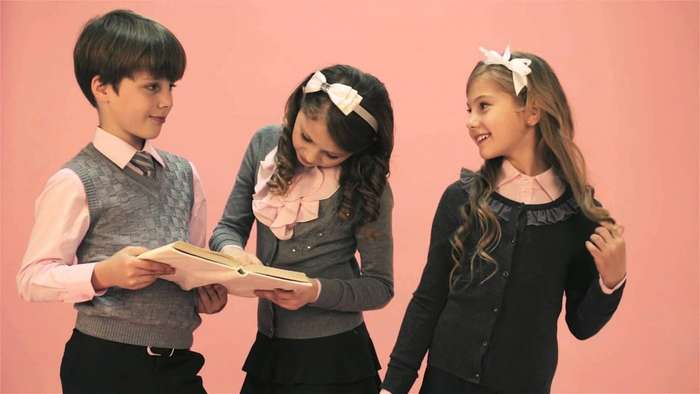
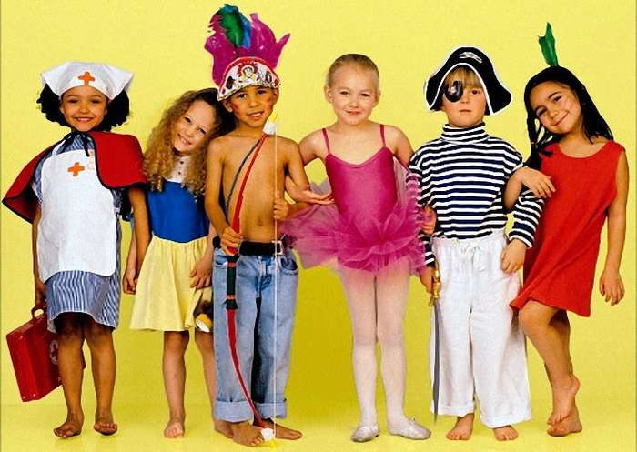

# Хүүхдийн бодлоор, сайн хүмүүжлийн 21 зарчим

Сан-Франциско хотын “Мэрри Моппетс” сургууль, суралцагч хүүдүүдийнхээ сэтгэл санааны эрүүл орчин, аз жаргалтай байдалд илүү анхааран ажилладагаараа алдартай. Долоо хоногийн 5-дах өдөр бүр, сурагчид нь дуртай тоглоомоо сургууль дээрээ авч ирж тоглож болдог, дуртай номоо өдөр бүр хичээл дээрээ авчирахыг зөвшөөрдөг, түүнчилэн, долоо хоног бүр хүүхдүүдийнхээ хүслээр, “гайхамшигт үс засалт”, “унтлагын хувцасны гоёл” гэх мэт хөгжилтэй баяруудыг зохион байгуулдаг аж. Мөн ангидаа, хүүхэд бүр, тус тусын харилцах хайрцагтай байдаг. Эдгээр хайрцагуудад, эх эцэгт хандсан захиа, зурвас, гэрийн даалгавар зэргийг хийж, хүүхдүүд ч мөн хүсэл сэтгэгээ бичиж хийж байдаг. Энэхүү, хүүхдүүдийн хүсэл илэрхийллийн хайрцагнаас, хүүхдүүдийн, өөрсдийгөө аз жаргалтай хүмүүжүүлэх 21 зарчим урган гарсан гэнэ.

1. Намайг битгий эрхлүүлээд бай, миний хүсэл болгоныг биелүүлэх албагүй гэдгийг чинь би мэднэ\
2. Надтай шулуун зан гаргахаасаа бүү ай\
3. Намайг буруу зуршилд дасгаж болохгүй. Дараа нь түүнээсээ салах надад бүр хэцүү байх болно\
4. Миний үзэл бодлыг “юу ч биш” гэсэн хандлага бүү гаргаач. Ийм үед би, муу зүйл хиймээр санагддаг гэдгийг ойлгооч\
5. Намайг бусад хүмүүсийн нүдэн дээр засах гэж бүү оролд. Миний нүд рүү хараад ярилцах үед би илүү бүх зүйлийг ойлгодог юм\
6. Миний алдаа дутагдлыг, аймшигт, засашгүй гэмт хэрэг шиг болгож бүү ойлгуулаач, надад... \
7. Миний хийж үйлдэж буй зүйлсийн үр дагавар бүрээс намайг бүү хамгаалаач. Би зарим үйлдлүүд сөрөг үр дагавартай байдаг гэдгийг ойлгож мэдэх ёстой \
8. Би заримдаа салахгүй гонгинодог л доо. Гэхдээ үүнийг битгий тоож бай. Зүгээр л анхаарлыг чинь татмаар санагдаад байдаг юм\
9. Намайг зөрүүдлэх үед хүндээр бүү хүлээж аваарай. Эрх мэдлийг чинь л эсэргүүцэж байгаа юм. Өөр юмгүй\
10. Нэг юмаа олон, 100 удаа битгий давтаж хэлээд бай. Тэгэхээр чинь бүр дүлий болмоор болчихдог юм\
11. Биелэшгүй амлалт битгий өгч байгаарай. Биелүүлэхгүй бол чинь гомдоод, бүр голмоор болоод байдаг юм. Бодолтой амла\
12. Намайг ямар нэг юмыг бодож тунгаан, тайлбарлах чадвартай болоогүй байгаа гэдгийг бүү мартаж бай\
13. Ууртай үедээ, надаар заавал үнэнийг минь хэлүүлэх гэж бүү шаардаж бай. Би айсандаа худлаа хэлчихнэ шүү\
14. Тогтворгүй зан чинь намайг эвдэнэ\
15. Миний асуусан асуултад хариулж байгаарай. Үгүй бол, би асуултынхаа хариултыг өөр газраас эрж хайж, заавал олохыг оролдох болно\
16. Айх үед минь, миний айдсыг тоохгүй бол, бүр аймаар болдог\
17. Алдаа хийдэггүй төгс юм шиг харагдахыг битгий хичээж байгаарай. Ийм байх боломжгүй гэдгийг ойлгох үедээ сэтгэл санаагаар би, илүү унах болно\
18. Надаас уучлал гуйх үед, би шударга байхын чухлыг ойлгодог\
19. Би маш хурдан өсч байдгийг бүү мартаарай. Тиймээс, та, байнга өөрчлөгдөж байх ёстой\
20. Намайг ямар нэг юм сонирхох, туршихад бүү хориглож байгаарай. Үүнгүйгээр би чинь хөгжихгүй шүү дээ\
21. Хамгийн сүүлд хэлэхэд, намайг гэрт минь их, бүр ихээс их хайрлахгүй бол би, аз жаргалтай хүн болж өсч чадахгүй. Үүнийг, та нар тэртэй тэргүй мэдэж байгаа\
Хүүхдүүд өөрсдийгөө хүмүүжүүлэх зарчимыг ийнхүү бичжээ. Энэхүү хөөрхөн, өрөвдмөөр, өхөөрдөм хүслүүд нь, биднийг ч мөн хүмүүжүүлэх, хүүхдүүдийнхээ хүсэл сонирхолд анхааралтай хандаж сургах үр дүн дагуулах, хүүхдүүдийн маань хүүхэд нас аз жаргалтай, баяр баясгалангаар дүүрэн өнгөрөх, мөн сайхан сэтгэлтэй, хүнлэг, шударга журамтай сайн хүн болж өсөхөд тус болохуйц бараг сургамжтай дүйцэх зүйл гэдэгтэй маргах хүн үгүй биз ээ.
