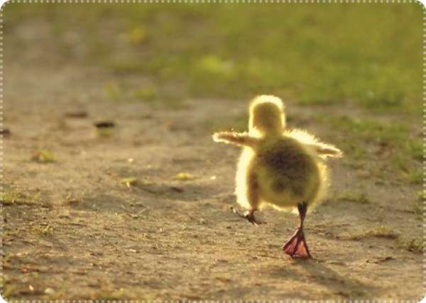

# Хүүхдийн ирээдүйг өөрсдийнх нь гарт өг

Хүмүүс, аливааг хэт хайрцаглан, үр хүүхдээ ойлгохыг хүсэхгүй, өөрсдийнхөөр байлгах гэж зүтгэдгийг, үх хүүхэддээ итгэхийг, заавал бусадтай адил байлгахыг шаардахгүй байхыг энэхүү сургамж харуулна бус уу?

Агуу яруу найрагч, сэтгэгч Шамс Тебризи, өөрийн хүүхэд насаа ийнхүү дурссан байдаг: Бага байхад минь, аав ээж, төрөл садны хүмүүс намайг “азгүй амьтан”гэдэг байлаа. Аав минь нэг удаа, миний ойлгомжгүй байдалд цухалдан, надаас, -“Хүү минь, чамайг, би, яах вэ? Галзуугийн эмнэлэгт хэвтүүлье гэхээр, чи, солиотой биш, сүмд өгье гэхээр, чи, шүтлэггүй, тэгэхээр би яасан нь дээр вэ?” гэж асуусан. Би, түүнд, -“Өндгөө дарж байгаа, тахианы үүрэнд, нэгэн нугасны өндөг хийчихжээ. Өндөгүүд хальснаасаа гарч, тахиа, дэгдээхэйнүүдээ дагуулан цөөрмийн эргээр явдаг болов. Энэ үед, нугасны дэгдээхэй цөөрмийн ус руу үсрэн орохыг харсан тахиа, өөрөө сэлж чадахгүй тул, араас нь орж чадахгүй дэмий баахан хашгирч, тусламж дууджээ. Аав минь намайг сонсооч, би, та нартаа хязгааргүй хайртай. Гэхдээ би, эрэг дээр үлдмээргүй байна. Намайг далай тэнгис дуудаж байна. Би, үүнийг мэдэрдэг, би тэнд өөрийн гэрээ засах болно. Таны сэлж чаддаггүйд, сэлж сурахыг хүсэхгүй байгаад тань би буруутай гэж үү? гэж хариулсаныг аав минь ойлгосон юм”.
