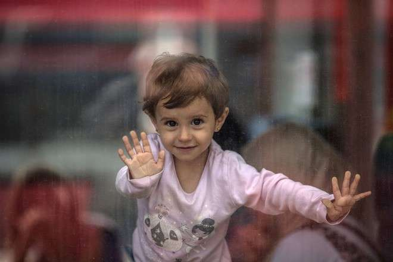

# Хүүхдийн хүүхэд насыг хайрлах, алтан зөвлөгөө

Михаил Лабковский. Сэтгэл зүйч, радиогийн нэвтрүүлэгч. Нэр бүхий сургуулиудад сэтгэл зүйч, “Эхо Москвы” радиогийн нэвтрүүлэгч, Иерусалимд, гэр бүл салалтын үеийн сэтгэл зүйн зөвлөх, Хотын захиргааны хүмүүжлийн доголтой хүүхдүүдийг хариуцсан орон тооны сэтгэл зүйч зэрэг ажил алба хашиж явсан. Одоо, гэр бүл, хамт олны мөн ганцаарчилсан, сэтгэл зүйн эмчилгээний түвшиний зөвлөгөө өгөх ажиллагаа амжилттай явуулдаг. Тэрээр, хүний амьдрал өөрт нь тааламжтай байх ёстой. Таатай байлгахын тулд, зөвхөн өөрт таалагддаг, дуртай зүйлээ эрхэлдэг байх ёстой гэсэн үзэл баримталдаг бөгөөд өөрөө ч үүнийгээ мөрддөг гэж ярьдаг бөгөөд энэ үзлээ дэлгэрүүлэх, хүмүүсийн амьдралыг таатай сайхан болгох үйлсэд амьдралаа зориулж яваа нэгэн ухаантан юм.

Хүүхдийг, сургуульд орохоос өмнө, элдэв дугууйлан секцэд хамруулахгүй байх хэрэгтэй. 6-7 настай хүүхдийн тархи, их мэдээлэл хүлээн авах чадвартай болоогүй байдаг. Та, мөнгөө дэмий үрж, мөн хүүхдийнхээ хүүхэд насыг хулгайлж байна гэсэн үг.\
Хүүхдийг сургуульд оруулахдаа, сайн гэсэн сургуулийг сонгоход биш, харин гэр орондоо ойр сургуулийг сонго. Хүүхдийн хувьд, ойр амьдардаг найз нөхөдтэй болох, мөн биеэ даахад нь нөлөөлдөг сэтгэл зүйн таатай байдал илүү чухал байдаг\
Анхны багш нь, хичээл заах арга нь бусдаас илүү гэдэгт биш, харин хүүхдэд хайртай хүн байх ёстой. Үүнээс, хүүхдийн цаашидын сурах хүсэл, сурлага хамаардаг.\
Хүүхдийг, хичээл хийсэн эсэх, хичээл номоо хэрхэн бэлдсэн зэргийг хэт анхааран хянах нь, хүүхдийн хамгийн гол суралцах ёстой зүйл болох биеэ даах чадварт муугаар нөлөөлж садаа болдог.\
Хүүхдийн сурлагын дүнд хэт анхааран, сургууль дээрх асуудлуудыг сонирхон асуухын оронд, хүүхэд өөрөө, сэтгэлээ хуваалцан ярьдаг болоход тусал.\
Аль болох, хэрэв, хүүхэд өөрөө, тусламж дэмжлэг хүсвэл, тэр үед нь, тусалдаг байхыг хичээ.\
Сурах боловсрох нь, хүүхдийн өөрийнх нь тусын тулд болохоос таны хариуцлага биш гэдгийг ойлгуул.\
Шилжилтийн насны үед нь, ойлгохыг хичээж, тэвчээртэй, тайван байхыг хичээх хэрэгтэй.\
Хүүхэд тань багштайгаа асуудалтай байдалд орвол, тэр асуудлыг нь хойшлуулалгүй шийдвэрлэж байх хэрэгтэй. Хүүхэд энэ үед шаналж байдаг тул сэтгэхүйг нь хайрлах нь маш чухал.\
Сургуулиас ямар нэгэн хүнд, хэцүү хөтөлбөрөөр хүүхэдтэйгээ ажиллах санал тавьбал, татгалзалгүй хүлээн авч, харин хүүхэдтэйгээ өөрийнхөөрөө ажилла.\
Хүүхдийн авъяас чадварыг, зөвхөн өөрөө хүссэн, дур сонирхолтой, дуртай байгаа тохиолдолд хөгжүүлэх оролдлого хийж бай. Авъяас чадвар, хүүхдэд баяр баясгалан өгч байх ёстой гэдгийг мартаж болохгүй.\
Хүүхдээ байгаагаар нь хүлээж авч, хайрлаж сур. Хүүхдээ, өөр бусад хүүхдүүдтэй харьцуулах, эсвэл өөрийн хүсч байгаагаар байлгахаас зайлсхийхийг зөвлөж байна.
