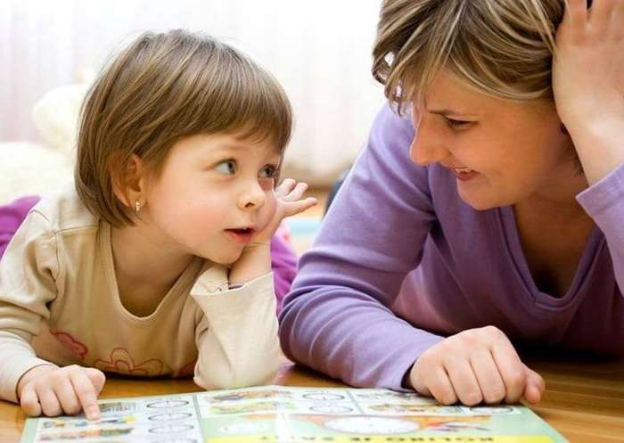

# Хүүхдийн ой тогтоолтыг сайжруулах энгийн 9 арга

Хүүхдийн ой тогтоолт, хүүхэд сургуульд орсноос эхлэн огцом асуудал болон гарч ирдэг бөгөөд хүүхэд энэ үед асар олон мэдээлэл авдаг болж, хүүхэд болон эцэг эхчүүд сандрах, санаа зовинох байдалд ордог. Гэтэл, энэ асуудлыг шийдэх энгийн аргуудыг хамтдаа, хэрэгжүүлэн, өөрсдөө ч мартаж санахаас хөгжилтэйгээр салах дараах боломжуудыг ашиглаарай. Дашрамд хэлэхэд, хүүхдийн ой тогтоолт угаасаа муу байх нь маш ховор бөгөөд ихэвчлэн хөгжүүлж чадаагүйтэй холбоотой байдаг байна.

1. Орой бүр хүүхдээсээ, энэ өдөр хэрхэн өнгөрсөн талаар асууж, яриулж сонсож бай. Энэ бол маш сайн дасгал. Хүүхдийн энэхүү яриа, аливааг хүүрнэх, дүн шинжилгээ хийх чадварт сургаж байдаг бөгөөд эхний үед тасалдсан авцалдаа муутай байх боловч, тун удахгүй дэс дараалсан утга холбоостой болж буйг анзаарах бүртээ та, хичнээн их баярлана гээч. “чи яаж тоглосон?” “найз чинь тэр үед юу хийсэн?”, “тэр ямар өнгийн хувцастай байсан?” гэх мэтийн асуулт тавьж, дэмжиж байгаарай.\
2. Хүүхэддээ ном уншиж өгөх. Хамт шүлэг цээжлэх. Үүгээрээ та, хүүхдийнхээ үгсийн санг баяжуулж өгнө. Мөн номын найз болоход нь туслаарай. Номын үйл явдалыг хоорондоо ярилцаж, өөрөө зориуд алдаж хүүхдээрээ засуулж, хөгжилдөн инээлдэх сайхан байх болно шүү.\
3. Хамгийн их хэрэглэгддэг үгүүдийг уралдан хэлэх. / Жимсний нэр, тоглоом, ургамал, гэр орны тавилга хэрэгсэл гэх мэт/. Та өөрөө ялахаа урьтал бүү болгоорой. Багахан хожигдох тань, хүүхдийг тань өөртөө итгэлтэй болгоно. Гэхдээ байнга хоцорвол, бас таныг юу ч мэддэггүй гэсэн ойлголт хүүхэд тань авчихвий. Зохицуулаарай. Үсэг үзэх үед нь, тухайн үсгээр эхэлсэн үгээр уралдаад үз. Хүүхэд, хөөрхөн, өөр үсгээр эхэлсэн үг хэлж будилдаг. Түүнийг нь хөгжилтэйгээр засаж, ойлгуулж байгаарай. \
4. Нэг нь нөгөөгөөсөө ялгаатай зургийн ялгааг олуулах. Энэ арга хүүхдийн анхаарал төвлөрүүлэх чадварыг хөгжүүлдэг.\
5. Зурагтын нэвтрүүлэгч, эсвэл сурвалжлагч болж тоглох. Эфирт байгааг зарлаж, хариуцлагатай байхыг сануулж тоглуулахад хичнээн хөгжилтэй гэж санана. Та, өөрөө ч хөгжинө, үйл явдын сэдвүүдээ харин оновчтой сонгоорой. Үгсийн санг нь нэмэгдүүлж, харилцаанд сургадаг. Та ч хамт суралцаж, аливааг сайн илэрхийлдэг болно. \
6. Үгийн утга, холбоог ойлгуулахын тулд ижил төстэй зүйлүүдийг харьцуулан ойлгуулах.\
7. Биеийн тамирын дасгал сургууль, цэвэр агаарт хийлгэх нь ой тогтоолтыг гайхалтай сайжруулдаг. Хүүхэдтэйгээ хос бэлтгэлийн хувцастай, гүйлтээр хичээллэж байгаа аав, ээж нар уярмаар, гайхалтай сайхан харагддаг. \
8. Оюун ухааныг нь ачаалж сургах. Хүүхэд хэрэв мэддэг зүйлээ мартчихсан байвал аль болох өөрөөр нь сануулахыг оролдоорой. Ийнхүү оюун ухааныг хүчилж ажиллуулснаар, тархи дасгалжиж байдаг.\
9. Оюун ухаан дэмждэг, тархинд ашигтай хоол хүнс хүүхэддээ өгч байхыг хичээх. Загас, банан, хушга, лууван, бууцай, цэцэгт байцааг хүүхдийнхээ хоолны ширээнээс бүү салгаарай. Эдгээрийн заримд хүүхдүүд дуртай байдаггүй. Гэвч, багахан ч атугай хүнсэндээ оруулж хэвшээрэй.
