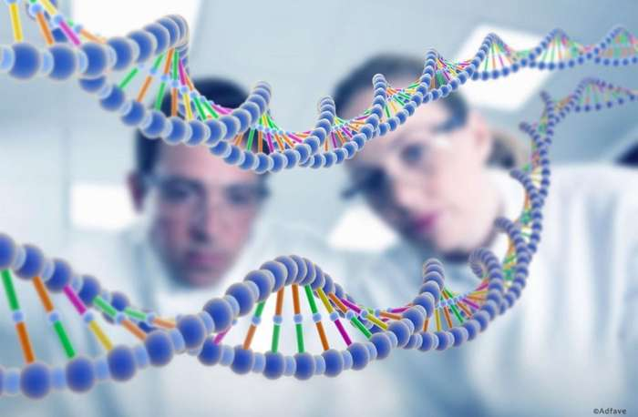
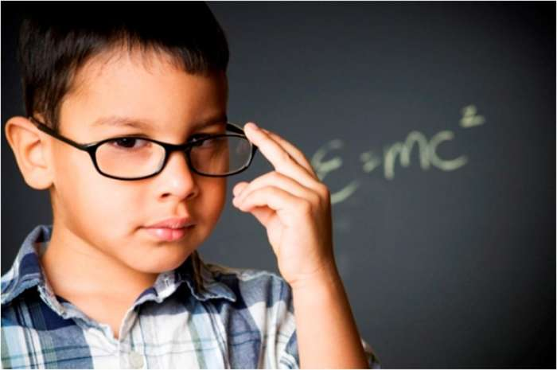

# Хүүхдийн оюун ухаан, ээжээс нь шалтгаацдаг

Оюун ухаан ээжээс дамждаг бөгөөд өөрсдийн оюуны түвшин, сэтгэхүйн төлөө ээжүүддээ талархах ёстой гэнэ.

Эрдэмтэд, олныг хамруулсан томоохон судалгаагаар, оюун ухаан, урд өмнө эцгийн генээр өвлөгддөг гэж үздэг байсныг өөрчилсөн, эхээс өвлөгддөг гэсэн дүгнэлтэд хүрчээ. Уг судалгаа, эхийн ген тархины хөгжилд, эцгийн ген лимбийн систем буюу сэтгэл санааны хөгжилд удамшдаг гэдгийг тогтоожээ. Мөн, оюун ухааны ген, Х хромосом дээр байрладаг учраас эхийн оюун ухаан хүмүүст удамшдаг гэж тайлбарлав. Түүнчлэн, Германы Ульма Их Сургуулийн судлаачид, илүү хөгжсөн оюун ухааныг, дан ганц эхийн оюун ухааны генээс шалтгаалахгүй мөн өөр хэд хэдэн нэмэлт хүчин зүйлтэй холбон тайлбарлажээ. Хүний оюунлаг байдалд нөлөөлдөг эдгээр зүйлс мөн л ээжтэй холбоотой байгаа бөгөөд ялангуяа, 2 нас хүртэл ээж нь хамт байж, танин мэдэхүйн тоглоом хамт тоглох, харьцах зэргээр огт холдоогүй хүүхдүүд, үеийнхнээсээ харьцангуй ухаалаг, оюунлаг болдог гэсэн дүгнэлтэд хүрчээ. Мөн хоёр дох хүчин зүйлийг хайр халамж гэж үзсэн бөгөөд 13 нас хүртлээ хайр энхрийллээр дутаагүй, хайр халамж дүүрэн, сэтгэл санааны дотно холбоотой байсан хүүхдүүдийн тархины гиппокампын эд эс 10%-р илүү үүсч, өсч байдгийг харуулав. Энэ судалгааны үр дүнд, эрдэмтэд, оюун ухаан 40-60% нь генээр удамшдаг үлдсэн хэсэг нь өсч буй орчин нөхцөлөөс хамаардаг гэж үзжээ. Мөн, төрөлхөөсөө ухаантай хүүхдийн, асуудлыг шийдвэрлэх чадварт онцгой анхаарч хөгжүүлж байхгүй бол өсч томрохын хирээр оюун ухаан нь суларч болохыг сануулжээ.
